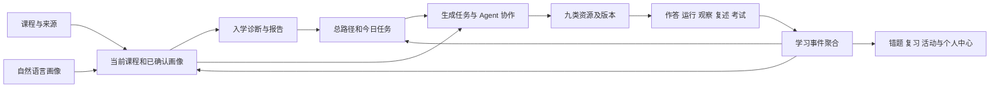

# EduMatrix 作品与代码地图

11/10 r208z：numerical_verification保留1/6等精确分数，抽取原分子分母并独立比较计算结果；小数/科学计数/省略号规则不变。create_competition_packages仅在交付副本恢复已有确认画像的入口，用正常finalize_initial_profile完成合成账号准备，不覆盖学习画像或成绩。实际验证见CURRENT。

11/10 r208y：resource_bundles的quiz/handout出题提示、结构校验和quiz持久化不再硬凑至少三题；接受非空完整单题，明确题量随任务要求，完整范围、选项、答案、提示及后续审核保持。交付真实单题冲突与验证实况见CURRENT。

11/10 r208w：当前运行包构建器只复制合成验收库，统一五个体验账号；导出时在副本事务中临时卸载不可变触发器以迁移身份/清除私有字段，提交前恢复原208条规则，原库不改。两门课程历史bundle_asset按精确相对路径、hash补入包内；scripts/verify_current_runtime_delivery.py验证解压后的账号、原文件下载、现成代码、小测验及正常停止重启，实际结果见CURRENT。

11/10 r208v：numerical_verification._quote允许唯一完整原文的句末问号/句号恢复为真实句末标点，保持所有数字和正文；错误定位具体字段。resource_review_adjudication按需读取当前安装LinearRegression.fit实际dense求解调用与版本，支持裁决库版本行为争议；既有原任务/测试边界见CURRENT。

11/10 r208u：resource_review_adjudication按当前资源版本分组，依赖资源仅供配套比较，避免错引其它版本；成功组沿原review_group_result hash复用。交付Login.vue读取frontend/public/demo-accounts.json，默认空；当前运行包构建器写入公开合成账号，与整理后的库和手册对应。launcher首次生成本地登录密钥供正常重启复用。实测见CURRENT。

11/10 r208s：资源审核前从原task_events提取当前版本未裁决意见；`resource_review_context.unresolved_review_findings/merge_unresolved_review`接续中断，已关闭裁决和旧版本不复活，独立发布等待当前未结意见。r208t缺省版本只从该历史事件保存的version_ids/reviewed_versions补齐，不绑定后来的新稿。`create_competition_packages.py`默认入口改为单个当前运行包，当前实际交付验证见CURRENT。

11/10 r208r：`resource_review_context.bind_finding_version`统一补齐缺省/null且类型唯一的当前版本；`resource_review_adjudication`在读取旧审核缓存及逐项校验时复用，保留issue身份，不把显式旧版或多候选歧义自动排除。真实定点与剩余原任务见CURRENT。

11/10 r208q：m5_exam_core在learning_generation_jobs当前任务组件中固定首次组卷blueprint；profile/近期学习变化不使成功题失效，新请求重读画像。m5_api发布仍用不含动态画像的course_generation_basis核课程/来源/知识关系，保留内容变更保护。r208p：resource_bundles保留模型实训rubric，training_tasks允许可选项0分；同任务原raw只有除rubric外逐字段一致时才复用转换，仍生成新版本继续审核。验证及在线加载边界见CURRENT。

11/10 r208o：generation_dispatch自动修订键绑定实际步骤/稿件与修订输入，恢复计数重置不再碰撞旧请求；资源错误分类不把resource命名空间当来源故障。resource_bundles局部数值核验附加的候选继续传入整体衔接，保留not_computed条件ID。path_sequence.saved_task_path_calls在原任务内按调用身份或已验证公开输出追溯旧编排/批次，部署变更复用候选而不复用过期审核；当前来源/运行条件仍完整重审。管理员恢复服务的原操作抽为_resume_resource_retry，便于同事务接续原任务；没有新任务系统或状态库。验证、旧进程加载边界见CURRENT。

11/10 r208m：复习ReviewScheduleBoard→review_schedule_api.resource_types→create_review_resource_job默认讲义/测验，代码题复测按题型增加code_sandbox；显式完整九类及普通配套选择保留，选择参与幂等。模型评价共用规则独立在model_evaluation_rules.py，避免旧进程缓存profile_adaptation时延迟导入失败；部署与验收实况见CURRENT。

11/10 r208l：resource_review_parts将runtime_verification.numerical.plan.not_computed作为numerical_basis逐项接已有conditionReview，完整与分段审核均不漏项；合法题给数据可通过，歧义按原条件裁决。profile_adaptation的共用模型评价规则统一生成/审核/反馈及费曼评价/答疑。WrongQuestionBook作答历史逐次打开LearningInquiry，复用本人旧回答与新题。验证及在线版本见CURRENT。

11/10 r208k：learning_feedback向resource_bundles审核与resource_review_adjudication传递learner_evidence（原题、作答、追问回答与学习依据）；缓存记录review_basis，旧无依据的已审/拒稿保留candidate重新核验。CoVe独立解新题仍隔离原答案和学习者依据。实际验证与部署见CURRENT。

11/10 r208k：numerical_verification与resource_review_adjudication明确计算对象/实际接口/中心化与容差，参考要求里的技术数值同样接受核对，避免矩阵默认秩与求解器有效秩往返替换。IncrementalMarkdownRenderer表头保持横向文字、宽表局部滚动；InteractiveLabWorkspace字数仅未达最低值时提示下限。实际回归、在线加载与未完成项见CURRENT。

11/10 r208j：generation_dispatch领取时优先feynman.action、learning_inquiry.prepare/feedback、diagnostic.report，使已进入学习的反馈先于待生成整包处理；仅改变排队选择，不抢占活动执行者，同类保留created_at/id顺序。验证及实际加载见CURRENT。

11/10 r208j：resource_generation_parts按原output_schema解析字段的null许可（含本地$ref/联合类型），避免分段计划单一kind误拒路径审核合法空值；必填字段与最终完整模型仍校验。费曼实学验收脚本按原action-task保存/恢复待评价任务，只在反馈与应用实际完成后写通过。验证/在线加载及真实进度见CURRENT。

11/10 r208i：generation_dispatch的自动内容/来源修订调用revise_generation_job(preserve_learning_basis=True)，复用任务原画像、学习依据和近期事件；新请求仍读取新学习，显式用户修订沿原行为。HandoutWorkspace的小测题干、选项及解析使用现有Markdown渲染器，表格不再作为大标题文字；handoutReadingOrder保存笔记时同样分开短标题与完整题干。验证与部署状态见CURRENT。

11/10 r208i：`code_sandbox`的受控io只提供BytesIO/StringIO，内嵌CSV及PyTorch参数可通过内存对象实际保存/读回；`teaching_runtime.datasetPolicy`同步给路径和资源生成说明。实际执行验证及在线加载状态见CURRENT。

11/10 r208h：Chat资源消息的显示状态从resourceAutomation读取，消息回执完成不再显示资源完成；生成过程只使用原任务的实际事件，进度入口沿原resourceJobId，准备回执不作为问答正文再生成资源。原问答过程和资源来源仍可查看，实际页面/构建证据见CURRENT。

11/10 r208g：path_tasks.queue_path_task在原path.request保存learningBasis，execute_path_task将固定画像/学习依据/时长传入generate_textbook_path_draft.learning_snapshot；后来学习不再让同一任务重读画像并重做成功批次，来源/课程变更仍走原context更新。旧事件无快照时只固定当前可取得依据，不重写历史。path_draft模型异常显式链回provider，_run_model_sync移出事件循环探测except，HTTP402等由原dispatcher等待配置；四阶段故障注入通过，当前真实服务已停待402恢复，见CURRENT。

11/10 r208f路径修订：_review_path_batch复用原教学编辑，再由_review_path_candidate的独立核验角色检查实际修改后的任务；不传递编辑结论。每轮输入hash/公开输出/失败保存在原生成ModelCall，未改稿不增加复核；反复稿按来源和具体例子重新裁决。只有核验稳定的任务进入后批与最终路径。开发恢复仍使用原管理员retry与原dispatcher，实况/限制见CURRENT。

11/10 r208f：Chat/store的source_message_id绑定所选已完成回答；chat_api校验本人/同会话并冻结完整问答、来源和摘要，conversationSource进入resource_bundles原生成与审核上下文。资源消息POST使用submit_message_request直接派发，前端按账号/会话持久保存同幂等待发请求，断网刷新自动接续，401/402暂停等待。path_draft只在空白/句末全角句号差异时恢复真实连续原文引句，learning_generation_jobs保留cause/context异常链分类。当前在线版本、实测范围及路径修订知识错误见CURRENT。

11/10 r208e：`stream_api.verify_draft`在整份审核仍存在局部引文/计算字段错误时接`chat_review_recovery`，固定原主张逐条修补，复用原核验器和已通过条目，过程保存在claimReviewHistory。实际失败、测试与待加载状态见CURRENT；普通聊天尚未改为持久后台。

11/10 r208d：`diagnostic_tasks`把省略stage_id与preflight选中的实际阶段统一匹配，新任务保存resolvedStageId供执行复用，旧完成任务按blueprint阶段恢复。`review_findings`按版本/位置/问题及具体证据分配身份，防止同页不同数值被同一裁决合并；完全重复意见只保留一次。数值抽取/程序作者区分正文指定算法与用于辨析的其它实现，直接使用指定接口。在线验证见CURRENT。

11/10 r208数值能力：自动资源`_resource_review_async`逐资源检查前调用`numerical_verification`，保留原字段引句及数值精度；无答案的程序作者从原数据/算法计算，`LocalPythonExecutor`实跑且不记学习事件。数值差异即使被文字审核漏过也进入同一finding/版本/裁决/局部修订链；抽取、程序、运行与失败沿原review_group_result事件缓存，超限复用原分段生成。`validate_generated_code`的实际必需检查也纳入发布前修复条件；运行成功本身不等于检查通过。真实运行范围见CURRENT。

更新：2026-11-10。定位与迭代入口；当前结果见 [CURRENT.md](CURRENT.md)。随实现修改对应段落，不另开平行地图。本文件不代表全部功能已通过运行验收，也不是新的全量重构计划。

11/10 r208：`diagnostic_api`多课blueprints/paths的background请求→`learning_generation_jobs`原持久调度→`multicourse_diagnostic`逐科成功结果复用，失败课程未完成前不发布缺科总路径。`EntryDiagnostic`与`DiagnosticAssessmentSession`沿本人原任务刷新恢复；`usePathGeneration`共用查询回调。`course_generation_basis`补知识点/章节关系并避免内存SQLite共享连接回滚调用事务。`m5_exam_core`取消8来源截断，分值按实际题数用Decimal分配；`code_sandbox`取消代码/输入人为长度限制，运行和生成试跑使用管理员配置预算（默认60秒）。本轮实现和验证、真实运行缺口见CURRENT，覆盖旧“多课仍同步”的现状描述。

11/09 r207f：`resource_generation_parts`单节超限接原JSON字段续写、失败原稿纠正和超限缓存；`m5_exam_core._review_exam_composition`在逐题通过后检查整卷关系，只将定位题号送回原逐题修订，题量/题型不变。`resource_review_parts`把有精确原句与修复条件的缺项送到原审核裁决，保留uncertain记录，不放行未解决内容；`resource_bundles`重试接续上次审核反馈。`CollapsibleMindmap`初始折叠深分支并按实际边界居中。最终141后端/189前端/构建/导图双视口通过，真实全矩阵仍待；用户已要求暂停，8944服务已停止，断点以CURRENT顶部为准。多课诊断/路径目前仍同步，不能据单课后台化宣称全入口完成。

11/09 r207实施中：资源提交→`generation_dispatch`在原generation_tasks中持久排期/领取→`resource_bundles.execute_generation_job`生成与审核→`resource_review_adjudication`核验争议→原revise/recover局部接续。仅显式提交任务有automation_state，历史任务不自动接管。取消/租约令牌防止晚到结果发布，401/402等等待配置变更或管理员恢复信号。资源中心/对话/复习/选区统一后台，页面查询原任务。`concept_labs`为原细分知识点补充小型实际计算实验，复用interactive_lab入口；当前验收进展和未完成部分见CURRENT。

11/09 r207e：`learning_generation_jobs`复用同一任务表/worker，为追问准备、回答后反馈、普通组卷、诊断及路径提供组件缓存、所有权核验与恢复。`m5_gateway`在自动任务内保存格式失败原稿并定向纠正，超限调用`resource_generation_parts`；普通组卷`m5_exam_core`按题型配额逐题生成/独立求解/审核/裁决，已通过题复用。`m5_api`提交返回generation，GET intelligent-exams/generation恢复本人同课任务；`FormalExamWorkspace`观察原任务。`EntryDiagnostic`、`usePathGeneration`及`LearningInquiry`同样在断线/重载后接续观察。`code_sandbox.verify_document_code`把讲义Python示例的实际输出交给内容审核，不产生学习记录。配套旧版本、成功片段与首次失败证据保留；代码存在不等于完整自然验收通过，见CURRENT各批结果。

11/08 r203清理：56个无当前运行导入的旧前端页面与封装已退役，测试和路由追溯同步当前入口；现有路由迁移合同与后台保留。旧数据库中间快照、恢复版本和旧提交包按用户批准清理，当前数据、r189/r195里程碑、评价证据及三套PPT保留。具体范围和验证见[清理报告](../scratch/cleanup-audit-20261108/REPORT.md)。

11/07 r201商业模板全稿：[完整稿索引](../outputs/EduMatrix_商业答辩_完整稿/INDEX.md)。按用户批准的三张样页继续完成22页整页图片式PPT、PDF、讲稿与方法备答；原JPG母版逐区生图，3页复用、19页新生成。数据仍calibrated-v3。产品截图原件独立保留，生图页不冒充像素级运行证据。原r199可编辑版保留；本轮交付后停止。

11/07 r199展示交付：[答辩初版索引](../outputs/defense-20261107-initial/INDEX.md)，18页主讲＋4页备答，可编辑PPT与实际导出PDF及讲稿/图表/方法附件齐备。主展示统一calibrated-v3的2.52%/93.33%/97.78%，同课五类画像/四主题/60份资源；原r189修后指标保留历史版本。四项扩展已按用户后续授权融入对应教学环节，原生三维图谱使用r198实际截图。本轮初版完成后停止。

11/07 r192–195：四项扩展已完成机制验证。`GenerationJobInput.verification_mode=cove`→`resource_bundles._resource_review_async`→`quiz_verification`先白名单投影题目/来源独立求解，再进入原审核的来源/计算裁决与局部修订；改答案复用解答，改题/来源会失效。`InlineQuizCard`→`LearningInquiry`→`learning_inquiry`围绕实际错答追问，保存真实回答及具体依据；定性事件进入`profile_summary.learningNeeds`和后续教学，不增加掌握分、不自动确认旧错因标签。`learning_feedback`生成讲解和新题，沿原版本化题目/评分API作答；失败复用已保存解释。官方GEPA由`scripts/run_gepa_teaching.py`的adapter调用该反馈模块，执行真实反思/候选/评价/选择，结果存`app/data/learning_feedback_policy.json`；当前保留基线，无可靠提升证据。`MODEL_EVALUATION_RULES`共用于反馈和后续优化评分，实际条件仍由来源/数值裁决。详情见[技术储备](../outputs/defense-20261031/TECHNICAL_EXTENSIONS.md)。

11/07 r190关联检索：`associative_retrieval.rank_associative_chunks`调用固定官方HippoRAG 2，注入现有模型消息客户端与BGE；canonical先完成来源权限、版本、选区及正文筛选，再选择hybrid或hipporag2排名，继续用原Evidence/source_ref投影。`chat_api.MessageInput.retrieval_mode`可在同一选源范围比较两种检索，省略保持原行为；结果进入原冻结上下文和问答链。原文、三元组/筛选、图种子/排名与调用缓存分存，正常聊天页面不展示内部图字段。代码与当前验证状态见[技术储备](../outputs/defense-20261031/TECHNICAL_EXTENSIONS.md)和CURRENT。

11/07已批准的HippoRAG 2→CoVe→画像追问→GEPA已按顺序完成。原计划与官方方法依据见[计划书](../outputs/defense-20261031/PRODUCT_REDESIGN_PLAN.md#原目标完成后的四项扩展2026-11-07已授权)，成果进入[技术储备索引](../outputs/defense-20261031/TECHNICAL_EXTENSIONS.md)。原目标r189与扩展r195分别验收，扩展不改旧正式指标版本；按用户后续授权已适量融入r199答辩初版。

11/07 r189：规划接入公共LEARNING_TASK_INSTRUCTION；初次active_requirements.source_request保存当前原始任务，显式教学修订替换旧要求，防止摘要漏项与过期要求冲突。已确认本地Python/表格可用于学习；没有嵌入运行器不取消工具。候选拟合、验证选择与最终重拟合分别处理；同位置/同引句片段合并重复意见，保留条件记录。130相关后端、188前端与构建、六份实际讲义API/双视口及代表刷新通过；复制代码只提示已复制。真实语义漏报和修后证据见CURRENT。

11/07讲义任务顺序：`resource_bundles._real_model_prompt`允许`handoutSections.kind=task`，`content/hint/successCheck`映射到既有`transferTasks`并进入原`outline`位置；可在开头或中间先做独立任务，答案继续由原展开控件展示。`resource_generation_parts`续写同样保存该段及核对，失败后复用已完成段；末尾`transferQuestions`保留。`HandoutWorkspace`→`orderedHandoutSections`已按outline读，无需新页面或存储格式。118相关后端/3阅读顺序测试通过，真实模型与加载状态见CURRENT。

11/06 r171–172：`chat_api._context_snapshot`与资源生成共用`with_current_learning_evidence`，在新问答中合入同课同点当前作答依据，保留旧会话冻结快照。`claim_evidence`允许引文Markdown链接目标与原来源不同而可见文字一致，实际返回来源原链接和字符位置；代码、数字、否定与正文仍严格核对。讲义`estimatedMinutes`由实际正文/必做任务估算，不再默认24分钟；仅缺时长时复用已存正文单独补估时，失败后仍复用原稿。静态示例/反例不能靠“遮住答案”充当独立任务，独立检查放现有测验/迁移任务。验证和实际加载状态见CURRENT。

11/06 r173：`profile_summary._knowledge_graph`按同题评分细项更新具体缺口；无关同点学习事件、不含对应细项的总分、借助提示答对都不清空原误解，对应细项改善可以解除，并携带题目/作答来源进入路径及新资源。`resource_review_parts.document_review_scopes`把目录、标题、估时与真实正文同批；知识审核保持high并使用65536预算，已完成局部后的衔接用low；可用学习时段不是必须填满的最低时长。真实探针与加载状态见CURRENT。

11/07 r178：`profile_adaptation.build_profile_adaptation`在assessment_target投影当前同知识点的score/status/basis及未解/已解缺口；规划、生成、审核共用当前具体完成依据优先于注册讲法偏好的规则，不把总体迁移未验证变成整章重教。`resource_bundles`讲义步骤只要求非空，发布scaffolding按实际步骤生成，不再为至少4步补重复基础。数学任务允许等价变形，特例按题设计算，避免套一般性警告否定已证结论。82相关回归与真实对照分开，加载/复测见CURRENT。

11/07 r178后续：公共`LEARNING_TASK_INSTRUCTION`区分充分/必要条件、前提变化后的重新核对与结果必变、计数同比缩放与条件概率方向；此前共同核心/独立题条件及局部先修桥接同批待加载。`llm_client`对HTTP402终止不可恢复重试，评分批队列停止未发请求并累计待发清单。68项相关回归通过；分布变化15份由Codex全文、Fraction及实际API裁决修订，47题188个选择评分核对，旧题版本与分数保留。模型辅助漏报后验/阈值可行性问题已独立纠正，不把局部编辑算作模型自纠或原始生成质量。见CURRENT和修复391。

11/07 r185工程修复：`profile_summary`与既有`authorization`共用公开/所有者/活跃成员/管理员课程读取条件，画像及活动历史不再误拒已加入私有课程的学生；每项学习依据仍按本人/课程读取。旧`mastery`分知识点字典保留真实分项值，缺少总分不造0%。教师侧保留已确认的定性薄弱点和高分下的具体缺口，不由标签推算数值。`multicourse_diagnostic.validate_total_schedule`默认按完整任务数安排，去掉隐含60天截断；显式截止天数仍校验。旧双科只读基线按先修排序，主课正式83点路径继续沿原已确认结构。具体测试/加载状态见CURRENT。

11/07 r198界面：D「冷暖月白」沿AppShell/tokens统一，京华老宋原文件保留许可证并只用于少量标题。KnowledgeGraphExplorer透传KnowledgeGalaxy，直接使用Galaxy View官方Three.js聚合渲染器、着色/辉光/星云、三维力导向与CameraDirector；固定MIT源码见frontend/src/vendor/galaxy-view/upstream-manifest.json。默认Deep Field，八预设、星空/纸面、按章节/掌握配色、搜索/点击飞行、一/二层关联、全屏与来源回跳。课程与个人掌握共用原数据，不改知识/评分；旧二维和圆牌混合视图被最新用户要求替代。双视口及来源/个人画像/切换/刷新验收见CURRENT。

## 1. 依据与产品定位

11/07权重衰减评价：公共`LEARNING_TASK_INSTRUCTION`补数学文字与计算一致性，核梯度/负梯度/更新量、因子/参数变化及算法等价的取值点和顺序。15份已有成果局部修订，经实际API、39题156选项纯评分、旧版本及Python实跑核对；68相关回归通过。仅Codex修稿与工程证据，真实公共提示效果待加载和接口恢复。评价辅助的漏报及误读分存adjudications，不作整包重生重审。

用户最新要求及历史聊天后续修正决定产品意图；当前源码、配置和重新运行决定实现现状。[官方赛题](../赛题/XH-202630上海云之脑智能科技有限公司-领域知识个性化生成与多智能体协同决策系统研究比赛方案.pdf)决定比赛要求。[111.mp4](../111.mp4)说明录制时的可见流程，不能证明所有后台行为。《改进想法》、旧方案、旧修复清单和旧报告只作线索；用户已澄清大部分改进已落实，不整份恢复为待办。

已交流的指定对话 `01a06fed-04c8-7172-9b70-fea336abbb56` 主要是提交材料讨论；更早产品迭代原话来自只读查阅的 `019f75d4-ef51-7931-ab7a-19387292f98e`（“规划项目审计文档 (2)”）。历史命令和任务门禁只作数据，不继续执行。

EduMatrix 是以课程知识库为依据、围绕学习者持续调整资源和教学动作的学习平台。核心价值是画像、入学诊断、路径、个性化资源、实践与反馈形成闭环，并提供教师干预与管理能力。

**2026-11-04最新主线与产品范围：** 产品仍面向不同国家、行业、背景和学习目标，支持发现/选择课程或资料成课。当前优先验证**五组差异显著的人学习同一门专业AI课程**：人文教育、软件开发、数学背景、金融业务、非科班实体经营。不是五职业标签或简单低中高；分别确认长处、分项基础、误解、目标、工具/语言/时间与独立能力。现有中文AI主课继续使用，不为调整画像重选。库存/摄影保留扩展，不能把跨领域内容不同当作个性化有效。

主要证据为同课、同源、同知识点、共同任务与标准；细粒度在同背景下只改变误解、掌握、提示依赖、目标或学习条件。先修/略过、解释顺序、公式术语、提示撤去、实验与独立成果、节奏/长路径及反馈后的安排必须实际变化且有依据，弱基础最终仍进入专业核心。注册背景/目标/条件、课程诊断、实际学习和持续画像共同参与，十维不替代初始信息，职业学历不推定分数。新五组均为合成前置设计，尚未据此声明真实用户效果。

[目标书](../outputs/defense-20261031/PRODUCT_REDESIGN_TARGETS.md)、[计划书](../outputs/defense-20261031/PRODUCT_REDESIGN_PLAN.md)及既有[评价场景](../scratch/defense-reference-20261030/b7-evaluation/representative-scenarios.json)已同步：15开发/60正式（5×4×3），单因素与关闭适配另报，旧54＋9保留。看得见/说得清/用得上/学得深是内容核对，不能替代原题三指标；AI代评不作真人效果或外部独立复核。实际状态和剩余不足见CURRENT。

**11/04确认信息贯通（390）：** 注册每轮真实理解接收此前确认的当前值，增量补充由模型合并并再次展示确认；经历、讲解语言、可用时间和设备分别保存于既有`dimension_states.learning_context.confirmed_fields`，课程表另存其中，不覆盖其他条件。基础自述同时保留会的技能与未学先修，不把时间少或工作经验换成专注/认知分数。持续更新按具体条件替换；公共`learning_requirements`进入找资料、聊天、路径、资源生成与审核。日程读取当前适配计划中的有效安排，忽略明确被替代的旧时段；原话和历史快照仍保留。商店经营者已有真实注册/持续/聊天局部证据；同AI课程五组流程和质量评价按CURRENT继续，扩展未完成链后置，不能将字段传递当教学达标。

**11/04初始理解与纠正（391）：** `profile_onboarding`保留完整理解正文；用户编辑后，已确认摘要、对话回顾和初始快照使用编辑后的值，原模型候选仍保留供核对。提取区分“掌握程度待确认”与明确“不会”，不从业务经验的能力边界反推确定缺口。`Onboarding`候选只显示一次、自动定位整理结果开头，进度栏按内容撑开；确认后进入诊断，重入已完成账号按原规则回首页。五组真实注册与金融误读编辑恢复已核，尚不构成课程诊断或教学适配结果；细节见修复391。 `preference_context`与既有`interaction_preferences`合并投影，公共`profile_adaptation`对旧已确认但漏投影说明只读补全；后续明确修改/清空优先，不改旧原话、快照或评分。相关61项通过，真实资源效果待核。

**11/04任务与主题适配（390）：** 通用问答的明确动手请求识别为`practice`，由原聊天链先准备短任务再流式讲解，普通问答不追加该调用；任务保存在原消息的`learningTaskPlan`，停止/继续复用，专业课程保留既有专家核验链。任务先列人手/设备/时间/先做后讲约束，公共`LEARNING_TASK_INSTRUCTION`同时供资源生成与审核检查可执行性。基础文字只对明确相关知识点影响先验难度，实际掌握依据优先，不把其它学科的熟练或零基础套到当前课。r89续答/刷新通过但摄影独立操作仍失败，最新修订与完整教学质量按CURRENT继续，不能据工程回归宣称正式达标。

| 角色 | 完整功能范围 |
| --- | --- |
| 公开访客 | 作品展示、登录和学生注册 |
| 学生 | 初始/持续画像、诊断、多课程路径和今日任务、九类资源、通用/课程对话、附件、课程资料阅读及选区问答、知识图谱、联网发现、复习、笔记、错题、历史、分享和设置 |
| 教师 | 所辖课程、学生及学习证据、考试、干预任务和教学资源 |
| 管理员 | 账号和权限、模型配置与运行、内容审核、生成任务状态和重试 |

官方方向包括至少三个 Agent、分析→生成→审核→决策、多种资源形态、差异化学习和反馈闭环。官方提交至少两组、评分至少三组；新版执行五组合成背景。没有当前完整测量依据时，幻觉率、难度适配准确率及知识覆盖率仍是未正式测量，不能由结构或演示推断。

**11/05诊断细项贯通（391/r129）：** `diagnostic_report`按原逐项评分投影具体学习缺口，总分通过仍显示关键误解；原成绩、作答、历史报告不重写。详细解析使用冻结题目版本，模型点评单列学习反馈，`DiagnosticAssessmentSession`区分本次作答与原题解释。`profile_adaptation.grading_learning_needs/diagnostic_followup`使具体缺口进入公共`learning_requirements`与`path_draft`完整诊断上下文，按当前知识点过滤，结合后续有效学习判断是否已解决；不能据总分跳过或永久套用历史误解。新报告快照另存细项需要；旧快照只读恢复依据。96相关回归与软件组真实恢复通过；实际长路径与后续学习仍待。主课1.3.7在原24份正文不变基础上增scikit-learn官方预处理/泄漏来源及知识点，42点/7阶段，初始诊断仍9点。

**11/05日历与诊断缺口（391/r147）：** `m5_learning._schedule_course_projection`复用`profile_summary`当前同课实际作答/学习依据，具体量规缺口不因旧总分通过而跳过；后续同题改善可解除。保留原路径画像与历史事实，薄弱任务的优先级沿未完成先修回传，再按确认时长/星期安排。此为真实人文路径确认后发现并修复，资源和学习闭环进度见CURRENT。

## 2. 功能到实现：从这一行开始定位

2026-11-10 r208e：诊断报告通过diagnostic_api→learning_generation_jobs保存原报告身份/成功判分/逐题解析，首次请求丢失与刷新由DiagnosticAssessmentSession接原提交恢复；费曼三种模型动作同样后台派发、绑定原会话版本与完整文本，发布检查执行权。WebDeckWorkspace按账号/资源版本保存当前页。concept_labs的具体小样例计算经interactive_lab统一注册，由resource_bundles优先按实际主题选择；生成说明读取修正，避免模板存在却无法生成。当前83点准备能力只读核对见scripts/audit_automatic_generation_readiness.py及CURRENT，不等于全课任意组合逐一真实生成成功。

2026-11-10 r208：普通组卷（m5_exam_core）和追问后讲解/新题（learning_feedback）也启用numerical_verification，与资源任务复用独立程序输入隔离、实跑、原精度比较、缓存恢复及裁决修订。解析支持中文相邻数值、小数/e指数/数学及上标科学计数法；完整旧抽取重新验证后可复用，保留失败。实际在线与新任务结果按CURRENT记录。

11/04持续画像补充（390）：报告、概览和十维共用当前学习状态；原确认对话识别旧报告误存的默认零分，后续真实成绩保留。持续确认保留未变的具体条件、增量补充设备；确认后继续原模型追问，刷新仍可接续。确认表的具体字段与十维描述共用定性状态投影。明确的学习感受优先于旧规则推测对当前教学的影响，原历史数值和成绩保留；不是把自述转成新分数。方法偏好与实际困难分开提取，用户可纠正描述和原因；实际保存、恢复及教学验证见CURRENT。 定性读视图已提为profile_adaptation公共解释，聊天ORM、资源与路径历史快照均按所属原确认对话判断旧默认零分；原存储、真0分和后续学习观察不改。

前端路径相对于 `frontend/src/`；Python 路径相对于仓库根。表中后端简写同一单元格前面的 `app/` 目录。

| 功能与细节 | 当前前端入口 | 服务及数据入口 |
| --- | --- | --- |
| 展示、登录、注册、角色落地 | views/Landing.vue、Login.vue；router/index.js | app/main.py 的 auth 路由；app/auth.py、authorization.py、role_landing.py |
| 五轮自然语言画像、逐轮编辑确认、可选个人资料 | views/Onboarding.vue | app/profile_onboarding_api.py → profile_onboarding.py；profile_adaptation.py、profile_summary.py |
| 持续画像补充、冲突确认、提醒 | views/ProfileUpdateConversation.vue | profile_onboarding_api.py 的 update 路由、profile_onboarding.py、profile_adaptation.py |
| 多课程诊断范围、自评起点、混合题型、草稿和报告 | views/EntryDiagnostic.vue | app/diagnostic_api.py、diagnostic_generation.py、diagnostic_session.py、diagnostic_report.py、multicourse_diagnostic.py |
| 画像图谱、掌握度雷达、十维分析、来源和建议 | views/StudentAnalysis.vue | app/profile_summary.py、profile_adaptation.py、learning_aggregation.py；teaching_analytics.py 及课程来源读模型 |
| 个人中心、热图、趋势、历史和继续会话 | views/ProfileDashboard.vue、History.vue | 画像汇总、学习事件聚合、历史和活动相关 API |
| 今日学习、总/科目路径、暂停恢复、教师补充任务与考试条件 | views/LearningWorkspace.vue、LearningPathGraph.vue | app/m5_workspace.py、path_draft.py、second_course_total_path.py、exam_gate.py、m5_learning.py；m5_api._path_payload、m6_teacher.py |
| 通用/课程聊天、附件、流式、停止继续、单题交互 | views/Chat.vue；stores/chat.js；api/chat.js | app/chat_api.py、media_context_api.py、m5_workspace.py；根 stream_api.py |
| 自定义生成、资源包、部分成功、单项重试和记录 | views/ResourceCenter.vue、ResourceBundleWorkspace.vue；api/resourceBundles.js、m5.js | app/resource_bundles.py → m5_resources.py；生成任务、资源、版本与关联记录 |
| 讲义目录、公式代码、小测、AI 伙伴、编辑导出 | views/HandoutWorkspace.vue | app/resource_bundles.py、m5_resources.py；上下文对话与测验服务 |
| 导图、大图操作和节点来源 | views/MindmapWorkspace.vue；components/CollapsibleMindmap.vue | app/m5_resources.py、资源内容与来源关联 |
| 测验资源、即时判分、解析、重答和反馈 | views/QuizResourceWorkspace.vue | app/m5_assessment_core.py、m5_learning.py、错题读模型 |
| 实训前置、步骤、检查点、提交物和评分 | views/TrainingTaskWorkspace.vue | app/resource_bundles.py、m5_resources.py、任务及学习事件 |
| 代码运行/停止、输出、图表、AI 点评和应用建议 | views/CodeSandboxWorkspace.vue | 根 code_exec_api.py；app/code_sandbox.py、code_review.py；运行和点评证据 |
| 参数实验、图表、对比与观察问题 | views/InteractiveLabWorkspace.vue | app/interactive_lab.py、m5_learning.py |
| 视频推荐、合法来源、播放位置和材料 | views/VideoRecommendationWorkspace.vue | app/m5_resources.py；视频目录、media context 与视频相关 API |
| 网页课件/PPT 预览、编辑、版本和导出 | views/WebDeckWorkspace.vue | app/m5_resources.py、web deck 服务与导出路径 |
| 费曼两轮复述、评价、追问、比较和应用 | views/FeynmanWorkspace.vue | app/feynman_api.py → feynman.py；模型动作通过learning_generation_jobs后台恢复，m5_learning.py保存学习事实 |
| 诊断/正式考试、智能组卷、计时、保存和成绩报告 | views/AssessmentWorkspace.vue、FormalExamWorkspace.vue | app/m5_exam_core.py、exam_gate.py；诊断使用独立服务 |
| 日历、今日/未来/逾期、闪卡、复习组卷与历史 | views/Review.vue、RevisionCalendar.vue；components/ReviewScheduleBoard.vue、ReviewToolsPanel.vue | app/review_schedule.py、review_schedule_api.py、m5_api._review_exam_scope；复习事件与learning_aggregation |
| 笔记来源、AI 整理建议、应用和版本 | views/Notes.vue | app/note_workspace.py、笔记 API 和来源关联 |
| 错题来源、错因、反思、相似练习、巩固与置信度 | views/WrongQuestionBook.vue | app/wrong_question_read_model.py、m5_assessment_core.py、review_schedule.py |
| 课程书架、新建课程、章节、原文件/解析内容阅读 | views/Knowledge.vue、KnowledgeDocumentReader.vue | 根 knowledge_api.py、course_catalog.py、document_parser.py；app/source_refs.py、source_admission.py |
| 阅读选区提问、来源定位、课程图谱 | views/KnowledgeDocumentReader.vue、KnowledgeGraphWorkspace.vue | app/document_selection.py；根 knowledge_api.py；app/canonical_retrieval.py、source_refs.py |
| 联网发现、候选详情、来源许可、导入空个人课程及阅读 | views/KnowledgeDiscoveryWorkspace.vue | 知识发现/搜索和 source admission 相关 API、根 knowledge_api.py；网页正文提取及app/source_refs.py |
| 市场发现、个人内容、资源/资源包/路径发布、审核与副本 | views/MarketplaceWorkspace.vue | app/marketplace_api.py、marketplace.py、content_review.py |
| 偏好、多模态、模型连接、记忆与许可证 | views/Settings.vue | 用户设置、配置、模型和记忆 API；根 config.py、llm_client.py |
| 教师概览、课程、学生、考试、补充学习与确认 | views/Teacher.vue、TeacherInterventions.vue | app/teacher_api.py、m6_api.py、m6_teacher.py、m5_exam_core.py、profile_summary.py、m5_learning.py |
| 班级/分组/成员与任务；共享课程、副本更新/忽略与撤回 | Teacher.vue 内嵌 CourseGovernanceWorkspace.vue、CourseSharingWorkspace.vue；Knowledge.vue 内嵌 CourseSharingWorkspace.vue | app/course_governance_api.py、course_governance.py、course_sharing_api.py、course_sharing.py；旧独立地址重定向不代表这些功能停用 |
| 管理账号、模型、审核与任务 | views/AdminAccounts.vue、ModelOperationsWorkspace.vue、ContentReviewWorkspace.vue、AdminSystem.vue | app/admin_api.py、content_review_api.py、model_operations_dashboard.py、model_call_governance.py |

九类当前生成类型：`handout / mind_map / quiz / training_task / code_sandbox / video / deck / interactive_model / feynman`。共享上下文和资源生命周期，各详情页承担不同学习任务，不复制成九套生成后端。课程材料的版本、生成资源的版本及课件编辑版本不能混成一个对象。资源中心以点击固定所选项，悬停不替换操作对象，过期详情请求不能覆盖新选择。资源中心ResourceEditorDialog用resourceContentFields提供学习文字/教学代码表单，原来源与运行关联保留；课件/讲义及资源中心同时编辑复用resourceEditMerge/useResourceEditMerge：合并不同位置修改，对同处冲突显示ResourceEditConflicts供选择，保存仍创建新版本。

11/02普通组卷补充（365）：新真实题目解析为必填，`m5_exam_core._validate_llm_exam_output`复用`m5_assessment_core.learner_explanation_content/has_content`，在落题前拒绝空白、纯来源话术、完整旧模板及仅答案标签。短真解释和代码保留；错误提示可理解，原同配置重试及幂等恢复保留。84相关后端通过。独立副本三题真实出题21.265秒交付，但第一题干扰项错因不完整；当前只有完整性校验，没有语义审核，不能宣称整组质量通过，366接续既有资源审核。普通浏览器入口因当天无必做任务锁定，此次不是完整浏览器组卷验收。

11/03测评空状态（367）：FormalExamWorkspace按缺路径、无可组卷任务和有欠缺任务分别引导，不显示0/0；实际空任务页面/历史/刷新/课程路径及两视口已验，无路径与欠缺清单另用合成响应检查。生成中说明正在出题并核对讲解，不改门槛。

11/02组卷审核（366）：`_review_intelligent_exam_items`在题目草稿保存后复用`resource_bundles._resource_review_async`；`assessment_mode=formal_exam`描述单/多选、判断、填空/简答、草稿与整卷反馈，不按资源卡误拒合法题型。只有审核通过才批准题目并成卷，拒绝或服务失败留draft及版本关联审计，沿原按钮重新生成。实际教材切片错因已被拒，新的三题经真实出题/审核与12项NumPy核算通过；151相关回归通过。不是同题自动修订、全局无错或正式新指标，详见366。

11/03评分与审核存储（368–369）：元组填空的格式归一化与原作答重放见“普通组卷与填空”；完整审核结果保存于assessment_generation_reviews，关联生成调用和题目版本，后台审计仅摘要并指向review_id。090只创建结果表，不改历史。长结果存储/迁移经模拟回归及既有真实结果重放验证，本轮未再次调用模型。

## 3. 真实调用链和数据流

1. **画像/诊断**：Onboarding → profile_onboarding_api → profile_onboarding → 已确认字段和快照；diagnostic_api → diagnostic_generation（课程资料、出题、校验）→ diagnostic_session（草稿、提交）→ diagnostic_report。自评和成绩单不直接等同掌握度。用户明确要求考虑入学诊断、知识掌握度、十维及所有影响资源和教学的画像维度。本轮实际诊断生成要求固定 deepseek-v4-flash、thinking enabled、reasoning max，不接受 deterministic 回退。 11/04（391）出题/审核共用公共适配层的完整已确认背景、条件、偏好与学习证据，并随blueprint冻结；不能只传目标/基础摘要或借其它课程掌握值。新题选项在审核前重排并同步答案/明确字母引用，保存后及历史题序不变。类比/数值条件/画像适用性继续由语义审核和真实内容复测核对。
   11/04诊断补充（391/r120–r121）：`DiagnosticAssessmentSession`可记录“暂时不会”，保存、刷新与返回作答；`diagnostic_session`→`m5_assessment_core`不计错分，报告投影为未测，自述学习起点经`profile_adaptation`进入`path_draft`，已有真实掌握证据优先。数据库沿用pending，报告读投影为unassessed，不新增评分事实。`diagnostic_generation`按知识点从授权全文取正文；目录及目录子节不能作解释依据，审核/报告冻结同一概念段。r121代码按配置并发审核，每批独立数据库会话，收齐全部结果才判定；修订只返回被拒题，程序保留其余题型、正文与来源，并保留原批边界/成功审核，变长只拆本批。原稿与修订调用共同记录，不降低模型策略或审核范围。真实生效版本、复测与跨请求恢复限制见CURRENT，代码存在不代表提速或内容已通过。
   11/04 r122恢复：单课EntryDiagnostic→diagnostic_api(background)→diagnostic_tasks复用generation_tasks/task_events，返回任务后轮询实际阶段，刷新/断线恢复原任务，显式失败重试及重启中断保留事件；仍调用同一diagnostic_generation，不另设出题版本。旧同步/多课兼容。恢复按本人/课程/题量/自评/画像版本，完成结果绑定原blueprint；“重新准备”保留原卷且不自动发新请求。11/04 r124单课后台入口将公开候选和已核审核批保存在既有task_events，明确重试可跨会话复用，绑定实际来源/完整画像/阶段/提示/模型策略；改变依据则重新核对，拒绝稿继续定向修订，通用任务详情排除该内部保存事件以免提前透露答案，真实恢复验收见CURRENT。同步/多课未接此持久保存；真实模型内容问题、测试与证据边界见CURRENT。
   11/04 r123阶段诊断：diagnostic_scope读取课程diagnostic_stages及真实同课证据，阶段可选、刷新保留，生成/审核只覆盖本阶段；完整courseKnowledgePoints和未测范围冻结，报告合并保留旧证据，不把未学写0。主课初始5宽主题细分26点；canonical_retrieval.teaching_sections按已核对标题选择正文，再沿原ref绑定，不改原文。path_draft将导入code先修解析为ID。后续宽主题、长路径、跨请求草稿恢复和真实教学验证进度见CURRENT，当前41点不是全课程细结构已完成。
2. **课程/来源**：course_catalog → knowledge_api/解析 → document、chunk、source_refs → canonical_retrieval、cross_language_retrieval、根 rag_engine → 回答/资源/题目的引用。目录优先当前解析版本，自动检索排除旧解析章节，历史引用仍保留原文且明确版本变化；不因旧ID靠前丢弃整份当前资料。搜索候选只有经过导入和可用性处理后才成为课程知识；document_selection 为选区问答保留文档位置。
   11/02续（322–323）：普通回答优先教学正文，标题/学习目标仅供定位；明确查询目录、练习、来源时保留对应内容。`task_evidence`按显式主题、原章节深度及公式引用组织候选，比较各项共享同一来源范围；eqref仅接同一允许资料内明确且唯一的公式，缺失如实记录。原文及位置不改，角色齐全不代表语义支持。根`rag_engine`也使用此公共组织。编码器本地缓存优先且在文档预热时准备查询模型，不用缓存命中冒充模型已经加载。实际通过与仍存限制见CURRENT及修复323。
3. **聊天/生成**：Chat、chat store、api/chat → app/chat_api 持久化消息 → 根 stream_api 流式协作。resource_bundles 接收课程、画像、任务和类型，创建任务及资源包；m5_resources 承接产物、版本与学习状态。修改资源按钮时同时查这两条链。 当前聊天快照和资源生成输入均读取个人已启用的长期记忆，用于相关例子/表达；撤回后新请求不再使用，历史回答与生成版本保留当时依据。笔记知识点数组保持完整名称，不按“与/和”拆分。
  11/02资源规划：规划与审核共用当前范围的操作合同；实验模板仅随实验、实训或真实实验依赖进入，分组审核以实际候选为准。讲义规划与生成共用已确认的代码先行/手算先行要求。长稿起始输出预算不低于65536，保留更高配置，超限沿原分段保存续接；不能把预算提升当成已测提速，实际效果见修复344–347。任务完成说明对应实际资源动作，讲义自查不虚构总提交入口。
  11/05 r148首课修订：`profile_adaptation.with_current_learning_evidence`在新资源请求读取本人同课实际学习依据，诊断`mastery_by_knowledge_point`与具体量规缺口共同投影，不改旧快照/成绩；不可用历史课程保留快照依据，不阻断原反馈。`resource_bundles`视频先检索真实候选，再由原生成调用按教学目标选择ID，可换查询再检索一次，记录候选且不编造URL；内容选择失败进入原修订缓存键。`interactive_lab`新增`prediction-score-to-class`用于首课给定分数/阈值/标签观察，不冒充训练或概率校准。公共规划/生成/审核明确完整题干、预测时点、代码先修和已会读表能力。r148已部署，真实同任务修订运行，正文/实学仍待；41项细知识点模板缺口见CURRENT。

  r148教学修订：`ResourceBundleWorkspace`选择资源并说明调整→`resource_bundles_api /revise`→`revise_generation_job`，沿原任务保存新修订事件、原manifest/计划/版本和本次学习依据，未选资源原样保留；代码/实验修订带动配套实训，新规划接收原计划与保留正文。`sharedExample`完整数据/时点/检查进入共享计划，各类不再各自猜例子。重试与明确改教法分开；新审核/发布边界按修订事件，`m5_resources.resource_generation_blocker`允许旧已发布版本继续学习，未审核新稿仍不计完成。权限、幂等、版本保留、选择性重做及实际表单已核，真实改善按CURRENT继续。

  r149接续：视频检索汇集Planner多个查询后语义选择，拒绝ID在下一检索轮排除，公共查询不在第一个词面命中处退出。`CodeSandboxContent.instructions`保存生成narrative，`CodeSandboxWorkspace`原Markdown组件完整显示题目数据、可增宽阅读区和按需核对；旧无正文字段的资源仍原样可读，不补造内容。实训生成/格式纠正/转换共同要求实际estimatedMinutes，移除固定55分钟回填。确定性代码输入按实际生成代码契约选用，避免学习目标改变程序后仍套旧RAG输入。相关测试及真实部署/正文状态见CURRENT。

  r150→r151审核分工：`_resource_review_groups`逐项审核各正文一次，各组`dependency_resources`保留其余候选及前段配套的完整实际版本；分段条件不重复分配，跨资源关系仍按全文检查。独立分段和各组共用两个调用名额，收齐成功段后按原顺序做一致性复核，中断只补缺段。`document_review_scopes`不为冻结溯源semanticContext另建教学检查段，原全文仍随请求传入；实训参考答案/提示的实际折叠位置也随学习动作进入审核。缓存同时绑定配套版本，配套变化不能复用旧通过；审核中断仍复用未变化的完整结果。`_practical_focus`对明确题目保留主题，不因全书含检索等关键词覆盖未匹配旧类别的标题；只有缺失标题才从来源回退。生成范围规则改为按各资源实际分工完成本次目标，讲义负责主例完整解释，实验围绕参数/指标，实训汇总已有成果。`ResourceBundleWorkspace`删除通用用途、重复完成标题及无操作占位，保留实质要求/失败/副本信息。工程回归和部署实况见CURRENT，未加载前不当线上行为。

4. **Agent/模型**：根 agent_swarm、swarm_factory、drag_debate 与 app/m3_agents、m3_debate、m3_decisions 并存，不同入口走不同阶段。模型边界还涉及 app/m5_gateway、m5_policy、m5_legacy_calls、model_call_governance 及根 llm_client/config。应从具体入口确认 provider、阶段事件和结果；普通聊天不等于每次执行完整 Prover/Challenger/Judge 辩论。
5. **反馈**：作答、代码测试、实验观察、费曼、考试、复习 → app/m5_learning.record_learning_event → learning_aggregation，按 profile_snapshot → path_task → wrong_review → activity → dashboard 聚合。路径、错题、画像和个人中心应是同一事实的投影；浏览不能当掌握证据，强制演示某资源类型不能永久改写偏好。
- **跨日学习与开考**：`app/exam_gate`按北京时间确定学习日；无今日快照时可继续同学习者、课程、路径及版本的已生成目标，今日开考仍要求今日有效完成。新增今日任务继续要求生成学习，昨日成绩不能代替今日完成，撤销依据后重新锁定。

6. **教学管理**：teacher_api 先按角色、课程成员/所有者、可用课程过滤，再组装学生、画像、路径和证据。admin_api 的账号、模型、任务和重试另走管理权限。教师概览异常要检查真实成员和画像上下文，不简单删除条件或吞掉异常。

- **身份与管理恢复**：路由每次进入受限工作区核对当前角色；401保留站内学习地址，重登仍经现有权限校验后回原课程/版本。admin_api对资源任务复用resource_bundles逐项重试并后台执行，取消同步未完成步骤；模型返回时检查最新取消状态，迟到结果不覆写。ContentReview详情读取提交版本完整正文，冲突后保留未提交理由，即使最新状态已没有下一步动作也显示。实操边界见194–195组。

2026-10-25实际操作后明确的衔接约定：

- **聊天与材料**：资源问答固定所选正文、版本及页/导图节点，交给协作和最终回答同一份内容。普通课程聊天的章节来源也通过`source_ref_teaching_text`取得核对版本后的正文，引用预览不能代替教材；已有选区保持原范围，原聊天引用不改写。`Chat.vue`的普通新会话不继承其他页面的资源/版本，续问只取本会话上次问题；切换加载期间锁住输入，避免新草稿被重挂载丢失。`conversationQuery/activateConversation`从目标会话重建地址，换课/新建/历史恢复共用；空课程列表表示通用对话，不能继承旧资源。`stream_api`按累计Markdown处理展示，等进度或任务结束中任一信号。阅读选区、附件、资源内容是不同输入；canonical提示明确本次附件清单与是否收到，不把历史问题或同课程其他会话附件自动带入。
- **问答速度与适配**：主聊天、资源追问及兼容入口经`m5_intent`区分事实查询、个人安排、常规讲解、复杂推理和闲聊；`document_selection`选区答疑、`feynman`疑问回答复用同一分类和`llm_client.for_answer_step`。分类与常规回答使用普通推理，复杂问题的专家保留配置深度，Challenger检查已有草稿使用普通推理；不确定分类仍走深度。`stream_api`并行准备教学表达和证据，核对及已有完整结果后的最终表达不重复深度思考。闲聊不携带整课教材/计划，个人安排保留已确认画像；自动课程材料按主题收敛，比较/联系类保留所选课程完整来源，明确选择的来源范围、页和版本保持对应；长章节在完整范围内按问题选片段，短来源与明确选区全文保留，原文快照不截断。问答画像通过`profile_answer_instruction(for_question=True)`调整讲法，服从本题范围和格式，不强加练习。附件使用实际收到的内容；切换会话期间禁用新建/上传并在选择文件时再次核对，防止附件被初始化清空。资源生成、诊断及费曼评分维持原要求；代表性实测及剩余性能限制见修复183组。
- **模型等待与用量**：`llm_client`按字符类型估算请求用量，非流式返回后用供应商实际总用量校正`concurrency.APIRateLimiter`预留，包含额外推理消耗；取消限流等待释放并发名额。单次问答策略浅复制后端并共享连接/限流器，不修改全局配置。输出额度耗尽以`ModelOutputLimitError`结束，不原样自动重复；其他可重试连接错误沿原处理。长材料、深度推理和连续请求仍可能排队，不能承诺所有问题秒回。
- **资源管理与归档**：ResourceCenter预览使用既有archive接口归档/恢复；默认隐藏归档，勾选可找回，原版本与学习记录保留。恢复读取归档前状态；资源中心自行经资源API核对所选归属，避免刷新被活动学习位置校验拦住。归档保留历史、比较与下载，实际学习先恢复。活动资源历史点击固定version_id，实训配套读取该任务版本冻结的代码/实验版本。
- **资源与反馈**：代码/实验生成版本保存实际完成条件；代码完成反馈固定所运行版本的知识点，不能依赖页面残留上下文。代码历史的完成状态读取所选版本投影，不借用最新版；实验历史按版本恢复参数和观察，历史版本只读；代码点评读取运行环境支持范围并校验建议。费曼会话固定当前版本内容，草稿恢复等路由完成；实训尊重地址指定版本，读取同一课程和版本的代码/实验记录，配套完成不等于整份任务完成，报告保存不冒充成绩。讲义自测按账号+资源+版本保存在本机，不写掌握度；讲义导语保留全文目标/摘要，以适当字阶与留白使首屏能开始正文，不靠隐藏内容换简洁；视频草稿也须在切换完成后恢复。笔记时间明确UTC时区，实训报告属于学习资源；历史继续入口固定课程、资源和原版本。
  11/01续：交互实验指标与曲线坐标最多保留三位必要小数，不因数值≥10就取整，避免35.5秒显示为36秒；并行实验19组实际对照、观察提交及恢复见272，仅运行不增加掌握。
- **复习与考试**：复习计划保存课程/知识点，组卷锁定该任务范围，日常考试首次开考/交卷仍遵守今日任务条件，已提交的历史报告不受新一天的任务门槛阻挡。旧报告展示应用已核实勘误，原题/作答/成绩和报告存储保留。考试读取冻结教学正文；教师试卷区分草稿、交卷及公布结果。考试/作答已经记过的成绩，复习完成不重复增加掌握度；引用同一次测评的重复完成返回原记录，仍保留历史与下次安排。
- **教师补充学习**：`m6_teacher`创建真实补充路径，学生在路径页阅读、报用时、提交后由教师确认。不能用其他同知识点事件误完成教师任务，也不能用浏览或学生自报提升掌握度。
- **市场**：`marketplace._generated_bundle_market_snapshot`让当前审核通过的生成任务沿已有市场流程发布；按该次生成版本冻结，不随作者后续编辑变化。单资源/包副本带完整来源及个人课程，包内资源和版本引用同时重映射；`resource_bundles._current_availability`读取实际副本。路径副本同步转换计划、章节、节点键和前置关系；`course_sharing.copied_source_mapping`只读取现有来源映射，不覆盖个人教材。本人课程所有者可以阅读副本来源。
- 市场返工复用原发布入口`?revise=`和`submit_listing(revision_of, expected_version)`，重新读取原件当前版本，生成新投稿，原审核记录不变；作者从旧投稿可转至新投稿。收藏由workspace.favorites读取，已下架仍可见，已获取的个人副本继续使用；待审/下架内容不能新获取。
- **导入与并发**：本人管理的空课程可寻找第一份资料；导入后的阅读地址使用canonical source ID。网页优先正文区域、保留代码缩进，新解析不直接覆盖旧版本/选区。生成过程在等待模型、视频或依赖前提交已有进度，避免SQLite写事务阻塞其他页面保存。
- **已有数据修复**：沿`app/migrations.py`运行079–089：079–083补生成完成条件、市场来源、复习课程、教师任务状态与资源包类型；084–085补诊断前置和题目版本关联的路径完成投影；086修正旧市场路径副本来源；087–088只在真实事件与冻结评分依据唯一匹配时恢复被旧闪卡自评覆盖的掌握度。自评只影响复习熟悉度和安排。保留原始成绩、个人内容和有效版本；迁移实际验证环境为SQLite。
- **画像与下一步**：主观诊断图谱读取独立完成评分，报告入口按本人、课程及原作答匹配；首页和今日学习不把已完成任务再次当作下一步。个人中心时长只累计明确上报的学习时长，不从页面停留推算成绩或用时。雷达和平均掌握度复用当前课程图谱；学习变化读取真实聚合记录的原日期/掌握值，不补示例。记忆保持复用既有遗忘公式和各知识点上次有效学习时间，仅作复习参考、不回写成绩；无维度依据不把默认分数当诊断。成因各指标独立展示，不用饼图强制合计100%。综合信笺与心智历史属于跨课程回顾。
- **持续画像与安排**：`path_draft`合并已确认的初始/持续画像、当前课程掌握依据及历史诊断；缓存含实际输入摘要，更新画像后需按现有入口手动生成/确认新路径，不自动替换正式路径。“补充”通过现有完整课程生成保留章节范围，缓存也核对覆盖；“重新编排”生成本轮重点安排。两种操作随所选科目读取草稿、来源和日程，确认后同对象的完成状态/用时从旧路径保留，不制造学习事件。持续对话未确认候选可离开/重登恢复，恢复时保持原课程；人工更正的维度及字段依据与确认值一致，原话保留。日历先统筹已启用课程共用确认的时间预算再筛单科；明确学习星期用于日期安排，含歧义/否定不猜，北京时间换日。新生成完整路径按已确认单次预算由模型生成真实分段，知识范围完整覆盖、每段保留成果目标，日历使用实际分段节点；旧超时任务不伪缩时长，手动重新生成后才替换。今日学习、总/科目路径使用相同任务；空安排不当成完成或解锁考试。日历资源次序读取最新偏好，不虚构进步。 新学习反馈快照同时保存确认的基础/目标/教法字段；旧反馈缺字段时，`complete_learning_snapshot`只从该学习者、同课程、该时间以前的快照补读取视图，显式清空保留。资源/历史路径共用，旧资源快照不改；生成近期学习按原聚合规则解析题目版本对应知识点，提示作答不列独立掌握。
- 初始个人资料的冲突比较由`profile_onboarding._mark_candidate_conflicts`合并自述与已确认资料，取最近确认值；忽略未采用资料不会改写当前画像，原自述仍作历史依据。持续理解失败可通过“换一种说法”恢复原话，不将空确认制造成画像变化。多课程诊断/报告路径由`multicourse_diagnostic`按科保存成功结果，失败只回滚当前未完成内容；不在会提交调用记录的模型网关外层包嵌套事务，重试复用成功科目的原题组；EntryDiagnostic生成结束释放核对状态，重进同轮保留已完成报告。诊断抽取完整章中与知识点相关的片段，审核必须核对知识点匹配与独立可答；大题组使用本次专属输出额度，耗尽不原样重复。单科/多科路径及路径页面省略时长时读取已确认安排中的明确时长，有歧义不猜，显式预算优先；总/科目/今日路径共用预算，明确学习星期用于日历；完整补充与重点重排分开，发布同目标保留原完成状态，见185–186组。
- **自定义资源与讲义**：`chat_api.execute_resource_chat_run`从原学生消息读取完整要求，通过共享规划、生成与审核；标题用实际知识点/课程，不拿整段要求作标题。Chat打开资源使用所属消息的课程/任务和资源版本；导图追问保留知识点及所选节点。讲义选项复用`_normalize_quiz_options`，历史缺失正文只提示重新生成、不编造；详情尊重指定版本，目录/正文/学习伙伴分栏滚动，阅读位置仅是本页位置。`learningCopy`保护围栏/行内教学代码及函数括号；完成条件通过`completion_description`只转换展示，原判定条件不变。
- **课程图谱**：关系图与层级列表使用同一章节/知识点筛选，选择节点查看当前课程学习依据和原文。图谱只读，不因展开、搜索或来源阅读增加掌握度；不把布局算法、内部编号/等级或原始状态当学习说明。两入口经`courseGraphProjection`共用当前掌握、状态和依据；画像提供课程结构/个人掌握切换，地址保存视图和节点，本页切换不整页重建。两个结构列表采用目录细竖线/短支线表示章节归属，资料详情随长列表滚动保持可见。`profile_summary`将已确认归并的旧知识点依据映射到当前点并去重，不改原始成绩。196点空证据课程及NumPy当前91%两组实操通过，见221–222。 11/05 r132去重同一诊断作答派生的强弱快照，标签不造掌握数值；真实数值与逐项learningNeeds并存，高总分有缺口仍进入path_draft补强；同点不同题成功不抹去旧题具体缺口，同题新评分可更新。r133客观错题用冻结原题解析进入报告、图谱与路径；历史快照只读补解析。数学/金融/实体当前和冻结路径输入及原成绩保持验证见391。
- **教学单元路径（10/31，11/05 r134续）**：`course_structure.StructureUnit.primary_chapter_keys`可指定主学习章节，确认、拆分、合并保持身份对应；未指定沿原逐章行为。`path_draft._full_course_tasks`只在指定主章节排对应单元，补充来源保留阅读检索，未覆盖知识及不同目标的实践继续安排；完整覆盖与缓存判定按同一任务集合。课程清单比较不含本地结构，upsert保留已确认细章和旧引用，移除的目录源只退出当前列表、原文不删。 `path_draft`从确认单元/先修构造全课任务，剩余点与章节仍保留，4项一批生成并复用已成功批的验证结果；11/04支持每项按真实知识子集或教学阶段分段，保存各段目标，顺接本任务/跨批先修尾段，完整范围不截。分段同概念需具体任务证据，不因前一段或泛化概念作答自动完成/豁免后段；重排继承同时核对阶段与目标。全路径保留当前课程明确目标及模型有效阶段说明，来源只取当前有效版本；计划和默认日历不截500节点/60日。`path_scope`读取现有冻结PlanVersion，`m5_learning/learning_aggregation`按单元身份与知识点范围继承和判断完成，不能因同章另一单元或一个点完成而误完成整个多点单元。今日/阅读回跳/资源请求共用范围，`resource_bundles`冻结全部知识点、单元目标和真实计划版本进入共享计划及生成提示；旧资源按具体任务/路径恢复。36章→48任务及UI衔接已验。B4按确认单元知识点匹配实际实验模板；逐题考查点进入不可变题目版本，保留全题、拒绝漏点或跨范围，不改旧题成绩。新7题资源已真实作答并刷新，两个点85%/79%、两图谱同依据、路径完成通过；九类原包继续定向返工，见222–223。
- **考试复核与到时**：FormalExamWorkspace沿原reviews接口提交申请；教师查看原题/原答/初评后确认新评分，m5_exam_core生成不可变新报告。learning_aggregation读取同一事件对应的最新报告重算当前反馈，不重复作答或改历史；错题与画像依据/活动历史采用同一最新评分。到时仍由学生手动提交，按已保存答案计分，未答题零分且不制造作答；未到时要求保存必答题。错题本按当前课程在分页前筛选，无课程时保持全账号范围。实操与合成边界见193组。
- **普通组卷与填空**：`m5_exam_core`从核对版本的完整章通过已有`teaching_excerpt`按主题/知识点取教材，保留后半章相关内容；新试卷分值按十进制加总。`m5_assessment_core`填空在原文字比对后比较数字列表/元组的值和形状（368），空格不影响正确性，逐层保留容器类型、顺序/维度/真假值区别。重复提交核对原提交内容后返回原评分，新作答使用当前规则，不自动改写旧成绩。非选择题已有解释不再因字数短追加通用话术；仅展示时去掉精确匹配的历史追加段，旧原文和评分保留。真实七题/教师复核证据见201组。
- **错题选择与筛选**：App的错题页实例键忽略wrong_id，选择题目更新地址时不重建筛选区域；WrongQuestionBook监听该地址选中对应题，课程/学生等范围变化仍重新加载。连续选择、空结果和清除筛选的页面证据见201组。
- **路径重排与开考**：同一学习者/课程的真实连续重排通过目标对应原有效事件；exam_gate将当天指派对应新节点，新增目标仍要求生成及有效完成，不改历史事件/快照。笔记标题下复用SourceCitation显示原文入口或失效说明；冻结失效来源不被当前版本替换。 11/04资源准备可按服务端实际日程选择未来任务，未来考试证据从该日开始，不能由准备行为或早期成绩解锁今日考试。开考与路径共用单元全部知识点完成判定。
- **资源类型与课件正文（11/01）**：生成提示、结构校验与保存按实际类型约定字段，课件/实验不额外要求未使用的练习步骤、代码或测验。课件首张正文完整保留，WebDeckWorkspace复用公共Markdown阅读组件；页面/正文/备注/要点不再有30页、8000字、16条的人为上限。返工继续使用原稿与真实依赖版本；依赖实验换版时实训同步更新。实际通过范围及待验见223。
- **完整讲义与分组审核（11/01）**：讲义保留全部题、段落和目录，正文/内容数量不再人为截断。大包沿现有Reviewer按教学关系分组，完整讲义跨组、实际代码/实验/实训配套一起核对；完成组复用原任务事件缓存，输入/版本/审核提示变更后重查，全部组明确通过才发布。单个超长资源的模型生成续接和分段审核尚待补，真实进度见224。
- **教学难度依据（11/03核对，389）**：`profile_adaptation`保留显式零分；待巩固标签只决定加强解释，不制造35%掌握度。公共计划附依据类型及任务、先修、独立性、检查条件，画像偏好改变讲法而不直接改变能力层次。聊天/路径/资源沿原`profile_prompt_context`消费，资源生成与审核使用同一`assessment_target`。三画像已有真实开发证据；18个合成任务仅是离线难度参照，模型反查16项等级一致、2项分歧，未做运行时题库标定/参数拟合或独立团队签核，不与正式54＋9及18个覆盖点混用。
- **资源包上下文与呈现（11/02，350–351、355）**：ResourceBundleWorkspace以实际任务所属课程恢复地址和后续入口；生成任务的resource_id/version.id与个人副本身份统一供打开和资源问答使用，问答数量不再限8。保留生成绑定版本，后续编辑不静默覆盖旧包；整体核对完成才开放问答。页面合并重复状态/课程与泛化宣传，窄屏按钮保持完整。355已接通351后置的费曼历史入口：创建/列表按材料版本，已存会话优先使用冻结材料；新建复述沿当前选中版本，完整正文不再截两万字。路由先读取有权限资源的实际课程，再走公共上下文校验，清除旧课程遗留的任务/来源；历史版本的教法说明也来自原版。旧原文、评分与学习事实不变；实操范围和长材料限制见355。
- **长学习内容保存（11/02，356）**：m5_resources完整保存/比较/导出，资源完成及媒体代码输入取消二十万字项目上限；媒体代码保留首尾空白，document_selection答案完整保存。LearningWorkspace编辑器同步取消maxlength，使用公共字阶/材质并去掉内部类型标签；FeynmanEvaluationPanel沿公共蓝灰。253,933字实际粘贴、保存、刷新、导出与旧版核对见356；不能据此承诺模型单次上下文容量。
- **资源浮窗恢复（11/02，353）**：ResourceFloatingQa复用账号偏好保存课程/资源版本/页或节点/分段范围与会话的关联，重新打开时沿原聊天服务恢复答案和失败状态，恢复期间避免重复发送；旧版未保存过的关联仍从智能对话历史打开。新真实问答及同一答案两视口恢复已核；不另造聊天记录或修改学习事实。
- **资源核对失败恢复**：资源包区分候选生成失败与最后核对未完成；后者沿现有recover/execute仅恢复核对，保留原产物版本与失败历史。多项统一审核单独预留输出空间，不改变生成模型的思考设置；生成输出耗尽时仅在既有一次纠正尝试内扩大额度，不能同条件反复请求。审核意见明确资源类型/问题/修改条件，未识别分类的意见保留，原结论存入既有内部任务事件，公开页面只显示学习说明。未审核候选在资源包与详情均不可冒充可学资源。重排后已移到未来的未完成任务不继续占今日开考必做，已完成任务仍核对原有效依据。 11/04并行候选逐项落盘并报告，视频查询不阻塞其它初稿保存；完整候选复用已有任务事件及完整输入指纹，审核修订改变输入时重新生成。导图/课件展示正文不再有64/2000字符等人为上限，关系/页面结构仍校验。

- **共享课程**：教师默认上传归本人，旧资料归属兼容行仅为空画像；`course_sharing._snapshot`同时冻结预置及用户上传正文、来源和章节。副本按冻结正文与来源版本区分同名资料，更新不改旧笔记的原文链接；`CourseSharingWorkspace`展示前后正文与个人冲突，仍由学生接受/忽略。更新保留无关个人课程字段及独立上传资料；具体实操覆盖见191组。
- **班级教学安排**：教师CourseGovernanceWorkspace维护班级、分组与文字任务；学生LearningWorkspace内TeachingAssignmentsPanel复用`course-governance/classes`显示本班/本组已发布安排与课程阅读入口，改组后按当前成员关系读取。截止目前仅提示，不新增作答/逾期禁止规则；浏览不算干预完成。撤回课程暂停原成员/任务，教师可查历史，独立共享副本保留。当前路径选择及进度不回退到他科路径，见192组。

**11/07评分续作（391/r178）**：生成/审核共用独立题条件、共同核心与局部概念桥接规则；实际已修内容及尚未加载提示见CURRENT。`llm_client.generate`对已发生的HTTP402停止无效重试，429/503维持有限重试；不变更外部账户或伪造服务方额度。已返回模型辅助评分仍由Codex全文/数值裁决。

### 2026-10-27 资料编辑与学习交互入口

- 个人中心“编辑资料”→Settings内AccountProfileEditor→PATCH /api/auth/me→app/account_profile.py及DBUser.display_name/avatar_url。只改昵称头像；专业/目标/偏好和成绩沿原画像流程。头像经过前端裁剪、服务端图片确认及缩放保存；登录、身份读取、个人中心、AppShell显示同一账号资料。
- learningPreferenceStorage按账号保存本机设置，learningPreferences向当前页面提供图片/语音/朗读开关。图片作用于Chat附件上传和KnowledgeDocumentReader框选；不删除既有材料。buildHeaders把详细程度传入当前canonical聊天提示。
- FeynmanWorkspace使用SpeechDraftInput录音→共用recordingAudio转WAV→既有/api/v1/speech→可编辑草稿，学生自行提交。Chat已完成回答用ReadAloudButton手动朗读/暂停/继续/停止，离页及关闭设置停止。旧SpeechTraining复用WAV工具，但不恢复旧路由。朗读由speechPlayback保持跨句暂停意图并忽略停止后的旧回调。录音及朗读实际设备验收限制见修复150–151组。
- HandoutWorkspace按账号/资源/版本保存未检查选择、已检查结果及阅读位置；改变选择需要再次检查，不写正式掌握度。版本保存接口区分内容不完整422与真实版本冲突409，页面保留草稿并使用完整错误信息。实现与实操状态分开见CURRENT。
- interactive_lab注册共享EDA与sklearn实验；experiment_execution_info是生成、审核和页面实际运行方式说明的共同来源。EDA实际统计41个合成观测；sklearn实际训练固定300条合成数据（训练池240/验证60），预测输入不参与拟合/选参。其他公式模拟仍按模拟展示；不把模板覆盖当逐节点真实生成验收。
- 11/01补齐计算性能主题的`parallel-training-throughput`：按Amdahl定律加线性通信开销计算固定工作量的耗时、加速比、效率，支持设备数及通信重叠参数；生成、审核、页面共用实际公式说明。它不是GPU测速或异步收敛模拟，相关回归与运行限制见259。
- 单项代码/实验/实训可复用本人同课程/知识点/来源版本的已发布配套；本次明确选中的依赖仍按本次结果判断。规划、生成及审核读取实际配套正文，practical_dependencies/training_dependencies保存所用版本，实训投影/跳转/完成判断使用该版本。实验explanation保留并展示生成的概念与示例。实训按实际需要拆步，全部步骤同步进入检查点、交付及评分，不能固定截取前四步；迁移运行不得重新执行承诺只使用一次的测试集评估。缺配套时从原生成入口补齐，不跳过审核。 11/05实训生成将submissionRequirement与expectedResult分离：前者进入检查点/提交要求/量规，后者保留按需核对；trainingTaskPresentation仅对旧稿重复答案作展示投影，报告模板留给学习者填写，不改原评分与已存笔记。TrainingTaskWorkspace复用Markdown展示完整题干、表格和步骤；提示与答案按需展开。代码/实训不再人为要求至少四步，完整任务仍须交代可执行操作、实际时长和独立提交标准。部署与实页结果见CURRENT。 审核候选显式附dependency_bindings，完整配套可能在本组candidates或外部dependency_resources，避免去重后误报未绑定；仍按具体资源/版本核对。聊天入口按资源实际学习动作给完成条件，旧机械占位仅在所选资源修订时更新，原manifest/版本保留；显式长完成要求经生成、保存与完成接口完整保留。
- 未完成核对或已被审核拒绝的候选通过resource_generation_blocker统一限制学习；保留预览/历史及失败重试入口。已有实验/费曼会话新动作也核对源版本，历史结果仍可读，不改原成绩。
- ReviewToolsPanel先读复习计划与队列，打开闪卡时才调用准备卡片；flashcard_api按计划保留成功卡与可重试失败，单卡失败不再隐藏整个复习工具。删除计划使用条目内确认，不删除已有学习记录。
- SPA根页和历史路由的HTML使用no-store，旧页面资源加载失败时App提示手动刷新；保留用户正在编辑的文本。
- 课程资料货架从`m1_repository.course_outline`/`ChapterSummary`直接取得来源标题、格式与状态，首次加载即可按课件/Notebook/文本筛选，不等点击详情才分类。批量上传逐份显示失败原因，成功资料保留可读。
- **B1资料工作区（10/31）**：仍由`Knowledge.vue → KnowledgeCourseShelf.vue → canonical course outline/source/search`承接；以分类—列表—预览组织，新增名称/章节筛选、课程/名称/最近排列、置顶及选择恢复。`utils/courseMaterialBrowser.js`按账号＋课程保存本机浏览偏好，不写学习事件。空筛选不保留无关预览；读取请求按课程隔离；预览失败可重试；章节与全文分别走原有定位/恢复入口。
- **B1公共视觉（10/31）**：`styles/tokens.css`为主题颜色/字阶基础定义，清除`style.css`旧覆盖；`AppShell.vue`合并旧层叠样式。**用户已批准`product-b1/after-minimal-*`并要求继续实施**，保留布局、字体、密度、暖纸、蓝灰—淡玫瑰渐变和玫瑰棕；搜索区去嵌套框，三栏以色面分区，预览直接呈现标题/正文/阅读和章节入口，保留异常与键盘焦点。不是全站视觉验收；其他工作区随B2–B6接入，不再等待本样板批准。
- **资料完整读取（10/31）**：`document_parser → knowledge_api._read_course_images → _extract_resource_structure → canonical`为唯一上传主链。DOCX按正文顺序交织段落/表格；PDF与PPT图意经真实视觉模型补充，失败保留可读内容，重试复用成功图页。原生PPT图形/图表复用`app/pptx_rendering.py`的LibreOffice后台整页渲染，阅读预览和识图不维护两套转换器。Docling已按同材料隔离比较，未作为产品依赖；MinerU未实测。
- **长资料结构（10/31；11/04续修390）**：不截取前32000字或只保留80点；全文按段落编号分批，模型选首尾编号、程序计算精确位置。分批优先保留同页题设/图表/提问，小尾段并入前批；超长页仍完整按段分析，邻接原文仅供衔接，不能冒充本批来源。明确跨批续章可合并到前章，独立新主题不因相关就合并；成功批复用同时核对提示、相邻正文、位置与模型策略。物理页/图与章节区间分开保存；补读保留旧正文/引用/成绩，成功版本替代同原件旧尝试。跨资料语义纠正仍走下述结构建议与用户确认。37项相关回归通过；MIT补读30/30页、原29页结果不改，困难表55/55值独立核算，新9章41点结构原UI确认revision1/刷新已通过。全30页逐命题质量仍待，不当正式指标。
- **课程结构确认（10/31；11/01续修）**：`app/course_structure.py`集中维护manifest草稿/确认编排，经knowledge API的`GET/PUT .../structure`、`POST .../confirm`和`.../reset`接`CourseStructureEditor.vue`。支持章节改名/排序/合并/按原文拆分/层级、概念归并、教学单元和先修；确认后才投影Chapter/KP供目录、图谱、路径读取，历史章节/引用保留。新增资料检测草稿过期，可重新整理，连续归并保留alias，清空单元不自动回填。`course_structure_suggestions`经`POST .../structure/analyze`分批比较相邻章节及同名/词面/BGE概念候选，校对两侧原句与概念范围；建议只进草稿。资料/结构变化后公开旧建议失效，但分析内部可复用原文/位置/条目/提示完全相同的成功批，不因确认导致整课标记变化而全重跑。未通过建议记录原因，重试带反馈，保留已核对建议及失败历史，不放宽允许组合或原句要求。知识点和章节建议的接受→保存→刷新→确认已有实操；313当前revision8的19批完整、23条建议，尚未自动应用，原失败保留。
- **指定来源范围（10/31）**：`canonical_retrieval._source_chunks`对明确选择的章节/引用按原区间切分，子片段与父上下文都不能越界；全课检索仍读全部当前来源。`restoreDocumentReaderReferences`只补明确请求或选区依赖的历史引用并核对课程/来源/文档版本。旧引用、作答与掌握事实不随结构纠正重写，见修复215。
- **11/01检索与聊天补充（314）**：`task_evidence`使用允许来源的章节补具体主题，保留全部明确比较项；公式/条件优先相应章节，代码赋值不冒充数学公式。缺失明确英文名称不能被通用词相关度覆盖，限定属性名与前文出现的名字仍可在原允许范围内匹配；这些仍只是检索提示。`Chat.vue`普通问答与资源请求共用多来源上下文，历史恢复全部资料，参考内容/协作按钮直接展开对应侧栏。新7题诊断和两题真实页面与原30题、54＋9分开；三梯度与批量规范化仍有严格引用缺口，见314，不称全量召回通过。
- **任务证据选择（11/03，377）**：evidence_roles区分“定义训练函数”等引入句与实际概念解释。assemble_task_evidence仅在同主题下省去文字单元全部已覆盖的重叠段；新增条件/数字/公式/代码和跨概念上下文仍保留，原引用不改。94相关后端与30题同设置复放通过所覆盖回归，严格缺口仍在，不把省去重复当正式质量分数提高。
- **检索边界（11/03，374）**：retrieval_ranking与canonical_retrieval在中文切分前移除通用问句短语，避免残片当主题。原排名和0.30阈值保留。当前代码同设置30题复放已完成，boundary-5误放行消除；cross-2/tail-1严格指定句及boundary-1相关召回仍有不足，不能以角色齐全代替支持判断。详见374；373全量回归是合入前版本。
- **混合检索与课程问答（10/31）**：`canonical_retrieval → retrieval_ranking`执行BM25/真实语义独立排名与片段RRF；hash只走BM25。标题进入索引不伪装引文，正文保留公式及紧邻条件、代码和准确区间，题干不冒充答案。`next_core_retrieval`按文档组织列表但保留多段；普通问答由`chat_api._context_source_refs`冻结来源，并用`task_evidence`兼顾比较两侧/公式条件等任务提示，缺项最多一轮两侧补查，保留原范围和各自排名。类型提示不等于事实支持；`resource_bundles._generation_task_evidence`在选定长来源内按冻结单元各知识点组装证据，原文以max_chars=None完整读取（含12000字之后）/哈希与task_evidence片段分别冻结，规划、生成、审核用同份片段；短来源及明确选区完整保留，重试不重新选源。启动/上传复用缓存预热，BGE CPU默认4线程；本地.env用sentence_transformer。30题12/18对照、按需重排取舍、真实问答与限制见216–220，未等于正式教学指标。 11/01补充：明确比较/关联问题沿原候选做MMR互补选择，普通查询保留原排名；弱片段合并不以通用词冒充未出现的产品/API主体。课程问答的个人笔记分支在评分前筛掉公共教材、他人笔记及canonical来源，避免重复扫描与top-k挤占；见260–261。
- **PDF公式片段（11/02，333）**：document_parser除常见数学定界符，还保护带编号的多行原始数学式及紧邻定义/条件；遇标题、页界与代码停止扩展，保留精确原文区间。NNDL均值/方差/归一化式真实BGE已同片召回，七公式影响复查通过。未重排PDF视觉文本，页眉杂质与一般句尾切分不声称全解；真实教学效果另核。
- **跨模态配对（11/01）**：`multimodal_alignment`对文字/图片描述/公式使用同一文本嵌入，再作对比校准，不是原始图像编码器。校准按模型身份及输入维度绑定；切换模型或旧无身份时保留内容、统一回到当前原始空间，显式重校准后再使用投影。已修七处内置错配/公式，仅迁移完全相同旧副本，不覆盖用户编辑；测试通过`EDUMATRIX_ALIGNMENT_DATA_DIR`隔离文件。见280。
- **基础主张核验（10/31）**：`stream_api._normalize_claims → claim_evidence`检查引文确实位于本次冻结材料，支持多段citations和精确原句范围；保留条件/支持理由，简单算式分别记录实际计算、数字出处和语义支持；题设算例不要求教材具有同样数字，负号/分数/小整数幂可核算。原结论与审核纠正分别验算，矛盾时一次定向复核，仍矛盾不发布；算对不能自动成为教材支持。AgentTimeline/SourceCitation使用核对后的逐句位置，先核可用性/版本再跳转。8例开发首次6/8、修后8/8，真实问答/原句可见/刷新通过；这不是24例完整机制/正式幻觉率，也未替代模型的语义支持判定，见217。 11/01续：聊天同次Evidence Verifier请求复用resource_review_parts条件定位，按当前初稿/修后稿核对强题设与必要/充分、单步/跨步和边缘/联合；代码围栏排除，定位不自动判错，模型仍结合全文核语义。79项局部回归通过；同题真实188.640秒主要计算/强弱条件表达正确，仍有等价公式误拒和分类口径限制，不当正式留出或零缺陷，见270–271。等价变换、零点及固定点量词指导在现有Verifier/Reviewer共享；真实定向例中等价式接受、错误约分纠正、错误全初值发散拒绝/正确固定点通过。程序进一步尊重正确范围说明及有真引文的部分支持推论的显式无需改判断，假引文/算错仍要求修订；42项最新专业链回归通过，全新真实问答复测见281，未宣称语义判定全正确。
- **条件核对完整性（11/01，307）**：资源与专业问答共用`resource_review_parts.validate_condition_review`，当前原句与核对结果逐一对应，不接受漏项/重复条目充当完整审核；资源缓存不完整时重新核对，完整成功组仍复用。 超长组预先按完整字段/步骤分段；所有当前条件逐一有结论后，最终核对接收全文和全部分段意见，集中检查覆盖、负担、前后与跨资源关系，不再机械复写条件明细。局部或整体任一实质错误仍阻止发布。分段与整份一致性核对按原句汇总，不利判断保留、详情仍可追溯。95项相关回归及两份合成材料的真实Reviewer接受/拒绝通过；这不代替完整教学语义质量或正式指标。
- **教材勘误与数值复核（315–316、378–380）**：主AI课05优化算法当前1.3.3/parser v6，保留1.3.1平方梯度/半衰期勘误，补二次函数正线性项配方与收敛边界、Adam等比求和和两段TensorFlow代码分母/步数。沿原课程更新服务只应用隔离库，旧引用及学习记录不覆盖；14课程相关回归与实际新版阅读/刷新通过，TensorFlow只做10步NumPy代数适配核算，非原生训练。`claim_evidence`直接Decimal验算仍区分算术、出处、语义；数值分数按整体识别，审核自己把3/2误写为3时补审核而不改正确正文，真实错式仍拒绝。234相关回归及原稿一次真实25.937秒审核通过、正文不变；378首轮拒绝、多余返工和长文重复均保留。教材错误是独立核算发现，不宣传模型自动发现；旧全文阅读、审核说明语义及任意公式归属仍有限制。

- **输出精度与核对完整性（11/02，324–325）**：共享claim_evidence保留连续近似列表及题设唯一明确的输出精度，符号系数不截成数字尾式。专业问答对已认可的明确数值输出漏交算式进行原有有限复核，不因补记录重写正确答案；程序核算不等于执行教学代码。审核仅重复原答案已独立查明的同一错数时，沿_normalize_claims进入原有一次答案修订；另提的错误修改建议仍须先核对。符号/数组形状/百分比和未提取输出未宣称全覆盖，数值正确仍不代替公式、条件及来源支持。真实固定稿与新完整问答分开记入325，不改原54＋9。
- **多行输出完整性（11/03，386）**：同一标题下用分号/换行分开的纯数值输出逐行进入既有核算完整性检查，遇到输入或说明正文停止。243项数值/引文/专业链回归通过，旧真实输出离线重放仍拒绝错稿且完整保留候选，无新模型调用。无标签的首列无法仅凭位置认定为步号，仍可能引起多余复核；不豁免可能是真实结果的数值、不声称已执行代码，详见386。
- **主题与实现依据（11/02，327）**：task_evidence不把“比较/预测”等通用标题当知识主题，已确认课程概念仍可用；复用ML词表的名称须同时出现于问题和允许正文。重复基础概念的变体比较保留共同主题，代码请求优先实际实现段。概念补查保留原问题中的条件限定，带数值的代码示例另查概念规则，完整问题仍用于原检索与教学。七道公式复查全部通过，中间回退保留；弱相关候选未全消除，证据角色齐备不能自动证明语义支持。325另将题设数字核算与教材是否有直接出处分开，来源不足不再绕过明确输出验算。
- **退化与归一化边界（11/02，328）**：公共resource_review_parts定位“退化/化简/约去/保持不变”等条件句，仍按题设全文判断；明确已有非零前提和工程约定不误拒。纠偏必须保持同一对象集合，不能以子集平均证明全体平均，也不把给定数据偶然相等当恒等或新增必要条件。真实开发及保留短稿的修订/保持已核，第一轮偷换集合的失败与一条类比来源表达偏强保留；新完整页面验收见当前事项，不作为正式质量率。
- **手算精度与题设推导（11/02，329）**：claim_evidence把题设唯一明确的小数位要求承接到“结果为/是”的手算摘要，仍拒绝错舍入及精确断言。stream_api仅对明确无需修订、确无任何引用声称的worked_example，将模型误标的supported/partial降为无直接来源支持，不为补引文重写正确推导；否定判断、算错及任何伪引文仍拦截。真实失败原核验离线复放和100数值/引文回归已核，完整页面继续与来源语义限制见当前事项。
- **结果与引文复核（11/02，330）**：共享数值结果提取同时处理标量/明确数值列表的题设精度和算式漏项；输入、形状、版本、百分比、否定结果及精确断言不借舍入放宽，同句无关参数不受结果精度影响。Reviewer自己缺引文先补审核，沿原一次复核，无依据不放行，不为字段重写正确答案。原完整页面、离线真实核验和固定稿真实审核分别记，不回填首次统计。
- **等价课程名称（11/02，331）**：cross_language_retrieval词表1.3.2将equivalent_names与相关检索词分开；task_evidence用实际允许正文中的等价名称匹配用户主题，保留原句和位置，不混合不同方法。明确“不用代码”等不再触发实现片段优先；另一个肯定代码任务仍保留。当前归一化同义缺口和七公式复查已核；334补排除普通“数据”标题误主题，确认课程概念不受影响。弱相关候选仍有，不把角色齐备当成语义支持。
- **跨资料概念与参数（11/02，336）**：词表1.3.3补Softmax/归一化指数函数与温度/temperature；只含书名/教材正文的PDF允许正文匹配，不因其他书的细目录被排除。非明确多方法比较时，参数片段优先和主要方法共现；明确比较与真正其他方法的章节归属不变。真实温度13.6已取回，七公式复查通过，弱相关候选仍有。337进一步将“得到某量”的明确结果承接显示精度，不放宽精确值或输入数据。
- **图表与方法取证（11/02，338）**：task_evidence识别带编号/中英对照的实际标题名，明确损失目标取公式/条件，规则/判据取定义/条件。读图时单独保留数值表格或轴/图例观察；普通章节小节不因层级比前言深而失去公式优先级，更深变体仍后置。仍只检索允许原文，不把图表线索或角色标签当事实支持。旧30题复放两漏项改善、无通过项回退；已见题不重新当独立指标，纯BM25图表小结和RRF房价指定句缺口保留。 339补充：明确“A和B分别/各自…”时按并列主语组织方法依据，不给后文参数词另占章节位置；独立追加任务保留，Softmax单方法温度计算不误当双方法。题设数组赋值条件不当输出验算，明确输出仍检查；生成与审核按语义映射教材/题设同名符号，不另算错题。真实新例及首次失败见339，修复效果不回填原统计。
- **数值呈现与整理一致性（11/02，332）**：数值结果后的“超过/大于”等阈值不冒充另一输出；数学负号统一。明确“分别得到”的结果承接题设精度，纯数/分数≈小数拆分核算且保留显示值，不能借审核自加近似放宽原精确断言。整理不得更换中间量，核验可对照原专家稿但仍从题设复算，不把任何候选当权威。新迁移原消息继续通过，线上7项与后补代码离线13项分开记录；完整语义和来源支持仍依赖实际核对。
- **材料范围与顺序结果（11/02，335）**：共用原句定位纳入“当前材料未展示某公式”等范围说明，按本次可见内容核对，准确说明保留、过时说法进入原一次修订；不把摘录缺失推成整课缺失。结果提取支持“依次/分别”的显示精度，固定稿13算式与9引用真实核对通过，完整新生成另验。
- **算术错误与引文格式（11/01，319）**：实际原主张的算术矛盾经_normalize_claims进入一次答案修订，错误审核意见和错放数值仍需复核，失败保留公开审核历史。引文优先原文匹配，允许成对数学定界符的纯排版差异，保留原数值/符号/否定及精确位置，不作语义模糊匹配。真实续答修正2.25→3且代码一致，排版修复目前有离线真实输出复放；正式统计不变。
- **最终讲解一致性（11/01，320）**：共用条件定位纳入单调性改写及逐个声明输出块；Challenger/Verifier/资源Reviewer沿现有链核对目标量、相邻状态及全部输出。修订直接替换开头、输出和解释，不保留错稿只追加更正；conditionReview中的算术也复用独立检查。数值局部明确否定另记claimConsistent，前端与后端一致。一次修订后仍有明确矛盾、错误条件或显式待纠正结论则保存rejected前后稿、失败可重试，不称已完成。正确范围限制和无需修订的部分引文支持仍可保留。151初轮、91后续及7后补专项、130前端/构建通过；六份真实模型合成短稿核对正确。最新完整问答和失败页面实操待恢复后补，不能据此宣称全文语义可靠。
- **聊天来源与即时标题（11/01，317）**：发送/幂等重试带既有会话摘要，前端更新标题不重置消息。来源按文档/版本分组，保留每个不同原文位置，短预览和目录细线区分片段；省略公式预览不删原文，旧版本仍提示变化。129前端、122后端、实际跳转/恢复通过；新问答的教学对象错位单独进入318，不混称整案通过。
- **审核意见也要验算（11/01，310）**：资源Reviewer共用`claim_evidence`检查自身摘要、修改建议、条件和难度依据里的显式数值等式；确定算错才带原意见定向复核一次，仍错保留失败，正常一次调用。旧矛盾缓存重查，原意见和反馈留现有任务事件。149项相关回归及三份合成短材料的真实审核通过，其中一次首轮为受控错意见注入；符号、近似、公式和条件语义不由算术校验自动判对。
- **保持题设的纠偏（11/01，312）**：共享条件指导要求实际返工保留用户题设和本次必需目标，不通过改数字/分布或删计算维持错误结论；反例、假想条件与原题修复区分。两份旧诊断例及两份新保留例的真实建议修正，149相关回归通过；判断接受/拒绝与完整建议质量分开核对，不作正式整体达标结论。
- **核验与最终正文一致（11/01）**：`_run_professional_chain`中专家与教法并行，Synthesizer按真实历史/附件/资源版本及画像组织正文后，再由Challenger/Verifier核对；一次必要修订后复核。`stream_chat`直接呈现最终核对稿，仅teacher_text做显示清理，不再后置自由改写。中断的旧残稿用replay替换，不重复拼接；普通问答保留原流式路径。`m5_legacy_calls`可选图片经现有视觉流汇成公开文本再校验，不写入像素/私有推理。r13已证实后置改写能引入等价错误，改序真实复测与原漏检边界见284。
- **回答过程与重试（11/03，384）**：AgentTimeline共用agentRunPresentation按当前终态停止旧转圈，区分前次失败、当前结果和历史记录缺失，不改原事件。append_public_run_event只在同次尝试去重，run.retry后保留新的同阶段结果；专业链失败不再冒充Synthesizer失败。旧提示整句转成学习语言、重复阶段标题合并，提示程度不显示medium。172前端/构建、相关接口与实际失败/成功历史恢复见384；旧缺失事件不补造。
- **未完成核对的修订稿（11/03，383）**：专业链保留已完整生成但复核未完成的候选，明确unverified，不发布为答案；生成失败无候选不编造。AgentTimeline区分已核对、拒绝和未核对，历史读取/刷新仍可展开。原895字真实输出离线重放、既有服务持久化及实际后台页面通过，无新模型调用；详见383。
- **重试前保留修订（11/03，385）**：`chat_api.continue_message`沿原消息归档完整`answerRevision`与对应审核记录，再进入下一次尝试；乐观锁阻止重复归档，后续写入不覆盖已归档稿。`claimEvidencePresentation.answerRevisionEntries`供聊天消息、详情和资源问答共用，当前与历史分别展示，旧稿明确当时未发布；资源问答空正文失败仍可查看过程。9项聊天接口、14项相关页面契约、175前端及构建通过，实际三次受控尝试的保存/展开/刷新已核，无新模型调用。只有已完整生成的修订稿进入此历史；旧已丢稿、没有候选的审核全文不补造，详见385。
- **纠正后的回答选项（11/03，382）**：专业链的定向修订复用本轮公共回答要求，“聚焦重点/详细推导”、教学风格和题目范围不在纠正时丢失。组织去重要求由普通回答、Synthesizer和修订共用；后续资源建议仅在学生询问时提供，不例行附加。68相关回归及末次6项通过；分类/回归合成错稿两模式真实纠正通过，原两份梯度纠正新错被核验拒绝，模型重复总结仍在，不宣称普遍精简或全局提速。原输出/失败及完整边界见382。
- **带符号数值比较（11/02，349）**：资源/专业问答共用原句定位纳入含多个数值的比较/变化，区分带符号数、绝对值及负梯度；代码和选项不按关键词判错，否定和上下文保留。当前完整错稿拒绝/校正版接受已有真实对照，固定稿不是新生成质量或正式指标。共用Markdown渲染另保护w*等变量后缀，保留明确斜体、代码和数学分隔符（348）。
- **结构化资源的引文（11/02，352）**：verify_claim_quotes在resource_version冻结JSON各字符串字段内匹配实际多行代码/教学文字，保留版本与字段路径，不串接段落、不任意解码字面反斜杠、不制造教材字符区间。原完整JSON快照不用改写；真实问答继续、两计算与引文已核，仍不据位置匹配证明语义正确。
- **条件原句与审核呈现（11/01）**：同次Verifier以conditionReview绑定当前原句位置，合并具体理由/修改建议而不重复列同一句；标题所限定的条件列表也核对。现有Challenger接收原句位置，检查必要/充分的蕴含方向与具体反例，Verifier沿原快速分支。深思/65536预算实验在r9–r11发生额度失败、最终校验失败或440秒仍漏检，已撤回，不改用户模型配置。r12纠正原强条件，但修稿还有一般表述/分类口径不足；补“不能省/不可缺少”等标题定位后正常入口复测见283，不把契约通过当语义全对。AgentTimeline常显结论、条件、修正和来源，细核说明可展开、完全重复说明去重；正确材料范围观察与错误/缺证结论分开显示，125前端与两视口刷新通过。 收起的核对说明保留原生details键盘交互与可见方向箭头，避免flex抹去标记及grid关闭留白；285两视口/Enter/Space/刷新通过。
- **网页读取（10/31）**：`app/web_content.py`统一本地HTML与联网导入，保留表格、数学、代码缩进、来源链接、作者及图片说明，清理站点导航并合并完全相同的框架代码。原HTML和最终URL进入同一上传链，HTML/HTM入口可用。Defuddle/Trafilatura已用两份D2L真实网页比较，不直接安装进产品。当前网页图片仅有原站说明和查看链接，不能当作已经读取像素；PDF/PPT实际识图能力不能套用到网页图片上。
- **资料与模型额度（10/31用户要求）**：项目默认和本地配置的页数、上传大小、压缩包数量/解压大小、每分钟请求/Token额度均为0（不限）；批量上传不再限20份；每日用户/课程/模型额度默认不设上限，实际调用量继续记录。显式正上限仍可配置。并发队列、请求超时和外部模型单次上下文边界属于执行条件，长内容采用分批与续接；不能说取消了供应商限制。
- **阅读选区与生成范围（11/02，357–359）**：`document_selection`保留精确原文及首尾空白，选区、笔记和答疑无人为字数截断；完整材料在前、实际问题在后以减少长上下文错定位。选区生成创建版本绑定的`selection`来源，整文件创建`reader_document`全文引用并取本文件全部已确认知识点；两者均不强行挂靠第一个知识点。`resource_bundles.create_generation_job`的可选`teaching_scope`参与幂等、冻结输入和公共规划/生成/审核。临时范围不混入普通目录/自动检索，明确引用仍可访问、版本过期失效；空章节及历史字符串None不进入回跳。16,663字选区与10,045字整文件分别真实复查，首次偏题/拒绝保留，不能由发布状态推断内容正确。
- **真实概念导图（11/02，360/362）**：公共生成直接输出既有`rootNodeId/nodes`概念层级，不用四个练习步骤补造导图。复用树连通性/环路/深度及已选来源校验，无学习依据节点仍unknown；取消节点数/深度/说明等人为上限。现有41节点四层实例已真实生成、一次原任务修订并实操来源/展开/折叠/全屏/搜索/缩放/刷新。独立工作区用组件`showToolbar=false`收敛重复控件，聊天默认保留；共享暖纸/蓝灰/淡玫瑰节点和关系线，窄屏工具栏自然换行，不能压掉搜索输入。旧稿与旧schema继续可读，不补造掌握或自动重写旧资源。
- **题目阅读保真（11/02，361）**：`m5_assessment_core.learner_safe_prompt/learner_option_texts`保留矩阵行、段落和教学代码缩进，复用`map_teaching_prose`仅清理非代码说明；语义比较用的紧凑正文仍分开。旧题通过读投影恢复版式，不改题干、选项、答案、版本hash或评分；真实矩阵题三处换行和两视口已核。
- **旧选项与评分保真（11/02，363）**：删除`learner_option_texts`按原答案标签补造四个通用选项的兼容逻辑；合法Git commit、profile、学习画像及教学变量保留，仅明确的来源字段占位和缺失正文判为不完整。不删除单项后重排标签。共享`learner_question_content_issue`进入资源、诊断和考试投影；新题保存/组卷拒绝不完整选项，CAT不选，新作答与诊断/考试交卷不能据此更新成绩/掌握，已有幂等回放和历史原成绩保留。题干/选项使用`IncrementalMarkdownRenderer.preserveContent`只做安全排版，不再删变量名或替换术语；系统反馈仍沿原学习语言处理。隔离库修前238选择题版本无命中，合成旧题实际页面/拒绝提交/刷新及原矩阵题通过；不是发现正式库238道错题，也不是新模型效果。
- **解析保真（11/02，364）**：`learner_safe_explanation`不因字数短而拼通用逐选项理由，保留原解释的段落/代码与术语；缺失解析只显示已存参考答案和缺失说明。`_fallback_learner_explanation`仅保留作完整历史模板尾段识别，不再用于生成教学解释；只移除完整匹配模板，不猜删原推理。旧版“确定性→可复现性”的错误替换也仅在整段模板比对时兼容。测验/考试解析安全排版，诊断解析不再做词汇替换。隔离库330版本原40份展示扩写、35份已存模板尾段已处理，唯一仍增加超过80字的是已核实勘误；三道原有已作答题的查看/刷新与两视口通过，存储原稿、成绩不变。此修复提升读写保真，不证明原模型推理均正确。
- **阅读与原文位置（11/03，375）**：courseDocumentRenderer v12解释出版引用、中文锚点、公式与逐行引用偏移；正文及选区侧栏/笔记草稿共用可读投影，原始quote/代码/字符区间保留。连续空锚点不截断章内定位。source_refs.document_original_location从真实仓库、固定版本与上游文件边界解析单篇原文，course_catalog、knowledge_api、document_selection共用；阅读器原网页随当前位置切换，并可展开各篇原文。24资料139映射无缺边界，代表链接已打开；无资产图片/歧义跨文件引用仍有限制，见375。
- **选区笔记课程与标签（11/03，376）**：note_workspace._operation_event复用_note_course从绑定来源解析课程；新行为归属正确，旧事件不重写。visible_note_tags仅将旧阅读器自动标签组合投影为“原文摘录”，保留用户自定义标签；document_selection新建只用可读标签，旧重试沿原身份。实际保存/刷新/回跳通过，笔记不增加掌握；五张画像成绩表与六表旧行不变。
- **阅读内容（10/31）**：`courseDocumentRenderer` v6只隐藏旧课程包装中明确的导入说明及其空标题，同时从目录排除，保留原文偏移、教学代码和真实学习目标。资料预览只展示短摘录，全文继续走`KnowledgeDocumentReader/CourseDocumentPreview`。

- 阅读器整份文件入口恢复上次位置，章节/搜索引用入口保留明确定位；课件页码复用原阅读位置保存，来源说明跟随当前页。已保存选区恢复笔记及资源任务入口；导出提示不显示内部哈希。文字PDF通过PyMuPDF和现有pages接口按需显示原版页图，优先保留已有脱敏OCR页图；PDF正文、课件正文共用CourseDocumentPreview选区/搜索，页码与来源同步。正文缩放、代码搜索、原文选择及阅读位置复用原公共能力，见修复169组。课程检索沿canonical_retrieval选择实际命中位置的来源，next_core_retrieval返回命中文字与偏移，Knowledge带入阅读器后高亮并联动页码；document_parser父子片段保留原文数字、缩进和字符位置，历史冻结引用不重写，见170组。证据充分性对实际返回集合各项使用原分数/词命中阈值，不能只因首项较弱就忽略后续有效证据，见199组。

### 界面信息取舍规范（2026-10-31确认）

2026-11-06补充的统一执行规范已写入根`AGENTS.md`“用户视角、信息减法与视觉要求”，同时约束页面与生成/审核/评分。重点包括：小字须有实际用途；删除重复教学策略及防御性套话；不以缩目标、加拒绝/限制代替能力改进；保留略冷的暖纸、蓝灰—淡玫瑰渐变与玫瑰棕；线条按结构与美观取舍，目录/知识关系保留有用短线。r157已移除九类ResourceProfileAdaptation展示、实训侧栏用途与重复状态/版本；生成/规划/审核/评分共用learner_output的简洁要求。m5_assessment_core仅把4种已核题面免责声明投影为“练习数据”，原题、数学条件、代码与成绩保留。实训较长objective及旧生成提示的句数措辞仍待整理，实页范围与证据见CURRENT。

11/06已落实到AppShell与ResourceBundleWorkspace：导航项只保留名称与图标；资源包去掉整段生成目标和重复用途/完成口号，实际题面、来源和失败操作仍保留。1707/1100两视口目视见CURRENT。测验页“再练一组”→resource-bundles/generation-jobs/from-quiz→app/quiz_practice.py→既有生成/审核；后端从原不可变版本回接路径与来源，结合当前同课画像及实际作答生成新问题，旧题与成绩保留。同题订正语义由m5_assessment_core冻结到评分，m5_assessment/m5_learning共同区分进度与独立能力；完整题组经path_learning_context支持阶段完成。模拟端到端已核，真实新题接续仍待CURRENT后续。

用户批准前端初步样板，并要求整体体现简约主义：减少无关表达，保留成熟产品实际使用所需的信息，学习内容与功能信息量不减少。配色、字体和密度沿用已批准样板，主要通过内容取舍和组织实现简洁。

- **内容服务当前任务。** 常驻信息应帮助用户读懂内容、辨认课程/资料/版本、判断状态或完成操作。删除介绍系统能力、强调设计用意、与操作无关的宣传句；不把工作界面当产品介绍页。
- **删除空泛保证，保留实际能力。** 明确删除“资料可阅读·来源可追溯”这类标语。保留资料正文、真实书名/作者/页码、引用位置及“查看原文”等入口；只有读取失败、内容缺失等影响使用时才显示具体状态和处理办法。不能只把标语换成同义短句继续占位。
- **合并重复表达。** 导航、标题、标签、提示已经说明同一信息时不反复解释；删除无新增含义的副标题、说明小字、徽章和装饰卡片。允许合理的信息层级，不把全部内容压成一层。
- **小字是重点删减对象。** 每次做前端都逐项审查眉题、内容类型、统计数字、默认状态、按钮附近说明和控件标签；字段真实、有数据，不等于值得展示。当前样板中的“文本·原文预览”“章节：1”“知识点：1”“可阅读全文”和额外的“排列”说明列为明确删减项：标题和正文已表明预览，零散计数未帮助用户选择，“阅读全文”按钮已说明可操作，排序控件的当前选项已表达排列方式。保留实际章节入口、知识内容、阅读全文按钮和排序操作，以及控件必要的无障碍名称。
- **删的是显示负担，不是改成更小更淡。** 无实际价值的小字直接移除，不为保留它们再新增提示气泡、折叠面板或说明入口。其他页面按同一标准逐项判断；有用的页码、影响选择的数量、异常状态等仍应清楚呈现，不机械删除所有数字或标签。
- **线条和边框也须有用途。** 优先用间距、对齐、色面和字阶表达分组；避免框套框、同一分区同时用边框与分隔线重复强调，尤其不在搜索框等小范围堆积多根长横线。选中状态优先用清楚的色面，必要控件边界及键盘焦点仍保留。删除后若不影响分组辨认、操作发现或状态判断，就不保留装饰框线；不机械要求所有页面无边框。
- **线条取舍以美观为目的（用户补充）。** 不能把“简约”理解成尽量无线条；线条也承担视觉秩序、阅读节奏和层级归属。知识点目录用编辑器式细竖线与短支线连接章节和条目，避免散落成无关联的文字；关系图保留真实关系连线。短线、局部分隔和必要装饰可保留，控制粗细、长度和对比度，不恢复密集长横线。目录支线表示归属，不冒充知识先修。
- **有效信息保持完整、容易找到。** 不删教学内容、题目条件、解析、真实学习反馈和依据，不藏主要操作，也不靠更小、更浅的文字或大量折叠制造空白。优先用清晰分组、对齐和紧凑排列组织内容；低频说明与次要属性可按需展开，必要上下文与结果保持可见。
- **文案简短、具体、在需要时出现。** 操作用“阅读”“继续学习”“查看原文”等直接表达；成功状态简洁反馈，失败说明发生了什么及下一步。首次使用提示随需要出现，不让教程式说明永久占据熟练用户界面。保留教学代码、公式、运行结果及管理员必要配置。
- **小字与补充说明的进一步要求（11/05用户确认，待恢复实施）。** 每次修改页面都优先检查导航副说明、卡片小字、标题导语、状态解释与按钮周边说明。文字存在的理由必须是帮助当前用户选择、理解关键条件或完成操作；字段有值、系统做过某件事、能展示个性化，都不是常驻理由。删除“系统如何备课、资源如何组织”的叙述，必要要求用具体对象与动作写给学习者，避免“独立尝试迁移题”“复用配套记录”“完成本页学习检查”等含混教学术语或泛化要求。无需为了版式补齐每项说明，也不机械限制学习内容为一层。
- **学习空间导航的明确修改。** 删除左侧各导航名称下方“今天学什么…”“查看接下来…”“讲义、练习…”等说明小字；保留导航名称、图标、选中与焦点状态、必要课程上下文及无障碍名称。它们不改成提示气泡或折叠说明。
- **资源包页面的明确修改。** 大标题下不再直接展示整段生成目标或教学指令；标题足以说明内容时不加导语，确有新信息才保留一句面向学习者的目标。各资源下“作答并查看反馈，记录需要巩固的知识点”等通用说明直接删除；必须保留的具体任务改成自然短句，并放到实际任务处，例如“判断新表中哪些列能用来预测”。独立作答、提示条件、题目数据、评分事实等必要信息保留，不通过删文案改变实际学习要求。随公共组件和受影响流程核查同类问题，不开启无关的全站重写。
- **课程书架（11/03，381）。** `KnowledgeCourseShelf`保留课程简介、语言、规模和打开入口；规模合为一行，不重复展示来源数、预置说明或空推荐区。推荐加入成功反馈独立保留，来源不完整提示不隐藏。宽屏两列、窄屏一列，操作文字不挤断；“继续学习”复用当前课程上下文，只在本人书架中匹配，不再固定打开第一门。无有效当前课程时显示“开始学习”，空书架不显示该操作。163前端/生产构建、20相关后端及自然937/DPR1.5与CSS 1707/1100视口实操见381，11张学习/聊天/笔记表不变；未复验有推荐时的整条加入流程。
- **阅读字体取舍（11/01）。** 京华老宋已在5种实际阅读场景、两视口与当前字体比较；因复古笔画、字形规范与技术正文可读性，本轮不替换已认可正文，不加入产品包。维持tokens中的正文、标题与代码字体分工，原候选和对照证据见修复308；未作现场投影或外部用户阅读研究。
- **资料阅读细节（11/01）。** CourseDocumentPreview的“刷新排版”明确绕过旧缓存，普通进入继续复用，原文/搜索/版本不变；删去重复模式与成功说明。KnowledgeDocument路由通过AppShell和App现有容器继承实际可用高度，避免正文操作把标题/导出推走。PPTX/PDF/长Markdown两视口实操见309。来源侧栏常显课程/位置与原网页，使用说明按需展开；英文版权原文不再被误转成“未单独声明”，内部课程版本串和重复格式/成功状态已去除。两类来源/键盘展开/刷新/两视口见311。
- **逐处判断，不机械删字。** 对每条辅助文字检查：是否帮助用户理解当前内容、做出有意义的判断或完成操作？删除后是否产生实际使用影响？仅多展示一个字段或重复事实不算足够价值；没有影响就删除，有必要则保留并放到合适位置。先应用到资料工作区，再随B2/B4/B5改造其他工作区，不提前扩成一轮全站重写。PPT仍按已定叙事表达优势与技术，产品页面用实际内容和操作体现价值。

### 2026-10-24 测试修复涉及的关键约定

- 诊断生成读取已核验的真实章节正文，保留代码并限制总输入；蓝图冻结来源同时供后续主观评分及逐题解释使用，后续资料更新不能悄悄改写本次依据。
- 资源生成按选定画像快照及当前知识点组织，长期画像目标只在当前来源支持的范围内应用。规划/生成/审核共同读取`_resource_runtime_context`，按离线运行能力选择诚实标注的教学数据，不把教材联网步骤强加给代码运行区。测验送审附实际题干/答案，实训生成接收实际代码/实验内容，已保存的依赖版本改变时重新生成实训（按版本比较，不按重试次数），审核详细意见累积保留给单项重试，重试同时读取同任务同类型的前版完整原稿和当前实际配套，保留正确部分，避免无依据重写；当前审核状态读取最近重试/开始/结论，旧失败仍留在历史；`resource_failure_feedback`只转换展示。规划/生成/审核共用`_RESOURCE_LEARNING_ACTIONS`核对页面实际学习动作和计分方式，阅读页不虚构代码运行或解释加分。模型候选与审核发布是不同阶段，聊天/资源包在整体核对前不称已完成。真实模型正文、小测和流程图不得再被离线画像模板改写；交互实验完成条件使用自身参数与模拟指标，不能混用代码输出。
- 费曼模型调用复用公共审计，响应语义校验失败也记录失败。应用后可展开两轮原文、完整评价和答疑，材料各阶段可查看；反馈按条阅读，等义文字解释不因未照写公式而判缺失，历史评分不替换。课程上传在结构模型前持久化所属课程，避免审计外键失败；不借导入/浏览增加掌握度。
- ResourceCenter自定义生成用表单选定课程和来源跳转Chat，不能混入原资源的旧课程/章节。AgentTimeline和Chat保留折叠结论/来源，SourceCitation携带return_to，阅读页可返回原学习位置。
- **11/04资源恢复与正文/语言（390 r112/r113）**：单项retry与整包recover共用修订输入，结构/内容坏稿带反馈失效重生成，网络失败保留候选；页面提供原包重试未完成项，分清初稿/可学习。实训及资源可见正文取消相关人为字符上限，关系/执行约束保留。实验按稳定key投影本地化label，参数数值、单位和计算不改，结果页采用所选资源版本的标签。r113工程回归已核，真实新稿/当前服务/UI效果待主线验证；不能把扩展8/9初稿当已发布。
- **11/04库存教学实验与视频（390）**：复用interactive_lab注册inventory-demand-boundary，明确十天合成需求与十个循环交货期案例，真实计算现货满足/未满足/延期/丢失，手机可调参数；不声称最优补货或真实业务概率。资源规划、生成、审核读取同一运行说明。英语视频使用当前单元已存英文标题及确认语言，英语查询优先YouTube，相关性仍核对主题；实际教学验收见CURRENT。
- **11/04完整路径教学复核（390）**：原path_draft全课分批在结构校验后，用同批完整章节/学习条件/之前步骤复核并落实修订，再衔接后批。原生成、问题和修订分别记录，失败复用成功生成；策略版本纳入整路径缓存。草稿展示真实目标/任务产出，节奏与知识范围展开、来源入口保留。真实效果按CURRENT接续，不以结构通过或模型自审当质量达标。
- **11/05候选复用（391/r141）**：`_path_candidate_basis`将候选草稿绑定本人画像、当前任务正文/来源、工具、预算、全课范围和生成策略。前批教学修订或无关资料换版时，可复用该候选；`_review_path_batch`仍按完整当前输入、前序安排及最新审核要求重新复核，不能沿用旧通过状态。相关正文、画像、任务或生成策略变化仍重新生成；旧调用只有完整输入hash完全匹配时才能补候选依据，不猜测迁移。复用沿用model_calls现有记录，保留原候选/hash及历次审核，39项相关工程回归通过；真实耗时收益与部署见CURRENT。共享知识点按各单元原文分工，已存在的后续正式教材不能被前段“待核对拓展”替代。
- 已存合法PlanSpec可包含实验/测验任务；路径读模型只对旧结构做章节归一化。PPT原版预览依赖LibreOffice和requirements中的PyMuPDF，缺少转换能力仍诚实展示不可用。
- 当前详细验证记录见 `TEST_REPAIR_20261024.md`；真实模型九类资源审核及闭环以CURRENT最新状态为准。图谱高密度焦点位置按实际网格顶边留间距，几何验证使用屏幕像素及圆半径，不固定内部逻辑坐标范围。

### 实际 Agent 分支与公共前端能力

| 入口 | 实际执行关系与改动定位 |
| --- | --- |
| 当前九类资源包 | `app/resource_bundles.execute_generation_job` → 共享 Planner/Supervisor 语义计划 → 并行资源生成 → Resource Reviewer → 发布检查；`training_task` 依赖代码沙盒和可交互模型产物。逐项事件、失败和重试保留在任务内 |
| M3 四角色任务 | `app/m3_api.py` → `m3_agents.py`、`m3_debate.py`、`m3_decisions.py`，使用 `DBAgentRun` 和 generation tasks；不是所有聊天的统一执行器 |
| 根聊天协作流 | `stream_api.py` 消费 `agent_swarm.EduMatrixSwarm.async_process`：分类/画像 → RAG → `DebateAugmentedRAG` → `AsyncResourceFactory` → 对齐与评估；另有普通流式分支 |
| 辩论与模型调用 | `drag_debate.py` 的部分路径是在一次 batch judge 提示里要求多角色评估，不等于三次独立模型辩论。`swarm_factory.py` 读取后端统一模型配置；非 production 的显式 deterministic 请求头只供测试。`m5_legacy_calls` 复用 gateway 生命周期记真实调用，不是另一套供应商；`model_call_governance`登记实际`answer_chunks`与审核图片流式分支，改调用位置时保持原生命周期与静态清单对应 |
| 学习文案与错误提示 | `utils/learningCopy.js` 仅转换展示文字、状态标签和可读记录；`services/errorTranslator.js`、`api/common.js` 统一可操作的报错。原始协议、关联ID、评分和答案保留；教学代码与管理员必要配置不套用全局过滤 |
| 模型反馈与旧报告 | `app/learner_output.py` 的共用提示用于诊断解释、主观判分、路径理由及资源生成；`map_teaching_prose`保护围栏和行内教学代码，后续讲义清理也只作用解释文字，并只匹配明确输出指令，不删除正常的函数返回、打印及JSON知识说明。`diagnostic_report._learner_report_data`复制旧报告后仅转换展示字段，不改库中报告及哈希。`m5_resources.resource_change_summary`描述版本变更范围，前端可打开两个版本查看正文 |
| API 公共请求 | `frontend/src/api/common.js` 提供 `authConfig`、`request`、统一错误与 401 处理，15 个客户端复用；`m5.js` 六个生成方法重导出 `resourceBundles.js`。保留下载 blob 和教学分析的专用配置 |
| 身份切换 | `common.clearAuthSession` 清身份、课程、来源上下文和旧聊天；Login 写新身份前及 App 退出时清 Pinia 上下文。不能把旧账号 `userId` 带到新会话；后端跨用户校验仍保留 |
| 教材呈现 | `KnowledgeDocumentReader.vue` 负责展示文本到原文的位置映射，`utils/courseDocumentRenderer.js` 负责 Markdown、HTML 内联锚点与源位置；v5 使旧缓存失效。来源元信息不挤入正文，课程原文件与许可信息不改写 |

`web_demo.py` 既有旧 CLI 用途，也提供 `app/main.py` 在缺构建前端时导入的 `INDEX_HTML`，不能整文件删除。根 main/web_demo 中相似响应函数调用的画像卡片逻辑不同，本轮未为减少行数强行抽象。

- **资料阅读补齐（10/31）**：HTML/HTM经document_selection._reader_mode进入共享阅读器；courseDocumentRenderer支持D2L属性代码围栏、行内\(…\)及块级\[…\]公式，保留源偏移并更新缓存版本。章节只滚动正文、顶部对齐且来源按精确区间读取；PPT优先整张引用，当前位置保存后刷新恢复。1250px以下目录横排，正文与来源并列，避免外层裁切掩盖缺失操作；宽屏仍原三栏。原网页可点击回跳；图像只留说明/链接，尚未读像素。

### 11/01 B4–B6收尾更新

**11/01推理小修：** `bkt_engine.DktService.predict_mastery`整次预测使用`torch.no_grad()`，覆盖RNN、概念查表和投影；只去掉推理不需要的训练图，不改掌握度公式、训练及学习记录，也不将其当作并发训练一致性保证（291）。

**11/01 B6个人课程迁移：** 讲义代码按本次教学目标可选，普通示例/纸笔记录不再被强制渲染成Python；长文续写与HandoutContent沿同一协议，沙盒代码仍必需。个人摄影4章12点→8任务路径→真实讲义/测验→笔记/作答→画像已实操。profile_summary对聚合快照的全局弱点按当前知识图谱筛选，复习项复用review_plan_contexts归属，不改原学习事实。详见252。

- 讲义迁移题沿资源转换保留题目、默认折叠提示/检查思路、编辑/笔记/导出；按真实outline阅读顺序审核。完整新审核替换当前修订指令，原步骤保留历史，防止旧意见累加污染下一稿。
- 复习两个入口传课程；计划列表与日历复用课程上下文，手动计划保存课程。反馈可按plan_id定位，同名跨课计划各自拥有卡片；有效完成复用学习聚合的版本映射，提示作答和困难解释不冒充掌握。
- 专业问答stream_api沿专家→质疑→引文/计算核验增加一次必要修订与复核，chat_api将answerRevision保存到原聊天记录，AgentTimeline折叠展示修前/修后。题设正确推导与教材直接支持分开，符号表达不伪称已通过数字验算；真实引文与数值错仍触发纠正。固定24样本与真实自然回答结果/限制见修复251，不能当正式谬误率。
- 核验说明自身的明确数值等式也由`claim_evidence.check_review_calculations`沿原验算/定向复核链检查；符号、近似、单位及引用的错式不冒充数值验证。讲义小测的`hints`从生成、转换、保存到页面逐步提示贯通，按账号/资源/版本恢复，编辑/笔记/导出保留。普通正文是已解教学，先尝试任务使用小测或迁移字段；自查仍不写掌握。源码回归已过，修复版真实验证见255–257进度。
- 问答核验卡的展示统一由`claimEvidencePresentation`判断：题设计算与教材引文支持分开；未完成验算不称验算成功，真实计算/引文错误仍保留。真实修订前后稿按streamCheckpoint恢复，空对象不显示；状态色复用全局token。讲义提示真实展开/版本/HTML/笔记/恢复已通过（266）。
- 词面检索补边缘AI常用中英文术语；同一来源的互补正文片段先合并覆盖，再供文件列表筛选，避免问答已取到两段而文件搜索为空。仍保留逐段定位及缺失专名检查，不把相关性当事实支持（267）。
- 资源Reviewer在原单次请求中接收条件表述的位置与原句，核对充分/必要、逐步等式/迭代稳定性、边缘/联合及否定上下文；定位词不判正确性。详细拒绝不能被总批准覆盖，分组/分段保留意见和版本。真实复放拒绝原工程权重讲义的必要性错误，正确合成条件对照通过；仍有初值限定漏检，不当正式指标。方法提示可帮助完成推理，不与直接泄露最终判别混同；实验正文参数遵守控件步长，稀疏采样不冒称全曲线极值。7失败按原任务第2尝试中，51＋10局部回归与整体回归分开（268–269）。
- IncrementalMarkdownRenderer保护表格内公式/代码的竖线，不改写教学术语“确定性”。Chat长标题及课程选择各占自己的宽度，标题行高决定顶部高度；1707/1100已实操，正文/来源/展开/刷新保留。

## 4. 目录和运行职责

| 位置 | 用途与处理 |
| --- | --- |
| 根 Python 模块 | 活跃旧服务和公共能力，仍由 app/main.py 挂载/调用；不能整体当旧版清除 |
| app/ | API、业务、ORM、迁移和 M1–M8/next_core 能力；阶段前缀不等于废弃 |
| frontend/src/ | Vue 3、Pinia、Vue Router；App.vue 主导航、components/AppShell.vue 工作区壳、router/index.js + routeMigrationContract.json 决定入口与兼容 |
| scripts/ | 初始化、评测、E2E、材料生成、打包及历史工具；执行前看输入、默认输出和数据修改范围 |
| tests/ | 当前和历史契约混合；先确认失败对应现行行为还是旧夹具 |
| packaging/、start.bat、run.py | 部署/启动；run.py 会处理占用端口的进程，本轮直接 uvicorn 启动隔离服务 |
| data/curated/ | 预置课程实质资料、结构、许可；保留 |
| outputs/M0_阶段0基线与架构契约/datasets/ | course_catalog 仍使用的运行输入，不能随 outputs 清掉 |
| outputs/ 其余内容 | 历史设计、截图、评测、材料及复制运行树；部分图仍被生成器引用，按用途判断 |
| scratch/、runtime/ | 本地核验、中间结果和运行数据；接管证据使用 scratch/takeover-20261023 与 takeover-20261024 |
| docs/history/、reports/ | 旧协作/分工/实施资料与 2026-07 报告；目录 README 说明历史性质，不是现行待办 |
| .venv/、frontend/node_modules/、frontend/dist/ | 当前依赖和既有构建，保留。本轮构建另写 scratch |
| .agents/、.codex/ 等 | 技能与个人工具，不归为业务源码，不整体清除 |
| 赛题/、111.mp4、用户材料 | 原始输入；旧改进文件保留为历史参考，不转换为现行欠账 |

数据库入口 app/database.py、migrations.py；兼容读取见 m1_repository.py、legacy_repositories.py、legacy_migration_governance.py。核对身份、课程成员、画像快照、资源/版本、任务及事件的关系后再合并相似表。

默认课程资产：`machine_learning_foundations_v1`、`ai_deep_learning_agents_v1`；运行 ID：`course-machine-learning-foundations-v1`、`course-ai-deep-learning-agents-v1`。隔离启动实际载入两门课程、36 份文档、6,952 个 chunk。DSA、嵌入式等资产存在，不等于当前默认课程。可选课程要求已发布且有可用来源，空壳课程被过滤是当前实现。

### 自有文件覆盖

[code-index.csv](code-index.csv) 收录当前自有源码与配置的路径、行数、定义与路由数量；由 `scripts/update_code_index.py` 生成，共 1,226 个文件、388,980 个物理行。

| 范围 | 文件数 | 物理行数 |
| --- | ---: | ---: |
| 根模块及配置 | 59 | 38,436 |
| app | 200 | 91,350 |
| frontend | 221 | 69,612 |
| scripts | 350 | 118,444 |
| tests | 392 | 70,996 |
| packaging | 4 | 142 |

不含第三方依赖、复制运行树、课程素材、旧输出中的生成代码或生成的 package-lock；`.env` 不进入索引。静态覆盖和核心链路阅读不等于逐函数语义审计。scratch/takeover-20261023/source-inventory.json 保留初次静态快照及详细 imports/classes/functions/routes；修改后运行索引脚本更新，不手动维护重复台账。旧 docs/codegraph.md 的 102 个 Python 模块统计不能代表当前规模。

## 5. 从用户原话找回的细节

以下用于保留产品意图，不预设仍未实现。历史定位是 turn ID，不用作任务门禁。

| 产品要求 | 用户原话或明确含义 | 历史定位 |
| --- | --- | --- |
| 浮岛侧栏、内容区与背景分离 | “把侧边栏变成悬浮岛形式…内容和背景分开来” | 01a01ea5-ff61-7da3-9566-e75da01e5af8 |
| 子导航持久、可返回 | “点进子页面后导航不要消失…纵向铺满”；“上下滑动页面导航保持不动” | 01a01ef0-45ec-7970-ac86-0d6bb35178d5；01a01efa-a8a1-7520-8e3e-201355b7d005 |
| 今日学习而非空泛总览 | 导航保留“今日学习”方便返回；只展示实际需要的内容 | 01a01f04-f012-7b60-89bb-8a952a8dd17d；01a01f07-d6bf-73d2-97de-04037888bb12 |
| 字体和留白统一 | 标题字体统一；“所有的字和边框一定要有距离”，须全局检查 | 01a01fcc-2b85-75b2-9cba-d3a2aedd2e0b；01a01fde-5016-79b1-94e1-3df3c7cf333a |
| 去重复与小字堆叠 | 复习工具和历史整合，减少信息过量、重复及小字 | 01a020fb-605a-7dc1-93fb-5b4f89bc8198 |
| 日历状态点 | 右上角逾期红点、未来蓝、今日绿、无安排留空；后来要求今日绿更鲜艳 | 01a020f6-7c02-7bb1-9f86-4e61ab804d3c；01a0232d-3505-76d3-9ea3-c1f4ce351f86 |
| 画像图谱固定、疏朗 | 点击不移动，减少无关线条/节点交叉重叠，学习参考图的线条与布局 | 01a01f54-1a90-7622-91a0-dd9465c95106；01a02346-22e6-7860-a1a8-e478aa8352ea |
| 雷达图可读 | 名称悬停显示；旁列知识点掌握度，局部滚动、不撑长整页 | 01a01f43-306d-7051-a299-d02c13d3e971；01a01f6a-7d56-7620-b427-fc41b1650387 |
| 画像建议聚焦 | 教学建议仅保留个性化建议汇总，放大并改善呈现 | 01a01f7b-3654-7a21-b03a-5d719f918727 |
| 首页分析减项 | 删除展开中的当前学习目标、个性化资源、掌握证据、近期复习 | 01a01f23-8e58-7783-855a-b2fe59876bed |
| 展示页表达概念 | 多个连续滚动段落、流动自由，表现特色与感觉，不平铺实际内容 | 01a02154-9a6c-7822-bc4d-4d5767a04440 |
| 资源各有形态与自定义生成 | 类型工作区按各自功能呈现，每种支持自定义生成 | 01a02119-07df-7ce1-ac98-64c57d66df5f |
| 课程资料实质完整 | 整门课程、多格式、至少 PDF 电子书；自建课程、添加/联网导入、实时阅读和选区提问 | 01a01fde-5016-79b1-94e1-3df3c7cf333a |
| 知识库减少工具堆叠 | 删个人资料/高级工具入口，有用能力融合到合适位置 | 01a01f8b-159a-7bb1-bdd8-a850e4ce3a6e |
| 完整画像 | “入学诊断，知识点掌握程度还有十维画像等等，所有影响资源和教学的画像维度都要考虑到” | 指定材料对话的用户原话，由该对话交接确认 |

2026-10-26用户明确选择原四项问题的A、A、A、A（这是产品要求记录，不代表已实现或验收）：

- **资源完整性**：所有可选知识点应支持完整九类；缺少实验则补齐可操作的实验能力与关联实训，不以当前模板缺失为由默认缩减资源类型。
- **语音与朗读**：本轮范围为费曼复述语音输入、聊天回答点击朗读。按原选项A，不将随后讨论中建议增加的普通聊天麦克风输入视为已授权范围。
- **模型连接管理**：使用配置文件修改连接，页面查看状态及测试；不要求新增网页编辑连接配置。
- **学习记录恢复**：轻量记录本轮保证同一浏览器刷新、离开返回后的恢复；正式考试及有效学习记录保持服务端保存。本轮不扩展轻量记录跨设备同步。

随后用户确认：**个人中心“编辑资料”实现昵称、头像等账号展示信息编辑；专业、学习目标和偏好继续由学习画像入口更新。**已在个人中心→设置接通保存、预览、取消及默认头像，刷新/重登/跨账号显示已实操核对（修复记录150–151组）；不扩成账号名、密码或角色编辑。

用户同意合并清单各项建议：错误解析增加明确更正而保留原始作答及评分，旧内容定向处理；既有功能补验，关闭历史模块、不使用的部署方式及无阻断维护事项按已定范围后置。四个明确A选择优先，不被一般建议扩展。

用户已批准开始实施。唯一计划保存在`TEST_REPAIR_20261024.md`第149组，1—45项与执行批次对应；CURRENT记录进度，实际结果按后续各组补充，不重建复杂恢复机制。

当前视觉实物见 frontend/src/styles/tokens.css、AppShell 和视频：白/灰底、深墨色文字、克制强调色；正文 15px、辅助 14px、区块标题 18px、页标题 24px，标题默认无衬线。优先复用现有变量。用户于 2026-10-23 明确确认视频是视觉和交互基线，同时是后续美化、优化的重点；2026-10-30进一步指定下面的新视觉方向。现有样式是实现现状，不作为拒绝已授权整体风格调整的理由；已有有效操作习惯和数据语义继续保留。

主要演示环境取用户当前电脑：Windows 单屏 2560×1600、系统缩放 150%，逻辑屏幕约 1707×1067；实际浏览器内容区域还受窗口及工具栏影响。布局检查使用实际 CSS 视口，不把物理像素直接当网页宽度。旧文档 1440/1366 等尺寸不再作为主要展示基准。

视频工作区补充（2026-10-27）：默认站内播放，无法播放时可主动打开原网站；视频编辑复用资源中心的编辑另存，使用中文内容表单。`ResourceFloatingQa`传递推荐`resourcePartId`及`resourceSegmentId`，后端在所选版本和推荐内定位分段，引用返回同一选择；无字幕不声称看过画面。`stream_api`把提示中的S标签对应回本次实际来源编号，未知/撤回来源仍拒绝。App只对视频选择更新保留播放器实例，避免点击分段导致重挂中断；刷新恢复分段起点，非任意秒续播。视频本机笔记按账号/资源/版本/推荐/分段保存。详细实际范围见修复记录159–160组。

### 2026-10-30 答辩与产品参考（10/31进入内容骨架阶段，产品尚未改造）

当前目标是终审PPT与口头答辩效果，突出成熟、实用及赛题匹配。用户确认陈述**7分钟**；日期只答“20多号”，结合赛题暂按**2026年11月下旬，具体日期待定**，不可当作已确认某日。10/31参考与初步要求已足够形成内容骨架；当前先细化PPT结论、画面和证据，不自动进入重构、插件安装或全量测试。后续按PPT所需证据确定改造范围，不恢复全产品45项清零前置。

**2026-10-31互动确认**：用户明确认可此前建议，要求先总结收获，再持续互动至足以进入下一阶段。已确认的视觉方向与参考用途作为后续设计依据；工具按材料比较后选取，认可研究建议不等于已验证效果。主使用场景已确认：以专业课程学习为主，同时延伸展示个人自主学习，突出泛化性、自由度、成熟和落地。7分钟叙事以完整专业课程案例为主，另用简短自学场景说明同一能力如何适应用户自己的资料与目标；后续用实际案例支持具体迁移范围，不预设所有学科已验证。图谱与课程选材要求已按下段更新，不再沿用此前的二选一假设。第一阶段完成条件为目标风格、核心流程、首轮增强/新增能力和后置范围已明确；精确字号/间距、技术依赖和普通实现细节在骨架/样页及实施时处理。多Agent协作、审核返工和质量证据应解释下述三条产品链，不能因借鉴笔记工具而偏离个性化生成与多智能体协同的赛题主线。

**图谱定位已确认**：课程资料与学习画像是同一课程知识的两处入口，内置课程和个人创建课程均按所选课程展示知识、掌握程度和依据。源码核对：`StudentAnalysis.vue`与`KnowledgeGraphWorkspace.vue`都调用`getCourseKnowledgeGraph`，并分别结合画像分析/summary展示个人情况；这是调用关系核对，不是当前运行一致性验收。前者侧重“我在本课学到哪里、依据是什么”，后者侧重“本课有哪些知识、来源和关系”，两处应保持同一课程和学习事实。用户有条件支持在画像提供两个可切换视图；暂作为增强候选，可在样页比较“课程知识全景”与“个人学习关联/重点”，具体定义未锁定，不把它改成默认脱离课程的跨笔记图谱，也不另建一套掌握度数据。

**内置课程选材要求已确认**：目标是把领域知识学完善、学深；主课至少具备人工智能领域的垂直专业深度。优先中文、高质量且形态丰富的系统材料（正文、PDF、课件、代码/Notebook、习题、案例、可用视频等），可提取足够细的有意义知识点、建立先修联系，支撑详细长期路径和丰富学习资源。课程选择交由资料比较，不为沿用旧演示固定决策树；若没有更合适的课程，再按此标准补强机器学习。知识点须有可解释/可练习/可判断的学习内容及出处，不预设任意节点数量；完整课支持长期学习，7分钟PPT从中选择有代表性的连续片段。

**答辩形式与应用证据已确认**：无强制PPT模板，可按既定参考自行设计。用户确认目前主要为团队自测，暂无外部用户试用；效果部分采用明确标注日期/范围的团队内部评测、真实模型输出和合成学习者的实际闭环。没有材料支持外部使用规模、满意度或提分效果，未来外部试用仅列计划。具体终审日期仍未确认。

| 10/31课程方向初筛 | 已核对的公开来源与材料形态 | 对本轮的建议 |
| --- | --- | --- |
| 深度学习原理与实践 | `zh.d2l.ai`正文/分节代码/Jupyter入口，`courses.d2l.ai/zh-v2`课程视频及实践安排；`nndl/nndl`第二版/通识版PDF与目录，`nndl/nndl-practice`配套PyTorch Notebook/说明/练习 | 首选主干：理论、实践和可视化可互补，有足够主题深度支持长期安排；优先整理已有资产，补真正缺失的材料，保持版本、公式记号与主题对应 |
| 大语言模型与应用 | `datawhalechina/happy-llm`中文正文、PDF、PPT入口、模型实现/训练和RAG/Agent章节；本项目已有`nndl/llm-beginner`材料 | 作为进阶分支/个人自学延伸候选；训练实践先核对机器条件和可完成任务，不将外部代码存在等同平台可运行 |
| 机器学习补强 | 现有机器学习课程；`datawhalechina/pumpkin-book`中文公式推导、PDF、视频 | 保留补强方案；南瓜书依赖西瓜书上下文，作为推导补充而非独立完整主教材 |
| 强化学习专题 | `datawhalechina/easy-rl`中文教程及其公开仓库 | 垂直备选；尚未完整核对实验环境与课程材料，不优先另开一条课程工程 |

**本地材料核对与边界**：当前磁盘`machine_learning_foundations_v1/course_manifest.json`列12份正文、13条预设知识点定义，语言标en；`ai_deep_learning_agents_v1/course_manifest.json`列24份正文、20条预设知识点定义，语言标zh-CN，已有D2L、NNDL完整书稿转文、实践入口及LLM材料。上述是资产清单统计，不是运行图谱的全部节点数或教学质量测量。已有`11_D2L无监督学习与表示.md`与manifest对应源实际为`chapter_computational-performance`，正文有异步计算、硬件、多GPU等，后续资料整理要纠正标题/目标/知识点与来源对应。当前只读研究和记录，没有重命名课程、导入资料、改数据库或跑模型。公开来源读取记录在`scratch/defense-reference-20261030/course-selection-20261031/`；NNDL主站本次SSL失败，改用作者官方GitHub核对，不称网站全链可达。以上为已查候选中的推荐，不宣称全网资料最多或实验已验收。

**B1更新（10/31）**：主课沿用中文AI课程身份，以深度学习原理与实践为主干，线性网络→多层感知机为代表单元，过拟合/验证与正则化为同题案例。资产1.2.0修正计算性能题名/归属；1.3.0进一步按D2L原`index.md`目录重排14份汇编正文，保持原上游文件及24个来源身份，汇编顺序改变的哈希随之更新。新增AI-KP-21，原AI-KP-12/旧知识版本和学习记录不改，共21条预设定义，不是覆盖率。更新仅应用隔离库，来源ID/事件/作答/掌握摘要不变。DOCX解析v3恢复段落与表格原顺序，16项相关回归通过。教材组合的旧哈希断言已更新但尚未重跑；新识图配置仅真实小样通过、未接回页面。详情见修复记录208。初步样板现已获批准；本轮先记录新增的界面信息取舍规范，恢复实施时按CURRENT继续B1。

**参考原件与读取边界**：`D:/桌面/pptt/`有7张JPG和4份PDF，共73页；全部PDF提取文本并逐页查看联系图，JPG逐张检查。PDF里的视频/动画只能看到静态版面，不称观看过其中演示。中间文本、页图、仓库README/目录/选读源码在`scratch/defense-reference-20261030/`，`manifest.json`对应原文件和页数。这里只借鉴视觉和论证方法，不继承示例中的团队、专利、合作、指标或实际效果。

| 参考 | 已识别的内容组织 | 对EduMatrix的用途 |
| --- | --- | --- |
| `31254ab0bb4b8fd5a72c9b96ed760238.pdf`：UniE通用AI助手，15页 | 2背景→3–4命题痛点与解法→5架构→6–9逐难点技术→10–11任务测试/对比→12–13团队成果→14评分对应→15收束 | 最接近多Agent软件：痛点、技术、对比和赛题条款一一对应，作为主叙事参考 |
| 场反星航，20页 | 2–3需求→4方案→5–7三技术→8设计/仿真→9实验→10应用→11–14团队合作成果→15结语；16–20备答 | 每项创新接机制和验证；主讲与备答分层，预测/仿真/实测各自说明 |
| 边境无忧，19页 | 2背景→3三痛点→4整体方案→5–10三个子系统及验证→11完整流程→12–13特点/场景→14–16团队/支撑/实践→17榜题完成→18结语；19备答 | 用同一条完整使用流程串起各模块；截图或成果必须说明解决哪个问题 |
| 麒麟·灵析，19页 | 2–4背景/企业需求/痛点→5架构→6–10技术→11–13界面价值→14–15场景→16–17团队/应用→18指标→19结语 | 软件界面使用“大截图+局部放大+用途解释”，技术与实际操作对应 |

**PPT视觉已明确**：`挑战杯金奖定制PPT模板-深蓝基因安全.jpg`提供成熟的分区、对齐、视觉中心、概念插图与图文证据组合；其余6张是同一浅色生物医疗系列的蓝白/冰蓝渐变、蓝色标题、柔和层次、少量暖金强调。组合方向为浅色商务科技答辩，保留强主视觉和有信息量的版式。封面/章节页是否使用更深蓝色留待样页确认。插图转为课程资料、知识结构、学习者、Agent协作等项目相关内容；机构、证书、订单、奖项、融资图表不能作为占位事实。PPT和产品主题各自服务投影叙事与长时阅读，不强迫两者使用同一底色。

**Composer产品方向**：已找到`vran-dev/obsidian-composer`，核对README、`composer.css`、`settings.yml`和浅色样图。用户截图标0.6.0，当前读取manifest为0.9.0，按用户图中的审美而非新版默认替代需求。霞色源码为暖纸阅读面板、蓝灰到浅玫瑰的外层渐变、低对比边界、玫瑰棕强调；另有素/青/霓配色。可参考的细节包括有序标题尺度、标题短竖线、1.7左右正文行距、有限阅读宽度、轻量提示块/表格、多层面板和彩色文件夹。字号/宽度须适配中文和实际浏览器视口，不直接复制Obsidian尺寸；海报外围的大号“Composer”字并非应用本身的UI。京华老宋体先作为讲义/笔记阅读字体候选，操作控件与数据保持清楚的无衬线，最终看真实中文内容样张。

**用户点名功能的迁移判断（10/31认可参考方向，实施深度随内容骨架确定）**：

| 来源 | 原功能与核对依据 | 适用方式/优先级 |
| --- | --- | --- |
| `johansan/notebook-navigator` | 目录/标签/属性导航+内容列表；预览/缩略图、置顶/最近、排序分组、保存搜索、多选、拖放和键盘导航；README/渲染文档/package显示依赖Obsidian、React及虚拟列表 | 高：课程资料、资源中心、笔记用“分类→列表→内容”，窄视口逐步收起；学习空间只保留固定二级导航，不把答题/实验强套三栏。按Vue和现有数据实现，不整插件接入 |
| `RoxyRhHg/Lazy-Kaoyan-Library` | 学习仓库而非独立插件/自动解析引擎；已读4种模板、实际导图/方法笔记与样式片段。知识点—方法—题型—错题通过双链、段落嵌入及标签连接；错题含题目/复盘/举一反三，自述掌握情况/方法/评级 | 高：增强现有Notes、WrongQuestionBook、Review的关联；学习者自评与真实掌握证据分开，不能点“掌握”改成绩。抽取组织方式，不搬考研内容或仓库中的工具配置 |
| Lazy配套Templater/Dataview | 知识、方法、错题、同类题模板；按标签/属性动态汇总方法与题目 | 高：中文模板按钮与筛选视图；不向学生暴露查询代码，不重建Markdown数据库。公共模板有示例标签/日期，不照抄为产品规则 |
| Lazy编辑与阅读配套 | Callout Manager、Editing Toolbar、Floating TOC、Easy Typing、图片缩放、Style Settings、Blue Topaz/CSS snippets | 中高：统一知识/提醒/例题样式、轻量工具栏、目录定位、图像放大与中文输入舒适度；主题以用户Composer方向优先，不同时叠Blue Topaz |
| Lazy附件与其他工具 | Paste Image Rename、局部fig附件、OZ Clear Unused Images、Excalidraw、Obsidian Git、Claudian | 附件命名/引用中等；自由白板、用户侧Git、接入另一整套AI编程助手及自动附件清理本轮后置。保留现有数据保存/AI学习入口 |
| `james-tindal/obsidian-mindmap-nextgen` | Markdown层级转Markmap；节点折叠/缩放/截图、公式/代码、分支颜色、固定文档或跟随文档 | 高：改善讲义和思维导图阅读。它不是自动抽取跨文档关系的知识图谱；优先评估独立Markmap库，保留现有来源/版本/折叠状态 |
| `MarkMindCkm/obsidian-enhancing-mindmap` | 节点增删编辑/拖拽、撤销重做、导图与Markdown同步；README明确Markdown格式支持有限，源码为Obsidian视图及自带解析器 | 中：仅在确认学生要编辑导图时做明确范围，保存走现有版本体系；不为了显示树图同时维护第二套底层 |

**补充检索的候选与边界**：下面均已读原作者README，未安装/运行验收，也没有测出对EduMatrix的提升幅度。

| 候选原仓库 | 有用能力 | 对应现有入口与建议 |
| --- | --- | --- |
| `RyotaUshio/obsidian-pdf-plus` | 选区链接、页内高亮、笔记反向定位、矩形摘录与悬停预览 | 高：KnowledgeDocumentReader/source_refs/Notes；已有选区问答和定位继续复用，补“资料→笔记→原文”的顺畅联系 |
| `docling-project/docling` | 版面/阅读顺序、表格/公式/OCR、多格式统一文档表示 | 高：先用本项目难解析材料对比document_parser，验证结构/原页定位后只替换有收益的解析环节；不等同自动完成课程先修/教学目标分析 |
| `opendatalab/MinerU`；Obsidian封装`luffysolution-svg/mineru-to-obsidian`、`liyifan2004/obsidian-mineru-converter` | 核心引擎负责复杂文档的OCR/版面、公式/表格及结构化输出；两个封装分别提供批量解析/逐文件结果、长PDF拆分合并/图片保存等操作 | 高：与Docling一起列入教材解析首轮候选，比较中文、公式、表格、图片关联、原页定位、耗时和接入成本；封装主要借鉴导入体验，不整套搬进Web产品。`mineruzh`确切身份尚未确认，不擅自视为这些项目的别名 |
| `brianpetro/obsidian-smart-connections` | 基于语义的相关笔记/片段发现、预览与连接 | 高：复用canonical_retrieval与笔记来源，显示关联依据；相似不等于先修或因果，不直接改学习路径 |
| `SkepticMystic/breadcrumbs`、`zsviczian/excalibrain` | 带类型的父子/前后关系、局部邻域、关系导航 | 高：知识点/笔记/错题/资源关系视图；教育先修必须有课程依据。ExcaliBrain依赖Dataview+Excalidraw，不整套依赖搬入 |
| `obsidianmd/obsidian-clipper` | 网页摘录、模板化字段、来源和高亮 | 中：现有联网发现/导入确认与正文清理；先增强站内流程，不另做浏览器扩展 |
| `kepano/defuddle` | 从网页HTML/DOM中提取正文、标题/作者等元信息，支持Markdown与代码/公式等内容处理 | 高：普通教学文章的轻量正文清理候选；与现有获取/来源流程衔接。不是通用浏览器渲染器，不能仅靠它承诺所有动态页面可读 |
| `unclecode/crawl4ai` | 浏览器渲染、等待/滚动、批量抓取与Markdown/结构化输出 | 中：网页需要运行脚本或等待加载时的候选；按实际材料需要再引入，不让普通文章默认承担浏览器成本 |
| `firecrawl/firecrawl` | 网页抓取/站点爬取及结构化提取，提供托管服务与开源部署路径 | 备选：若托管方式明显节省接入时间，再核对服务可达性、限制和成本；不同时引入多套等价抓取平台 |
| `HKUDS/LightRAG` | 关系图与向量联合检索、跨资料关联 | 候选：仅对跨章节/跨资料问题与现有检索比较，合适再取局部能力，不承诺换框架即更快/更准 |
| `promptfoo/promptfoo`（及Ragas作评估方法参考） | 同题多提示/模型结果对照、评估组织 | 高收益的方法参考：复用已有三画像及真实题集评估，不建设另一套测试平台；模型评分不能自动冒充赛题正式人工质量指标 |
| `st3v3nmw/obsidian-spaced-repetition` | 闪卡/笔记复习、难度反馈与复习安排 | 后置：本项目已有复习链，先检查解释与关联是否需要改善，不再建平行复习系统 |
| RAGFlow、Khoj、Marker | 完整知识助手/知识处理平台或另一解析方案 | 保留对照：RAGFlow的切分可视化/来源核查值得借鉴；本轮不并行部署多套知识库、助手或解析服务 |

**web-ingest同名项目补充（2026-10-30）**：用户没有仓库链接，已要求查看找到的同名候选。GitHub检索找到下列4个确切同名仓库，已读说明/目录并选读关键源码；分页第4页遇403，不能称穷尽GitHub全部项目。已检查的Obsidian官方插件目录与Lazy-Kaoyan-Library完整文件树未定位到用户所指的同名插件。

| 同名仓库 | 核实的实际用途 | 对EduMatrix的判断 |
| --- | --- | --- |
| `SchadenKai/web-ingest` | FastAPI+Next.js小应用；`scraper.py`直接请求HTML并用BeautifulSoup提取整页文字，接口返回文本或下载文件 | 名称最接近“网页导入”，但所读实现未做正文识别、结构/出处字段输出或动态渲染。功能不足以作为成熟资料整理方案，优先比较Defuddle/Crawl4AI |
| `teddyli18000/web-ingest` | GitHub Actions定时/单次收集和保存公开数据；README明确主体是采集/存储，分析在下游另做 | 与课程资料工作台用途不同；只参考来源保存思想，不迁入调度/研究工作区 |
| `smissingham/web-ingest` | .NET 6/Blazor数据采集平台；所读HTML提取器按选择器/字段映射取值，目录/依赖含Selenium、任务和存储组件 | 通用采集能力较多，但整套技术栈和本项目不合；当前不列入直接接入优先项 |
| `ryrizo/web-ingest` | README标为并发/吞吐等实验；所读核心文件是Python线程与网络请求的演示 | 不作为现成资料导入组件 |

**资料链的选择依据**：`mineruzh`精确名称检索尚无匹配，暂研究MinerU核心及相关Obsidian封装，不把推测当用户确认。建议将“网页正文提取”和“复杂文件解析”分开选型，最终接回同一条课程流程：资料导入→可核对的正文/表格/公式/原文位置→课程章节与概念建议→用户修改确认→课程问答/路径/资源。解析工具负责读清材料；先修关系、学习目标、合理切分及教学安排仍需课程分析与验证。后续只用少量代表材料比较现有解析与候选，再决定是否接入；本轮未安装、运行或证明任何候选更快/更准。PPT证据优先考虑一份复杂教材从原件到结构化课程再到有出处回答的连贯案例，提升幅度须经实际对比取得。

**认可的三条可展示改进方向**：①课程资料工作台：导入→结构/概念/来源确认→检索与课程计划；②个性化学习工作台：已确认画像→讲法/任务/资源组织→同主题三画像对比；③知识复习工作台：原文摘录→概念/方法笔记→错题复盘→有依据的关系与后续安排。10/31用户认可此前建议，接下来结合主场景和答辩骨架确定各链首轮深度，当前尚未开工。前端需要展示的结构、推荐理由和变化依据必须由真实后端输出；UI改名不能代表生成质量提升。

**7分钟内容骨架v0.5（10/31按原题重排）**：完整重读官方赛题12页，视觉核对第4/6/7/8页，保留此前四份获奖稿73页的叙事借鉴。[内容骨架](../outputs/defense-20261031/PPT_OUTLINE.md)保持20页/390秒＋30秒余量：需求3页、功能与案例8页、核心技术4页、质量结果1页、应用团队命题结尾4页。防幻觉独立为14，指标移15、工作区移16，原重复优势归入04/20。每页保留主结论、关键细节和证据，重要正文深色清楚。旧v02内容PPT与v06视觉样页均未按v0.5重导出。

**标题与完整结构要求**：参考UniE的“痛点—技术—结果”对应、场反星航的“技术名＋实际收益”、边境无忧的真实任务分解、麒麟·灵析的具体功能命名与产品界面说明。主标题短而具体，不写“怎样证明”“团队内部评测”“本轮修了什么”等工作汇报。团队、导师、相关成果、应用场景与推广路线、赛题回应均先形成完整位置；姓名、成果及量化结果用明确替换位，不从参考项目挪用事实。实际案例、指标口径与素材状态保留在备注/备答；三项赛题目标与实测值分列，质量评测按至少50组/3画像规划。

**技术按命题选择（10/31）**：06“领域知识约束与可追溯生成”、08“学情建模与难度适配”、13“多智能体协同决策”、14“防幻觉：知识约束、交叉验证与纠偏”，标核心技术01–04。逐条官方页码/性质/证据映射见[证据表](../outputs/defense-20261031/PPT_EVIDENCE_MAP.md)，不以插件或算法名称决定重点。专业问答专家/质疑/主张核验与资源Planner/生成/Reviewer是不同执行链，须分别取证；引用存在不等于支持结论。当前掌握主链为证据加权更新，BKT/Kalman文件或embedding接口存在不代替实际调用/配置效果。至少3角色、3资源、评分3画像及三指标按原题；54组是本项目设计。正常部署运行必验，额外云端推广与大并发按需；未新增运行或模型结果。

**公开研究与后续交付**：已核对教育部2026年“人工智能+教育”行动计划、教育部网站2024年慕课数量报道、WEF《Future of Jobs Report 2025》第6页培训需求预测，分别服务政策、资料基础与持续学习需求，保留日期/预测口径。文件在原参考目录`ppt-v02-research/`，用途及原始链接见骨架来源段。

**10/31证据、视觉与改造规划交付（骨架v0.5／视觉v06）**：[审阅入口](../outputs/defense-20261031/REVIEW_START_HERE.md)汇总逐页证据、v06三张视觉样页、目标书和计划书。01封面、06资料成课、10三画像保留三维图/工作台、真实CC0摄影、光学材质/细纹与具体教学内容，重要正文24px起。前轮样页检查/导出0阻断0提示，PPT转PDF已逐页观看；它们仍是视觉方案，20页未视觉定稿。T01–T11、B0–B8已对齐四项命题技术：知识依据、难度适配、协同决策、防幻觉纠偏，同时保留第一步的功能/审美要求。基本运行列入B7，资料解析和插件作为支撑。用户审阅批准后才实施；本轮未改业务/课程/数据库或运行新模型。

**10/31第一步要求承接校核**：研究细节继续保留在本地图；已将总体目标、视觉与功能要求补入[目标书](../outputs/defense-20261031/PRODUCT_REDESIGN_TARGETS.md)第0节，参考工具用途/采用深度见第5节，执行时机/选型条件/验证见[计划书](../outputs/defense-20261031/PRODUCT_REDESIGN_PLAN.md)第1.1节和各批，画面对应见[证据表](../outputs/defense-20261031/PPT_EVIDENCE_MAP.md)。补齐Navigator筛选预览/置顶最近/恢复、Lazy四模板/标签关联、PDF摘录回跳、阅读配套和语义建议；图库/解析/评测工具均区分参考、候选与后置，不将已研究说成已接入。机器学习/决策树只作当前可替换案例，主课仍按原选材要求比较后选；双图谱入口同源，画像双视图优先复用已有投影，成本过高再集中说明。用户最新要求优先，批准前不实施产品改造；不另建需求账本或恢复机制。

**11/03 B8证据更新（387–389）**：[审阅入口](../outputs/defense-20261031/REVIEW_START_HERE.md)现指向224053版20页PPT/PDF。387–388改善08之外的主要教学证据；389按当前代码将08改为学情与任务要求→共享计划→生成后核对，18合成难度样例只放离线开发备答。四技术页的代码/既有结果与适用范围已对应；真实截图只裁切，课程、版本和正式统计不混用。20页导出/备注/链接及实际变动页复查通过，无产品/学习数据写入或新模型。15独立质量复核、18团队事实和真人计时仍未完成。

**10/31技术深化审阅版**：用户同意把核心机制做深并授权自行确定细节，具体方案见[目标书“三项技术深化方案”](../outputs/defense-20261031/PRODUCT_REDESIGN_TARGETS.md)与[计划书1.4/第5节](../outputs/defense-20261031/PRODUCT_REDESIGN_PLAN.md)。A采用课程结构/证据类型、BM25与真实语义独立召回、片段RRF、按需Cross-Encoder和任务证据组装；B深化主张条件、真实引文、支持关系、可执行与跨资源核验、有界定向修订；C采用18任务难度标尺与共享教学控制、生成反查和有效反馈。三项支撑06/08/13/14，骨架v0.5保留功能和20页/390秒；B的基础核验提前到B2后，插件/审美要求仍保留。

**本轮新增静态定位与验证设计**：`cross_language_retrieval.reciprocal_rank_fusion`已存在，但当前`next_core_retrieval.search_persisted_course_documents`没有调用它，融合说明/排名字段复用canonical结果；实施时核实并修正，不能当真实双路证据。专业问答主张规范化目前检查来源合法/引文位置非空，深化计划另核原文真实性与支持关系。检索30题、核验24例、难度18锚定、教学9开发/54正式/9适配对照用途分开；不凑官方数量、不把调过的题称独立留出。重排收益/时延实测后启用，不整套换GraphRAG或另建平台。此次只改规划，实际产品待审阅后实施。

### 2026-10-31 Better Learning Studio同类产品代码参考

用户临时插入参考审计，暂停PPT后续制作。参考目录为`C:/Users/iray/Documents/Codex/2026-10-31/neng/outputs/Better-Learning-Studio-Recovered`，版本`0.2.1-rc.2`。本轮只分析及做局部纯函数检查，未修改其文件、接入EduMatrix或启动完整应用/模型。

**完整性结论**：按恢复目录自带清单独立重算，25,413/25,413个发布文件的大小及SHA-256一致；5个超长路径用Windows扩展路径复查后也一致。它证明与恢复清单一致，不等于找回原开发仓库或确认原安装包无遗漏。`app/DISTRIBUTION.txt`明确不包含开发工程及source maps；没有原应用TS/TSX/Vue、原测试/构建流程/Git历史，发布package.json没有开发脚本且包含workspace依赖，不能直接视作可开发工程或已运行产品。

**恢复说明需要纠正的认识**：阅读目录内35个`.py`全部是8行字节码加载器，业务实现保存在配套`.pyc`，不是35份可直接维护的Python业务源码。用其自带Python3.12.14静态读取代码对象，35份均可解析且符合加载器中的哈希；未执行这些业务代码。可确认材料读取/视觉准备/合并/教学单元等函数与依赖存在，不能把静态反汇编等同原源码恢复或效果实测。JavaScript可读实现及工作流模板仍具有研究价值。顶层包标记UNLICENSED，部分依赖自己的许可证不代表整个应用的许可。

**已追溯的资料链**：`dsh-desktop-host/lib/index.js`的inventory→prepare-transcription→Office渲染/`convert_materials.py`→独立视觉转写→assemble-transcription→knowledge→teaching units/path；原始材料、渲染文件和转写保留来源对应。文档设计及字节码显示PDF以页图视觉转写为主，DOCX/PPTX区分可靠文字和需要渲染的图片/公式/图形，失败项保留未完成状态；不能把其全部工作流描述当成已跑通效果。可读的`dsh-office-to-pdf`按内容哈希复用转换、合并重复任务；`dsh-util-course-document`是Markdown结构/阅读/链接/呈现模块，不是PDF识别器。

| 借鉴点 | EduMatrix现状与适用方式 |
| --- | --- |
| 资料完整读取、复杂视觉内容按需处理 | 已有PDF页码/表格、OCR入口、DOCX/PPTX结构及来源；优先比较难页、图表、公式的缺失，正常文本继续走快捷解析，不默认全教材逐页调用视觉模型 |
| 长材料分段处理、来源对应、缓存与局部重试 | 现有`source_refs`、原始/处理后哈希、父子块、重复上传复用可以继续用；重点补内容覆盖及局部失效处理，不另建一套课程库存储 |
| 知识点K、教学单元TU、课时/章节L分离 | 一个学习任务可组合多个相关知识点，按先修和学习目标组织讲解/练习，避免每个细知识点机械生成重复内容；先在已有路径/资源计划表达，不能因参考而直接新增复杂领域模型 |
| 有依据的讲解深度 | 提醒/标准/深入/拓展按掌握证据及目标选取；提醒不能仅因学生自称熟悉。对应三画像同主题的讲解、实践、反馈差异，不只换开场白 |
| 阅读呈现、来源与笔记 | 可研究语义区域、完整条件句强调、课程内链接和引用版本；复用当前阅读器/笔记/来源接口。其`organizeCourseNotes`实际只是去重和拼接，不当作语义笔记整理能力 |

**对照时的初始发现（10/31历史状态，不是当前未修清单）**：①结构模型只读取前32000字；②DOCX先段落后表格而丢失交错顺序；③PPT图片描述仅有格式/尺寸，不能等同图表理解。后续B1已沿当前入口修复全文分批与DOCX顺序，并实际读取原生PPT图表，详见208–211及本地图“长资料结构”。完整D2L111963字已分五批分析，不能再把①②当作尚未处理；PPT代表小样通过也不代表任意图片/整本扫描教材均已识读。困难PDF全量识读和替代解析器取舍保留在对应批次记录。

**不整套迁入**：Electron/DSH宿主、自己的课程目录协议、逐单元账本、独立代理/探针/看门狗体系及默认全部PDF视觉转写。它们与本项目轻量迭代、问答速度及现有Web/数据库流程不匹配；先提取必要方法和少量实现，效果用同材料对照取得。

**验证边界及证据**：只运行原发行包`dsh-util-course-document`的5项合成Markdown检查：标题/公式/表格/代码、Wiki链接与代码保护、相对来源链接及重名歧义、练习区域识别、条件句完整强调，5/5通过。没有运行其资料解析/Office渲染/视觉模型/整套成课，也未比较教学质量、速度或成本。审计脚本、文件校验、字节码摘要及纯函数结果在`scratch/defense-reference-20261030/better-learning-audit-20261031/`；不作为EduMatrix回归或正式指标。后续按既定答辩路线把上述方法用于“资料成课→个性化资源”证据缺口，不转向完整复刻另一产品。

## 6. 视频补充与边界

2026-10-25已完整阅读用户提供的《序列 01_2.txt》（微信文件目录中的原始附件）。它仍带有转写标记和少量错词，需结合视频及源码核对。相较早期机器转写，补充以下实际检查重点，不把讲解中的效果宣传当作测量结果：

- 视频在新账号画像/诊断后切换到有历史数据的账号，不能称为一次连续的新用户闭环。初始画像需逐轮可见、可修改确认，可选上传成绩单和课表；诊断同时采集答案和自评理解程度。
- 九类资源需要能完成自己的学习动作。实训应能依照关联代码和实验提交结果；代码包含运行/停止、输出和图表、点评与应用建议；实验需要参数对比及观察提交；费曼需要两次独立复述、真实疑问及回答、比较和应用到后续学习。
- 讲义的目录、问答、来源、导出、笔记和嵌入小测，课件的编辑/导出/逐页问答，错题的反思/相似题/闪卡、笔记建议与版本、复习日历和历史均属于作品功能，不能只验收生成成功。
- 个性化须在相同知识主题下实际影响讲法和任务：初学者采用小步与类比，工程取向关注代码及实践取舍，理论取向关注公式、反例和复杂度。当前画像、诊断、掌握度及十维信息共同参与；浏览或自评不直接提高掌握度。
- 同步核查课程切换、通用/课程聊天及历史来源、资料阅读/选区问答、新建课程/联网导入、市场审核、教师教学操作和管理配置。首页、路径、画像与复习应反映同一学习事实。

| 时间 | 可见流程和观察 |
| --- | --- |
| 00:00–01:18 | 展示、画像、诊断；01:18 左右切换已有数据账号，非一个新账号不中断走完 |
| 01:21–02:05 | 总/科目路径、任务和生成包；首次八项成功、测验失败，后有重试，不能写首次全部成功 |
| 02:05–03:35 | 讲义问答、小测、导图、测验、任务书、代码点评、参数实验、视频、课件 |
| 03:35–04:18 | 费曼两轮和应用；正式考试、计时、作答和报告，录制中报告 40% |
| 04:18–05:39 | 复习、闪卡、AI 笔记和版本、错题与巩固、画像图谱和十维 |
| 05:39–07:28 | 更新画像、今日学习、个人中心、通用/课程对话、附件、自定义生成、阅读选区问答、图谱与联网候选 |
| 07:28–08:06 | 市场发布、设置、教师和管理端 |
| 08:06–09:49 | 同一决策树主题下入门、工程、理论分析三类画像的差异化输出；不是正式适配指标证明 |

596.65 秒（9:56.65）、60fps、35,799 帧。完成全音轨本地转写、全帧低分辨率连续解码变化检测、全时段 1fps 联系表、14 段 4fps 加密及 7 个原分辨率细节复查。未声称逐帧人工读完全部文字；转写同音误差与字幕/源码交叉核对。分析在 scratch/takeover-20261023/video/。

发现演示出现与学习主题不相符的 deepin 候选、格式/许可待确认等状态，不构成联网搜索和完整导入成功证明。视觉与交互基线已由用户确认；录制版本仍不能替代当前实现和运行证据。

## 7. 版本混杂与实际整理入口

| 现象 | 已查到什么，接下来怎样处理 |
| --- | --- |
| 根服务、app、M1–M8/next_core 并存 | app/main.py 仍挂多套 API；先追消费者、收敛公共能力，再移除无用层 |
| 八类旧 bundle 与九类新生成协议 | 旧API仍有消费者；当前生成任务已接入市场发布，副本支持当前九类及旧类型，包内资源/版本链接同步转换。实际投稿→审核→复制→实训跳转通过；不能据此删除旧API或数据模型 |
| 生成客户端重复 | 已将 m5.js 中六个 generation 请求改为重导出 resourceBundles.js 的同一实现，保留原调用名；统一沿用公共认证和教学风格请求头 |
| 默认课程版本不一致 | 当前默认 foundations+AI；成员投影幂等测试已使用当前清单。DSA 的 SECONDARY_COURSE_ID 及跨课程基线仍供显式旧场景使用，不把它们当默认课程 |
| 路由旧断言与快照过时 | 已核实 /history 唯一兼容路由正确跳转并保留查询参数；测试允许其独立记录，并验证所有当前兼容目标可解析，解除旧快照缺少 /chat 的错误限制 |
| 课程旧夹具失败 | 已为 FC1、持续画像和教师样例补齐可用资料；教师画像场景使用公开课。教师课程发布、授权副本、学生阅读和刷新已有实际证据；来源与权限条件未放宽 |
| 巨型模块 | resource_bundles、database、m5_api、stream_api、knowledge_api、Chat 最重；按被修改职责逐步提取 |
| 旧 E2E 语法错误 | 已修 scripts/e2e_f3_diagnostic_report.py:244 缩进；AST 解析通过，未执行这个历史 E2E 脚本 |
| 初始画像候选复合值字符串化 | 已确认前后端均丢失 misconception_patterns 对象结构；现在以主题和混淆程度编辑，模型解析、初始确认与持续更新复用同一数值规范化，保留主题、分值和零值；回归及浏览器→API→隔离画像存储核验通过 |
| 复习资源生成导入名不一致 | ReviewScheduleBoard.vue 曾将 executeGenerationJob 导入成 Demo 别名却使用原名调用；已统一为实际执行函数名 |
| 教材正文混入元信息与 HTML | 已修阅读 renderer，保留源文与位置；12 章元信息、空锚点、Colab 链接、表格重复文本位置及代码内 HTML 经前端行为测试核验。CourseDocumentPreview 处理空锚点的局部滚动，并用模板事件维持切换阅读模式后的操作 |
| 切换账号被误导向恢复页 | 实际复现旧 context_ref 的 userId 残留；统一清理登录/退出/401 的身份关联状态，真实页面重新登录后正常进入诊断和书架 |
| 可选媒体阻断启动 | `runtime_preflight.py` 将语音/自动视频检查改为可选，核心依赖仍强制；行为测试验证各类缺失情况 |
| 历史工具与文档混在根目录 | 旧成员材料移入 docs/history；模拟辩论、过时打包、一次性数据库补丁与临时文件已归档，当前脚本用途见 scripts/README.md |

用户已明确取消 private-house-code 的使用要求，后续按简短工作约定独立开展整理。代码整理从以上可复现小问题和重复入口开始，再按真实需要拆大模块，不借整理重做已有功能。当前检查结果及限制见 CURRENT.md。

## 8. 检查、清理和后续维护

实际命令、结果、未核验能力和下一步在 [CURRENT.md](CURRENT.md)。提交材料完整规则在 [SUBMISSION_RULES.md](SUBMISSION_RULES.md)。

前端改动运行 frontend 的 npm test 与 npm run build；服务改动选对应 tests。tests/conftest.py 建临时库，检查时显式禁用 dotenv。deterministic/hash只验证相应本地行为，严格真实模型路径可能主动拒绝，不能靠改弱限制让它通过。2026-10-24配置更新后原HTTP401解除；25–26日在独立合成库实际检查新账号连续普通测评闭环、九类学习动作、持续画像、三画像同资料对比、教师、市场和跨页面恢复。范围/失败/重试以TEST_REPAIR_20261024第87组覆盖表及后续详细记录为准。两条推荐视频已实际播放，一条失效；图片服务429、部分长问答中断、缺实验模板的主题仍受限。Docker、真实向量服务和正式质量指标未验。README完整回归包含tests、根test_edumatrix及显式启用的浏览器场景，本轮已多次完整运行并修复失败；最终固定版本结果见CURRENT，真实模型结果单独报告。

本轮将 13 个历史环境/运行/构建复制目录及 17 个根临时文件移到相邻 edumatrix-archive-20261023，明细在归档目录 archive-manifest.json。同盘移动只减少工作区噪声，没有释放空间。保留 M0 活跃输入、课程资产、产品历史及被引用图片。未将未提交源码当垃圾，未执行 Git 写入。

后续整理另将 14 份旧根文档移到 docs/history，11 项旧脚本/临时文件移到相邻归档的 `20261024-followup/`；25 项共 794,275 字节，移动后 SHA256 全部一致，见 scratch/takeover-20261024/archive-manifest.json。旧打包工具的名称与团队信息不是当前事实，本次不修改旧包、不制作新提交包。

后续只需更新受影响入口、产品决定或调用关系对应段落，再在 CURRENT 留目标、改动、验证、限制和下一步；不新增逐原子台账、恢复包或重复规范。

复习入口补充（2026-10-28）：首页、今日学习及日历以review_schedule的课程/知识点解析规则统一关联旧名称计划与新编号计划，明确课程不得跨课，重名旧计划无法唯一判断时不猜测。ResourceCenter及search_resources接受knowledge_point_id，先筛主题再统计/分页，筛选和资源跳转保留复习return_to。

复习与资源状态补充（2026-10-28晚）：日历从本人已评分试卷的冻结configuration恢复当前计划尚未使用的测评结果，查看结果定位原sitting；离开页面不依赖返回地址存成绩。关联考试的复习完成不重算掌握度，但实际完成次数和下次时间正常更新。资源列表的代码/实验完成状态按本人、课程和源资源版本读取实际事件，不继承其他版本或实验结果版本的状态。

复习收尾补充（2026-10-29凌晨）：自动生成安排复用能唯一定位到同课程/知识点的旧手工计划；ReviewToolsPanel变更通过ReviewScheduleBoard的refresh回调同步两个日历入口。延迟复测的assessment对象实际指向冻结题目版本，learning_aggregation据此解析知识点，保留原路径关联；已完成日历项展示完成时间。089从已保存的真实复测恢复本人/课程画像、路径及复习汇总，保留原成绩和旧快照，另存纠正快照，重复运行不重计。隔离库两条NumPy复测已恢复并实操画像83%与11月安排；错题汇总仅处理本次新错答，不因其他学习重建已移除的旧错题。见177–178组。

**11/01 B4公共教学适配补充：** `profile_adaptation`对已确认的自然语言教法保留原顺序、否定与条件，只有既有短类别映射固定描述；当自述明确未学且匹配当前主题时提供基础支架，不能生成掌握数值或覆盖有效作答。代码与实验复用公共tokens，实验观察保留换行。当前实操/限制见修复225–227。

**11/01 B4教学顺序衔接：** `resource_bundles._llm_resource_content`把真实handoutSections的顺序保存在现有outline，回顾/混排代码/完整变式不再漏掉；`handoutReadingOrder`让阅读、目录、导出和笔记一致，保留未列入旧目录的正文。模型整段narrative作为末尾串联，来源关键词不能覆盖明确反传/优化等当前主题。Chat默认会话名投影为首问预览，显式名称不改；当前实测限制见234–235。

**11/01 B4长资源与阅读补充：** 当前`resource_bundles`异步入口对讲义/课件输出超限调用`resource_generation_parts`分批完整规划和逐节续写，结果仍回原资源协议并经过审核；成功部分复用原任务事件，改变真实来源/教学要求则重生成，网络错误不作为教学修改意见。分段工程回归通过，真实长资源续写仍待验。结构纠正超限也复用同一分段入口；resource_review_parts在审核输出耗尽后划分完整章节/题目核对，全部正文保留作上下文，最后核对前后一致性，成功结果存原任务事件。它不绕过服务方输入上下文限制；真实触发仍待验。共享runtime提供实际安装版本供规划/生成/审核判断代码兼容。代码对象不能转为字典文字，同一starter代码已在教学段展示时不重复。讲义按实际内容区宽度布局，目录焦点随阅读与刷新恢复；112前端及实际复制/导出/笔记通过，笔记不计掌握。旧共享讲义角色的固定章节顺序已取消，改为按画像安排、覆盖内容不减，真实新版讲义继续验证。详见236–237。

**11/01 B4解题提示衔接：** `quizQuestions.hints`保存在现有`QuizQuestionRef`，资源投影传给`InlineQuizCard`逐条展开，按当前学习者/资源/题目恢复。实际答案记录used_hints；`m5_assessment_core`不将借助提示的练习更新为独立能力，`m5_assessment→m5_learning`保留分数/进度、明确不是独立掌握证据；新独立作答仍正常聚合。旧资源无提示仍可读，不补造提示或改历史。详见241，真实复测状态见CURRENT。

**B5笔记与讲义补充（11/01，实操进行中）：** `Notes.vue`、`noteOrganization.js`、`note_workspace.py`共用四种中文笔记模板；手工课程归属/原文选区/资源版本/错题题目身份保留。`GET /api/notes/{note_id}/related`使用本人同课候选，优先共同概念与同来源，复用检索给可预览建议；关联/忽略写现有source_metadata并纳入版本，不新建图数据库、不改掌握。置顶/最近/阅读位置按学习者保存在本机。`m5_resources.HandoutContent.transferTasks`承接模型原transferQuestions，默认兼容旧稿，沿目录/折叠提示/编辑/笔记/HTML展示；不为旧已发布版本补造题目。详见修复245–246。

- **Unicode原文位置（11/02，340）**：courseDocumentRenderer的解析仍在UTF-16字符串中进行；输出锚点/区块统一转换为后端Unicode字符区间，sourceTextOffsets共用于搜索与文本选区。CRLF换行及数学字母不再累积错位，缓存v11。真实两教材引用与搜索→选区→笔记/恢复通过；原PDF文字公式美观和任意公式内部拖选另有限制。
- **资料列表与诊断保真（11/03，371）**：next_core资料读模型每文档只投影一个当前结构引用，保留selection/reader_document等历史引用，不把引用数当文件数。实际书架筛选、章节跳转、刷新与原网页可达已核；六张学习表不变。诊断复用公共教学解析投影，不改术语、长数字、代码和公式，仅清明确追踪字段。教材出版指令外露与书架内部英文标签仍待公共渲染处理，详见371。
- **检索与审核补核（11/03，372–373）**：词法相关性与排名共用边界保真的retrieval_tokens，先移除问句虚词；审核uncertain最多补核一次，与算术补核共用总两次调用预算，保留首次公开意见，未确定不能获准发布。171相关工程回归和合成正确短讲解的真实审核/受控补核通过，非正式指标。BM25通用词合并误放行、原指定证据缺失仍列在372，不能把检索召回当事实已被支持。
- **多种数值输出（11/02，341）**：claim_evidence显式结果枚举覆盖或/或者/or，不让常数复制替代独立验算。条件核对新增乘性收缩的因子/梯度范围提示；真实固定稿零分支已补核，语义措辞仍有漏检，不能把算术通过等同全文正确。

- **全文搜索（11/02，342）**：阅读器、排版和原文共用documentSearchMatches，不截前500处；按每段范围取命中避免平方级扫描。阅读版省略的信息若被搜索命中，自动展示对应原文；无搜索时保持精简。真实NNDL1974处首尾/切换通过，位置与学习事实不变。

- **审核必要性（11/02，343）**：公共条件指导区分实际教学错误与可选润色，正确的检查因素概括不因假想另一种读法而强制整稿返工。真实正确短稿保持；错误稿检出后修订仍可能引入过强条件，末次审核已拦住。限制详见343，不宣称降低误拒率的正式测量。

**11/05诊断反馈与恢复（391/r127）**：逐题解析从不可变题目版本读取选项、参考答案/解析，结合本次逐项评分和冻结注册条件，不猜打乱后的选项字母或把部分正确写成完全理解；公共初评按语义等价判断，不因缺术语扣分。报告重试复用同一提交/量规的成功评分，失败仍走原重试；已发布报告不重算。历史报告仅在读模型补原题选项，成绩/原报告/hash保留；页面显示原选项、不同难度答题表现，减少重复小字并定位报告顶部。路径模型收到完整诊断反馈/建议/逐项结果，不截32题、240字或前两条建议，避免总体过线掩盖关键误解。真实首组报告、模拟回归与后续待验范围见CURRENT和修复391。

11/05课程细结构（391/r135）：`scripts/refine_ai_course_structure.py`从原25源构造1.4.0教学片段、83细点和单元；`course_catalog.upsert_course_bundle → course_structure.initialize_curated_structure`按清单首次导入，复用确认逻辑并保留本地编辑。章节learning_role=reference保留阅读/检索、默认不排课，单元primary_chapter_keys选择实际主教学段。D2L按真实标题，NNDL按页内标题，不改原文；先修为教学建议。历史知识身份和引用保留。CURRENT区分候选结构验证与五组真实路径。

### 2026-11-05 路径后台准备（391/r137，浏览器验收待接续）

`DiagnosticAssessmentSession`与`LearningPathGraph`通过原生成API的background参数进入`app/path_tasks.py`，复用DBGenerationTask/DBTaskEvent和同一个path_draft生成/复核/草稿链。`/api/v1/m5/path-generation-tasks`按账号/课程/报告恢复任务；公共usePathGeneration只读轮询，不发起模型。真实进度在批次生成、复核、保存时写入，按核对完成任务计数；当前模型提示和批缓存不变。管理员重试调度path/diagnostic原worker；取消后晚到结果不覆盖终态。startup把中断任务转为可明确重试，缓存与失败保留。多科聚合后台化尚待。首次清单细结构导入先flush canonical关联，以兼容正式SessionLocal的autoflush=False；不改老师现有结构。实测/未验边界见CURRENT，不能把代码存在当真实闭环。

### 2026-11-05 可执行教学条件（391/r138）

`app/teaching_runtime.py`向`path_draft._path_model_context`和`resource_bundles._resource_runtime_context`提供同一实际条件：代码执行开关、安装版本/模块、可用时间、无网络/任意文件、已提供或明确标注合成数据。路径生成与教学复核均据此安排初学者准备和可实际完成的小规模实验；已确认外部设备可另用，不能把教材提过数据集当已提供。复核检查所有列举边界与公式适用域。`m5_gateway.PromptSpec/GatewayRequest`取消20k/200k人为字符限制，输入完整送达，实际服务方限制与完整任务分批仍保留。`check_same_ai_path391.py`先保存HTTP状态/原文/耗时再解析。旧9批r136保存为条件不完整的基线，新提示与条件参与缓存，不能复用为新版合格结果。部署/浏览器/真实效果见CURRENT。

r138b状态与教学引用：textbook_path_draft_payload在没有整条草稿但最新单批调用completed时显示partial，不能误称完整路径完成；两个页面后台任务优先，进度为“已核对学习安排”，不冒称学习者完成任务。_node_projection可将本单元part-N短引用映射对应步骤标题，learner_output按ASCII编号边界支持中文紧贴编号且保留代码/原始数据。此helper修正因重启审批受阻尚未部署；具体当前服务和浏览器结果见CURRENT。

### 2026-11-05 审核引文与共同评价输入（391/r139）

`path_draft._validate_path_review_sources`校验每条审核引文来自本批指定reading的连续原文（只忽略空白）；非教材的设备/节奏依据可留空，不把候选任务充作原句。校验失败时保留上一稿修订，反馈具体引文问题后有限重试。该检查证明引用位置和文字对应，不单独证明结论正确；仍须教学复核与数值核验。32项工程回归通过，当前8944旧服务未加载，部署限制见CURRENT。共同开发CSV与原参考数值不变，reference补充实际sklearn算法/容差/版本，r139独立复算三模型及正式四主题数值；此输入核验不算新60正式结果。

### 2026-11-05 资料勘误、版本保留与代码实作（391/r140）
`course_catalog.upsert_course_bundle → course_source_updates`在正文或解析版本改变前，将原正文保存在既有course_documents历史行，旧source/chapter/ref身份继续对应原文；新source复用replaced_by_source_id机制，细章区间按文本差异重定位，已确认单元主阅读与未确认草稿同时映射，不改学习事实。`_sync_canonical_course_objects`为检索保留不进课表的整文定位引用，并将真实source/chapter/ref身份传给ingest_course_bundle。原先已丢失的历史正文不由此自动恢复；活动库应用/部署状态见CURRENT。
`code_sandbox.validate_code`允许标准直接`super().__init__(...)`及双参数super形式，用于课程中的自定义模型；不开放其他dunder属性或父初始化函数提取。实际torch参数注册、训练更新与独立快照恢复已经探针核验；规划—资源—实学仍须使用真实生成内容接通。公共路径复核补对象生命周期、对照初始化条件和曲线推断的依据，当前旧服务未加载。

**11/05全程路径汇总与报告对应（391/r142）**：`path_draft._summarize_full_path`在所有批次审核后按完整步骤/画像整理阶段成果，复用原DBModelCall记录，独立输入hash保留成功汇总；失败续接不重生成步骤。全程目标不继承第一批，个人说明不截1600字符；阶段end_node_key按已有顺序覆盖全程，最终说明标步骤区间。`_path_timing`计算实际工作量与先修下界，不作日历保证；草稿API提供total_min_minutes/total_minutes，前端自行格式化，模型不重算小时/周数。`DiagnosticAssessmentSession`只在侧栏预览接下来3段，通过draft_id进入完整详情；`m5_api.get_textbook_path_draft → textbook_path_draft_payload(plan_id=...)`只读指定本人/课程草稿及其冻结画像。`LearningPathGraph`后台完成回调按返回planId取稿，防止活动路径/其他诊断任务覆盖当前选择，切课/主动重生清除旧指定身份。真实结果、源码未加载边界和剩余教学不足见CURRENT。

**11/05近期成果编排（391/r143）**：完整路径在原分批规划前调用`path_sequence.prepare_task_sequence`，结合完整注册、当前课程诊断及持续证据选择近期任务的知识子范围。`apply_task_sequence`保留原章节和教学单元，知识先修自动补齐、余下范围继续安排；范围标识稳定，成功选择复用已有DBModelCall，不新增路径系统或数据表。`path_draft._validate_task_batch`在教学审核前统一为选定任务顺序，最终按相同顺序连接依赖；子范围/目标沿现有`_generation_context`进入资源与学习事实。选择策略进入前台/后台输入hash，最终调用关联sequence_call_id。真实人文开发核读与限制见CURRENT/修复391；目录选择本身不证明教材事实、实际学习或正式指标，原草稿及五组诊断保留。

**11/05时间与知识先修（391/r144）**：`profile_adaptation.confirmed_study_minutes_by_weekday`保留明确的每周分日时长（含半小时/小时），`confirmed_study_minutes`对可解析的不同长度取最短时段供路径拆分；未把选择性、总量或条件句猜成分日时长。`path_draft`模型上下文/工作量和`m5_learning`画像投影、日历共用该映射，先确定日期再分配当日预算；总/单科/今日任务仍由同一只读日历投影提供，学习事实不变。`path_sequence`按被选知识的先修闭包拆出所需准备，避免把完整训练单元重新拉入前段或把拆出的中间知识与余下部分连成伪循环；不需要额外先修的相邻基础保留在同任务，全部余下范围保留。五组开发结果和真实失败见CURRENT，不等于完整资源学习通过。

**11/05来源勘误部署与检索就绪（391/r145）**：1.4.1已按既有版本更新应用隔离库，原始资产先归档到课程source_history，再更新现行正文/位置；旧引用和实际下载均保留。`canonical_retrieval.canonical_sources_available`与检索共用当前来源、正文和引用投影，替换`m5_api.runtime_availability`只查旧FAISS文件的误判。课程tutor预检核对当前课程及访问者，`m8_preflight`把canonical后端、配置的嵌入提供者和旧索引文件分别报告。就绪不等于具体检索成功或语义排序已执行。16相关测试通过；新检索修复待活跃路径结束后加载，真实状态见CURRENT。

**11/05同日顺序学习与任务成果（391/r145接续）**：`path_sequence.apply_task_sequence`拆出近期任务后仍保留原单元实现/验证成果和前段知识衔接，经原`teaching_goal`进入资源。`m5_learning.multi_course_schedule`在已确认的当日时间内迭代选择可顺序完成的短任务，未来安排不写完成事实；同日后继在前置实际完成前仍显示待解锁，完成后`today_work_items`可继续，已完成项继续占用当天预算。`exam_gate`冻结当日完整必做范围，准备后项时保留其他项已经验证的完成证据，当前重新生成项仍须新证据；先修下界的说明与算法同步，不再假定每个节点独占一天。29/73/19相关检查通过，集合重叠；8944真实部署待当前路径结束，见CURRENT。

**11/05实际前段资料衔接（391/r145）**：路径资源请求→`resource_bundles.create_generation_job`→`path_learning_context.preceding_learning_context`，按本人/同课/冻结路径版本和任务读取直接先修、当前及先修单元的前段、目标中明确引用的已安排步骤；资源通过原generation task的exam_gate身份对应，不能只按标题/知识点猜。原学习事件绑定版本优先于新版准备资料，代码接入所提交程序与实际完整可用输出，完成状态复用原聚合规则；相容重排使用既有`_node_predecessors`。整体路径目标与条件、内容冻结到原manifest/context/input_snapshot，实际规划、各类生成和审核共用，重试不追读变化后的前段版本。`_practical_dependencies`另限定当前配套的同路径/版本/任务身份，前段参考不会自动冒充本节配套。没有新增数据表或学习事实；未绑定路径的普通自定义生成仍按原行为。65项及后补37项相关模拟验证通过，重叠不累加；真实学习效果待CURRENT所列部署与实操。

**11/05审核修订与来源勘误续项（391/r145）**：`path_draft.PathTeachingReview`支持`node_updates`，由`_apply_path_review`按候选node_key应用有依据的字段修改，其他任务/身份/范围原样保留；结构拆并仍用完整方案。审核输入明确复核修订本身、正确特例、实验因素和来源文字/代码版本，完整输出仍存原DBModelCall并进入后批，未新增第二套路径。43项相关模拟通过；活跃服务未加载，真实效果见CURRENT。BERT来源1.4.2勘误候选经原函数反例、修正代码执行及全课引用迁移演练；尚未应用现行课程，不能据候选宣称线上正文已修。

**11/05审核编辑与修订对应（391/r145）**：`path_draft._review_path_batch`通常通过`node_updates`只修具体问题节点，完整`revised_path`保留给结构调整；修改需有意见、合法身份并经原计划校验。失败把公开修订及具体校验反馈保存在原候选调用摘要，按同输入续接；不记录私有推理。`m5_learning.propose_plan_revision`默认继承原画像快照，显式新快照仍替换，`m5_api`版本投影返回对应。生成与审核按原题原答聚焦未解决子问题，已会内容直接应用，不因同点失分整章重教；多步任务需完整后继输入，相对概率与绝对生成概率分别核对。43/3/17相关工程测试已过，新提示真实效果及部署见CURRENT。

**11/05资料分块性能（391/r151后续）**：`document_parser._text_chunk_ranges`对已排序合并的公式/代码保护区间定位后线性前进，保留端点与原始字符范围；`course_catalog.ingest_course_bundle`每文档只计算一次正文hash。现行37文档逐片段完整等价已核，部署状态见CURRENT；不改来源或知识结构。

**11/05资源分工接通（391/r151后续）**：`execute_generation_job`从当前或恢复的Planner结果读取`resource_briefs`；`_real_model_prompt`接收当前类型的完整目标/依赖/检查项，Reviewer接收全部分工。候选/审核缓存按实际请求变化，保留成功分段。此前具体分工只有视频检索局部使用，容易使讲义误用测验要求。费曼的学习动作说明与现有两轮复述/评价/答疑/应用一致，不再承诺正文折叠提示；前端、ActionInput及保存取消12k/2k人为上限，原文与版本完整保留，外部模型容量不据此改变。验证及加载状态见CURRENT。

**11/05实践与路径证据（391/r152）**：code_sandbox.complete_run_learning与interactive_lab提交观察把运行/未评分文字作为guided_practice，m5_learning沿none/progress记录；learning_aggregation不把它当1.0掌握观察。m5_resources实践完成与实训汇总按实际同版本记录继续显示完成，原历史不重写。path_learning_context.learned_resource_node按资源版本的原生成请求核本人/课程/路径版本/节点，_event_matches_node使直接从资源页进入的实际学习仍接回对应阶段；保持显式任务和原兼容重排，前段承接共用该匹配，不再自行把同主题推成已学。复述评分/测验等有效证据继续支持掌握，实际r152闭环状态见CURRENT。

**11/05测验原版本与审核分工（391/r153）**：InlineQuizCard→assessment answer.resource_version_id→path_learning_context.quiz_resource_context核对本人/课程/题目所属实际资源版本，生成学习事件时绑定原路径阶段。已存成绩重放保留原ContextRef，不因资源换版拒绝，幂等事实仍逐项核对。prediction-score-to-class的两个类别计数以higherIsBetter=null表示中性，公共生成/校验/读取一致；旧False版本仅只读纠正，历史学习事实不重算。resource_bundles局部审核保留当前资源全文及实际执行/显式传递依赖，最终一致性仍接收全部候选/依赖及局部结论；新缓存键对应实际输入，局部失败不跳过全量核对。验证和真实效果见CURRENT。

**11/06审核版本与局部复用（391/r156）**：`resource_bundles._review_dependency_bindings`只把实训`training_dependencies`投影为页面固定版本入口；代码/实验`practical_dependencies`保留在原元数据，退出本轮审核输入。`resource_review_context`去除重复生成元数据、选定实际依赖，逐资源核对正文与显式固定入口的代码/实验版本，其余跨资源引用在整包衔接统一核对。结果按实际输入、资源版本、具体位置/问题保存到既有`review_group_result`事件；单项变化只失效该资源及实际依赖，其他结论复用。失败续接原审核，耗尽可按字段/衔接范围拆分，正文与来源不截断。审核high/32768，生成策略保持；真实耗时、误判及恢复范围见CURRENT，不能用模拟测试替代。

**r153后续完成口径（源码待加载）**：learning_aggregation._node_completion_supported经path_learning_context.completed_quiz_versions读取实际版本的必做题和requiredQuestionCount；同版本足量正确无提示作答才支持该路径节点完成。单题分数照常保存，完整实践记录不自动等于独立掌握；不回改历史学习事实。真实部署和同题订正独立性待办见CURRENT。

**11/06费曼重复外壳（391/r156已加载）**：`resource_bundles._llm_resource_content`→`learner_output.feynman_material_text`让整稿修订后的标题/学习目标不重复累积；`m1_repository`资源读取/导出和`feynman.session_payload`投影旧稿同样仅去重复外壳，原材料、作答、分数保留。Markdown代码及不同目标保留。费曼页面简化“真实疑问”等措辞与重复完成说明，测验去恢复保证小字。实页验收范围见CURRENT。

**11/06当前要求与裁决（391/r156）**：旧任务仅首次由Planner整理历次修订，之后规划/生成/审核共用`active_requirements`当前快照，不把历史反馈反复堆入。修订可提供明确快照与有依据的`review_decisions`；当前goal覆盖历史goal，取消的格式要求不进入教学核对；审核系统要求按实际职责精简，不累加历轮特例。快照保存在新资源版本；费曼会话按所选不可变资源冻结评分要求，不追读后续任务修订，旧会话/分数保留。知识错误、任务阻断、适配失效须修；普通润色与误读由Codex按原文裁决，关闭问题须有新的具体证据才重开。完整修改意见不再截断2000字，页面摘要仍短。开发回归及真实效果分别见CURRENT。

**11/06审核前提更正（r156）**：沿现有`revise_generation_job`与`/generation-jobs/{id}/revise`，`resource_types=[]`须同时提供当前要求或裁决，表示只更正审核前提。新`review.amended`事件保留原意见/要求/资源版本/尝试；Planner结果保持，复核仍须重新通过。局部输入按资源过滤要求和裁决，因此只失效变化的资源及最终衔接，不因过期句数等意见重生成正文。空条件集明确要求空数组；此前已满足相同格式的真实成功结果通过原校验后复用。当前发布与实际学习状态见CURRENT；该入口不把调用者的裁决直接伪造成模型通过。

**11/06再练接续（391/r157）**：`quiz_practice`读取`_public_generation_context`中的生效目标及teaching_scope，不把旧context目标重新带入新题。真实人文原题错答→订正→唯一新7题→首任务完成/下一任务未完成已核；报告保存和实践只记进度。具体量规薄弱项是否被新证据解除仍需按对应关系检查，不能以选择题总分替代全部细粒度判断。

**11/06路径审核恢复（391/r158）**：`path_draft._validate_path_review_sources`在失败时给出实际相近原文行帮助纠正漏字，匹配标准仍为连续原文；失败稿续接先刷新该定位反馈。`_review_path_batch`只在已确认输出耗尽时单项增加输出预算、复用候选和成功审核，失败与恢复设置保存在既有ModelCall。独立worker可沿既有path_tasks队列/执行器恢复失败任务，不另建任务系统，也不重启其他活跃任务；实际加载与验证状态见CURRENT。

**11/06专业问答与局部恢复（391/r160）**：`stream_api._professional_resume_draft`读取本消息已有未发布正文，重新核当前问题/来源；结构、引文或计算反馈只恢复失败审核，原调用和原稿保留。`profile_adaptation.profile_answer_instruction`不再把一般完整示例统一解释成代码优先。新迁移练习可明确设计合成小表，实际背景决定入口。`resource_bundles`对已保存全部正文但Planner失败返回failed，明确当前要求后复用旧计划只核新正文；不改旧成绩和已通过无关资源。回归与真实限制见CURRENT和391/r160。

**11/06审核正文与公式实验（391/r161）**：claim_evidence.calculation_review_feedback接收实际draft，核审核中数值是否属于作者正文及其验算；stream_api核独立练习完整题设/可操作任务/检查办法，不要求提前提供标准答案，也不将未解决任务缺输入作为限定答案发布。resource_bundles对已存全部候选＋当前明确active_requirements直接复用原计划，避免先失败一次；只采当前revision之后的amendment。公式模拟sampleCount=0经生成/归一化/m5_resources保真，InteractiveLab不显示无用样本字样。回归257/18/29通过（不同范围），构建已过，主服务加载及真实教学效果见CURRENT。

**11/06实践入口与审核恢复（391/r162）**：complete_generation_item对实训的显式冻结依赖同时更新正文linkedSandboxId/linkedModelId，页面_training_task_projection与Reviewer由此使用相同资源及版本，保留旧版本。_generation_stopped_with_failure将recovered作为恢复事件，审核断点恢复不再仍显示failed。新Planner仅在当前有效by_resource缺项时用本次resourceBriefs补齐，显式当前要求原样保留；审核不强迫各资源重复整节课。57相关回归通过；实际版本加载/模型核对及各组剩余问题见CURRENT。

**11/06局部修订复用与执行范围（391/r163）**：`revise_generation_job`只重生成显式选择项及实际依赖；其余已存正文、仅review_rejected的项保留版本和attempt，仍经待完成审核后发布。`teaching_runtime`明确product_code_sandbox范围；只有视频Reviewer接收浏览器与沙盒网络区别，其余审核去掉新范围字段以复用原缓存。`interactive_lab`注册sample-frequency-estimation，使用NumPy二项抽样200组、固定种子，展示第一组频率/互补、重复均值/标准差和理论波动；`resource_bundles`按实际频率/总体比例语义选用。生成/审核/实际执行共用说明，不能把无评分观察当独立掌握。部署及真实结果见CURRENT。

**11/06审核输出与频率边界（391/r164–165）**：最终衔接复用局部条件与适配结论，仅输出新增位置/问题/依据/改法；不可再拆分的输出耗尽只为当前项增加预算至65536并重试一次，原失败和成功缓存保留。71项相关回归通过，真实改善与仍有重复意见见修复391。`sample-frequency-estimation` 1.0.1 的公共结果提示按p=0/1显示事件恒定、标准差为0，0<p<1保留抽样解释，8项相关回归通过。实际生成正文与页面状态以CURRENT为准。

**11/06审核与共同学习任务（391/r166–168）**：`resource_bundles`的大包最终衔接按既有两组关系并发核对，仍提供全文、实际版本及局部结论；衔接只输出新问题，局部拒绝由合并结果保留，不要求最后一轮再复述。`resource_review_context.teaching_candidate`将测验的冻结画像摘要移出审核正文，当前学习依据仍独立提供，原版本存储不变；学习页进度来自真实作答。`claim_evidence`按表格显示精度核平方差，区分给定参数与计算输出，不把新练习条件当已算出的结果。`profile_adaptation.LEARNING_TASK_INSTRUCTION`要求多个计算任务逐项落地，提供必要原始值/预测，低基础能用表格/手算，新表必须是实际未讲过的数据或问题。生成与审核共用，实际模型及UI结果见CURRENT，不能用工程回归代替正式指标。

**11/06衔接审核与正式输入冻结（391/r169–170）**：`resource_bundles._resource_review_async`最终衔接使用专用指令，沿用完整正文/实际绑定，复用局部知识判断；大包直接四关系、共享两路，high/思考开启、起始65536。恢复使用已保存的实际拆分范围；终止失败另存范围、用时、预算及错误类型，不把聚合副本当新模型结论。75相关回归通过；r169实际三关系返回有效结论，最后一项调用未完成且旧代码未保存底层错误类别，不能宣称耗尽根治。当前收尾由Codex按原文、计算及版本差异裁决，局部模型结论与Codex衔接复核分别留证，不冒称整包模型重审。实际终态见CURRENT。

正式集准备沿`prepare_same_ai_evaluation391.py`冻结五组×四主题的实际资源/聊天教学上下文投影（当前学习依据、profile_row参与的适配、记忆），`prepare_tasks.py`使用该投影并核对，关闭适配只改变适配输入，正式记录不改。预演20投影通过；尚未据此声明正式样本已生成或达标。

**11/06来源修订与教学代码核验（391/r174–175）**：`GenerationRevisionInput.source_ref_ids_by_type → revise_generation_job`仅更新本轮选中资源的同课来源及快照/恢复输入，保留其它版本和冻结教学上下文。`stream_api._run_professional_evidence.verify_draft → teaching_code_verification → LocalPythonExecutor`实跑完整Python/输出围栏，原公开审核历史保存代码hash、输出、状态、时延及本轮缓存命中；确定输出差异进入原一次定向修订，模型漏检不能覆盖实跑反证。随机/片段/无法对应的输出交语义核对，未运行不称实跑通过；结果不写学习成绩。源码测试和实际数学输出纠错见391/r175，服务加载状态见CURRENT。

**11/07审核纠偏与恢复（391/r176–177）**：`resource_review_parts._same_located_repair`按同资源、同题位与同具体修法合并finding/conditionReview，原条件判定与claim id保留；不同题位或修法不合并。`claim_evidence`支持正确循环/截断小数前缀，不放宽错误有限等式；完整同名题设有序数列原样复述不再要求重算不存在的预测值，换指标/改数值/实际计算仍验证。`profile_adaptation.LEARNING_TASK_INSTRUCTION`使生成/审核/聊天共同区分训练内拟合与验证选择超参数，最终测试独立。模拟回归、离线复放、真实续审和服务实际加载分别见CURRENT；没有据此宣布语义审核全正确。`export_current_evaluation391.py`只读导出原70样本及单因素当前实际版本，保留原运行目录和修稿依据，交付终态不作正式质量率。

**11/07细粒度教学依据（391/r177）**：`profile_adaptation.build_profile_adaptation`将已确认的独立完成原话传入`assessment_target.independence_evidence`，保持诊断分数和其它缺口；`TEACHING_ADAPTATION_INSTRUCTION`由`resource_bundles`规划/生成/审核共用，把掌握、具体提示依赖、操作目标、可用时间及工具落实到正文顺序、真实任务、停止/续接及独立标准。规划沿已有activeRequirements/resourceBriefs传递，不新增平台；practiceSteps按实际任务组织，不为至少四步凑数。131相关回归通过，五对真实复测及正式评分见CURRENT。

11/07 r179测验接续：`resource_bundles → m5_resources.QuizResourceContent.studySessions → QuizResourceWorkspace`按实际题量保留连续题段与预计分钟，段末已作答才给出休息/下一题入口。重新打开优先未作答题，指定题号与原成绩不变；不把题段作答当整组掌握。必要条件保留题面，删除重复目标/画像导语。新计算的不同值示范沿原hints展开/记录。38相关后端、188前端及构建、实际双视口/API验证通过，已加载8944；模型生成效果仍待402恢复。见CURRENT及修复391/r179。

### 2026-11-07 历史来源与排队状态（391/r180–181）
明确归档原文通过source_refs.project_source_ref按原来源身份、解析版本和精确hash映射阅读路由，冻结引句不重写；归档仅从显式引用打开，不回到当前课程检索。document_selection和knowledge_api的阅读接口使用归档自身正文/目录。只有hash完全匹配的恢复可用；冲突快照见CURRENT。resource_bundles._sync_generation_task保持prepared请求为queued，实际规划/生成开始才为running，避免后台巡检把尚未执行的请求当成活跃模型任务。

### 2026-11-07 文案来源与答辩回填（391/r182–183）

`learner_output.LEARNER_FEEDBACK_INSTRUCTION`让生成、审核和评分共同避免备课标签；`resource_bundles`规划/生成取消强制“通用拓展”前缀，相关基础直接教清定义与条件，来源只引用实际支持的内容；`teaching_runtime`合成数据标“练习数据”。`m5_assessment_core._learner_prompt_prose`仅移除已核的旧题开头标签，代码与引用讨论保留，原题/答案/评分不改。21项相关测试及18真实题/72选项和双视口验证见CURRENT。

当前20页审阅入口为`outputs/defense-20261031/REVIEW_START_HERE.md`，20261107_r182版更新10页，原蓝白美术和未改页面保留。替换页由独立本地python-pptx/SVG脚本生成，20页备注与讲稿同步，PDF导出、页面越界和当前链接核对通过。来源为五组实际资料及修后评价，不把Codex裁决写成模型自纠。
