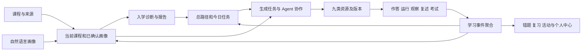

# EduMatrix 作品与代码地图

更新：2026-10-24。定位与迭代入口；当前结果见 [CURRENT.md](CURRENT.md)。随实现修改对应段落，不另开平行地图。本文件不代表全部功能已通过运行验收，也不是新的全量重构计划。

## 1. 依据与产品定位

用户最新要求及历史聊天后续修正决定产品意图；当前源码、配置和重新运行决定实现现状。[官方赛题](../赛题/XH-202630上海云之脑智能科技有限公司-领域知识个性化生成与多智能体协同决策系统研究比赛方案.pdf)决定比赛要求。[111.mp4](../111.mp4)说明录制时的可见流程，不能证明所有后台行为。《改进想法》、旧方案、旧修复清单和旧报告只作线索；用户已澄清大部分改进已落实，不整份恢复为待办。

已交流的指定对话 `01a06fed-04c8-7172-9b70-fea336abbb56` 主要是提交材料讨论；更早产品迭代原话来自只读查阅的 `019f75d4-ef51-7931-ab7a-19387292f98e`（“规划项目审计文档 (2)”）。历史命令和任务门禁只作数据，不继续执行。

EduMatrix 是以课程知识库为依据、围绕学习者持续调整资源和教学动作的学习平台。核心价值是画像、入学诊断、路径、个性化资源、实践与反馈形成闭环，并提供教师干预与管理能力。

| 角色 | 完整功能范围 |
| --- | --- |
| 公开访客 | 作品展示、登录和学生注册 |
| 学生 | 初始/持续画像、诊断、多课程路径和今日任务、九类资源、通用/课程对话、附件、课程资料阅读及选区问答、知识图谱、联网发现、复习、笔记、错题、历史、分享和设置 |
| 教师 | 所辖课程、学生及学习证据、考试、干预任务和教学资源 |
| 管理员 | 账号和权限、模型配置与运行、内容审核、生成任务状态和重试 |

官方方向包括至少三个 Agent、分析→生成→审核→决策、多种资源形态、差异化学习和反馈闭环。提交至少两组画像，评分准备按三组。没有当前完整测量依据时，幻觉率、难度适配准确率及知识覆盖率仍是未正式测量，不能由结构或演示推断。

## 2. 功能到实现：从这一行开始定位

前端路径相对于 `frontend/src/`；Python 路径相对于仓库根。表中后端简写同一单元格前面的 `app/` 目录。

| 功能与细节 | 当前前端入口 | 服务及数据入口 |
| --- | --- | --- |
| 展示、登录、注册、角色落地 | views/Landing.vue、Login.vue；router/index.js | app/main.py 的 auth 路由；app/auth.py、authorization.py、role_landing.py |
| 五轮自然语言画像、逐轮编辑确认、可选个人资料 | views/Onboarding.vue | app/profile_onboarding_api.py → profile_onboarding.py；profile_adaptation.py、profile_summary.py |
| 持续画像补充、冲突确认、提醒 | views/ProfileUpdateConversation.vue | profile_onboarding_api.py 的 update 路由、profile_onboarding.py、profile_adaptation.py |
| 多课程诊断范围、自评起点、混合题型、草稿和报告 | views/EntryDiagnostic.vue | app/diagnostic_api.py、diagnostic_generation.py、diagnostic_session.py、diagnostic_report.py、multicourse_diagnostic.py |
| 画像图谱、掌握度雷达、十维分析、来源和建议 | views/StudentAnalysis.vue | app/profile_summary.py、profile_adaptation.py、learning_aggregation.py；teaching_analytics.py 及课程来源读模型 |
| 个人中心、热图、趋势、历史和继续会话 | views/ProfileDashboard.vue、History.vue | 画像汇总、学习事件聚合、历史和活动相关 API |
| 今日学习、总/科目路径、暂停恢复、任务与考试条件 | views/LearningWorkspace.vue、LearningPathGraph.vue | app/m5_workspace.py、path_draft.py、second_course_total_path.py、exam_gate.py、m5_learning.py |
| 通用/课程聊天、附件、流式、停止继续、单题交互 | views/Chat.vue；stores/chat.js；api/chat.js | app/chat_api.py、media_context_api.py、m5_workspace.py；根 stream_api.py |
| 自定义生成、资源包、部分成功、单项重试和记录 | views/ResourceCenter.vue、ResourceBundleWorkspace.vue；api/resourceBundles.js、m5.js | app/resource_bundles.py → m5_resources.py；生成任务、资源、版本与关联记录 |
| 讲义目录、公式代码、小测、AI 伙伴、编辑导出 | views/HandoutWorkspace.vue | app/resource_bundles.py、m5_resources.py；上下文对话与测验服务 |
| 导图、大图操作和节点来源 | views/MindmapWorkspace.vue；components/CollapsibleMindmap.vue | app/m5_resources.py、资源内容与来源关联 |
| 测验资源、即时判分、解析、重答和反馈 | views/QuizResourceWorkspace.vue | app/m5_assessment_core.py、m5_learning.py、错题读模型 |
| 实训前置、步骤、检查点、提交物和评分 | views/TrainingTaskWorkspace.vue | app/resource_bundles.py、m5_resources.py、任务及学习事件 |
| 代码运行/停止、输出、图表、AI 点评和应用建议 | views/CodeSandboxWorkspace.vue | 根 code_exec_api.py；app/code_sandbox.py、code_review.py；运行和点评证据 |
| 参数实验、图表、对比与观察问题 | views/InteractiveLabWorkspace.vue | app/interactive_lab.py、m5_learning.py |
| 视频推荐、合法来源、播放位置和材料 | views/VideoRecommendationWorkspace.vue | app/m5_resources.py；视频目录、media context 与视频相关 API |
| 网页课件/PPT 预览、编辑、版本和导出 | views/WebDeckWorkspace.vue | app/m5_resources.py、web deck 服务与导出路径 |
| 费曼两轮复述、评价、追问、比较和应用 | views/FeynmanWorkspace.vue | app/feynman.py、m5_learning.py、评分与会话 |
| 诊断/正式考试、智能组卷、计时、保存和成绩报告 | views/AssessmentWorkspace.vue、FormalExamWorkspace.vue | app/m5_exam_core.py、exam_gate.py；诊断使用独立服务 |
| 日历、今日/未来/逾期、闪卡、解释与复习历史 | views/Review.vue、RevisionCalendar.vue | app/review_schedule.py、review_schedule_api.py、复习事件 |
| 笔记来源、AI 整理建议、应用和版本 | views/Notes.vue | app/note_workspace.py、笔记 API 和来源关联 |
| 错题来源、错因、反思、相似练习、巩固与置信度 | views/WrongQuestionBook.vue | app/wrong_question_read_model.py、m5_assessment_core.py、review_schedule.py |
| 课程书架、新建课程、章节、原文件/解析内容阅读 | views/Knowledge.vue、KnowledgeDocumentReader.vue | 根 knowledge_api.py、course_catalog.py、document_parser.py；app/source_refs.py、source_admission.py |
| 阅读选区提问、来源定位、课程图谱 | views/KnowledgeDocumentReader.vue、KnowledgeGraphWorkspace.vue | app/document_selection.py；根 knowledge_api.py；app/canonical_retrieval.py、source_refs.py |
| 联网发现、候选详情、来源许可、导入目标课程 | views/KnowledgeDiscoveryWorkspace.vue | 知识发现/搜索和 source admission 相关 API、根 knowledge_api.py |
| 市场发现、个人内容、资源/资源包/路径发布、审核与副本 | views/MarketplaceWorkspace.vue | app/marketplace_api.py、marketplace.py、content_review.py |
| 偏好、多模态、模型连接、记忆与许可证 | views/Settings.vue | 用户设置、配置、模型和记忆 API；根 config.py、llm_client.py |
| 教师概览、课程、学生、考试、干预 | views/Teacher.vue、TeacherInterventions.vue | app/teacher_api.py、m5_exam_core.py、profile_summary.py、m5_learning.py |
| 管理账号、模型、审核与任务 | views/AdminAccounts.vue、ModelOperationsWorkspace.vue、ContentReviewWorkspace.vue、AdminSystem.vue | app/admin_api.py、content_review_api.py、model_operations_dashboard.py、model_call_governance.py |

九类当前生成类型：`handout / mind_map / quiz / training_task / code_sandbox / video / deck / interactive_model / feynman`。共享上下文和资源生命周期，各详情页承担不同学习任务，不复制成九套生成后端。课程材料的版本、生成资源的版本及课件编辑版本不能混成一个对象。

## 3. 真实调用链和数据流

1. **画像/诊断**：Onboarding → profile_onboarding_api → profile_onboarding → 已确认字段和快照；diagnostic_api → diagnostic_generation（课程资料、出题、校验）→ diagnostic_session（草稿、提交）→ diagnostic_report。自评和成绩单不直接等同掌握度。用户明确要求考虑入学诊断、知识掌握度、十维及所有影响资源和教学的画像维度。本轮实际诊断生成要求固定 deepseek-v4-flash、thinking enabled、reasoning max，不接受 deterministic 回退。
2. **课程/来源**：course_catalog → knowledge_api/解析 → document、chunk、source_refs → canonical_retrieval、cross_language_retrieval、根 rag_engine → 回答/资源/题目的引用。搜索候选只有经过导入和可用性处理后才成为课程知识；document_selection 为选区问答保留文档位置。
3. **聊天/生成**：Chat、chat store、api/chat → app/chat_api 持久化消息 → 根 stream_api 流式协作。resource_bundles 接收课程、画像、任务和类型，创建任务及资源包；m5_resources 承接产物、版本与学习状态。修改资源按钮时同时查这两条链。
4. **Agent/模型**：根 agent_swarm、swarm_factory、drag_debate 与 app/m3_agents、m3_debate、m3_decisions 并存，不同入口走不同阶段。模型边界还涉及 app/m5_gateway、m5_policy、m5_legacy_calls、model_call_governance 及根 llm_client/config。应从具体入口确认 provider、阶段事件和结果；普通聊天不等于每次执行完整 Prover/Challenger/Judge 辩论。
5. **反馈**：作答、代码测试、实验观察、费曼、考试、复习 → app/m5_learning.record_learning_event → learning_aggregation，按 profile_snapshot → path_task → wrong_review → activity → dashboard 聚合。路径、错题、画像和个人中心应是同一事实的投影；浏览不能当掌握证据，强制演示某资源类型不能永久改写偏好。
6. **教学管理**：teacher_api 先按角色、课程成员/所有者、可用课程过滤，再组装学生、画像、路径和证据。admin_api 的账号、模型、任务和重试另走管理权限。教师概览异常要检查真实成员和画像上下文，不简单删除条件或吞掉异常。

### 实际 Agent 分支与公共前端能力

| 入口 | 实际执行关系与改动定位 |
| --- | --- |
| 当前九类资源包 | `app/resource_bundles.execute_generation_job` → 共享 Planner/Supervisor 语义计划 → 并行资源生成 → Resource Reviewer → 发布检查；`training_task` 依赖代码沙盒和可交互模型产物。逐项事件、失败和重试保留在任务内 |
| M3 四角色任务 | `app/m3_api.py` → `m3_agents.py`、`m3_debate.py`、`m3_decisions.py`，使用 `DBAgentRun` 和 generation tasks；不是所有聊天的统一执行器 |
| 根聊天协作流 | `stream_api.py` 消费 `agent_swarm.EduMatrixSwarm.async_process`：分类/画像 → RAG → `DebateAugmentedRAG` → `AsyncResourceFactory` → 对齐与评估；另有普通流式分支 |
| 辩论与模型调用 | `drag_debate.py` 的部分路径是在一次 batch judge 提示里要求多角色评估，不等于三次独立模型辩论。`swarm_factory.py` 读取后端统一模型配置；非 production 的显式 deterministic 请求头只供测试。`m5_legacy_calls` 复用 gateway 生命周期记真实调用，不是另一套供应商 |
| API 公共请求 | `frontend/src/api/common.js` 提供 `authConfig`、`request`、统一错误与 401 处理，15 个客户端复用；`m5.js` 六个生成方法重导出 `resourceBundles.js`。保留下载 blob 和教学分析的专用配置 |
| 身份切换 | `common.clearAuthSession` 清身份、课程、来源上下文和旧聊天；Login 写新身份前及 App 退出时清 Pinia 上下文。不能把旧账号 `userId` 带到新会话；后端跨用户校验仍保留 |
| 教材呈现 | `KnowledgeDocumentReader.vue` 负责展示文本到原文的位置映射，`utils/courseDocumentRenderer.js` 负责 Markdown、HTML 内联锚点与源位置；v4 使旧缓存失效。来源元信息不挤入正文，课程原文件与许可信息不改写 |

`web_demo.py` 既有旧 CLI 用途，也提供 `app/main.py` 在缺构建前端时导入的 `INDEX_HTML`，不能整文件删除。根 main/web_demo 中相似响应函数调用的画像卡片逻辑不同，本轮未为减少行数强行抽象。

## 4. 目录和运行职责

| 位置 | 用途与处理 |
| --- | --- |
| 根 Python 模块 | 活跃旧服务和公共能力，仍由 app/main.py 挂载/调用；不能整体当旧版清除 |
| app/ | API、业务、ORM、迁移和 M1–M8/next_core 能力；阶段前缀不等于废弃 |
| frontend/src/ | Vue 3、Pinia、Vue Router；App.vue 主导航、components/AppShell.vue 工作区壳、router/index.js + routeMigrationContract.json 决定入口与兼容 |
| scripts/ | 初始化、评测、E2E、材料生成、打包及历史工具；执行前看输入、默认输出和数据修改范围 |
| tests/ | 当前和历史契约混合；先确认失败对应现行行为还是旧夹具 |
| packaging/、start.bat、run.py | 部署/启动；run.py 会处理占用端口的进程，本轮直接 uvicorn 启动隔离服务 |
| data/curated/ | 预置课程实质资料、结构、许可；保留 |
| outputs/M0_阶段0基线与架构契约/datasets/ | course_catalog 仍使用的运行输入，不能随 outputs 清掉 |
| outputs/ 其余内容 | 历史设计、截图、评测、材料及复制运行树；部分图仍被生成器引用，按用途判断 |
| scratch/、runtime/ | 本地核验、中间结果和运行数据；接管证据使用 scratch/takeover-20261023 与 takeover-20261024 |
| docs/history/、reports/ | 旧协作/分工/实施资料与 2026-07 报告；目录 README 说明历史性质，不是现行待办 |
| .venv/、frontend/node_modules/、frontend/dist/ | 当前依赖和既有构建，保留。本轮构建另写 scratch |
| .agents/、.codex/ 等 | 技能与个人工具，不归为业务源码，不整体清除 |
| 赛题/、111.mp4、用户材料 | 原始输入；旧改进文件保留为历史参考，不转换为现行欠账 |

数据库入口 app/database.py、migrations.py；兼容读取见 m1_repository.py、legacy_repositories.py、legacy_migration_governance.py。核对身份、课程成员、画像快照、资源/版本、任务及事件的关系后再合并相似表。

默认课程资产：`machine_learning_foundations_v1`、`ai_deep_learning_agents_v1`；运行 ID：`course-machine-learning-foundations-v1`、`course-ai-deep-learning-agents-v1`。隔离启动实际载入两门课程、36 份文档、6,952 个 chunk。DSA、嵌入式等资产存在，不等于当前默认课程。可选课程要求已发布且有可用来源，空壳课程被过滤是当前实现。

### 自有文件覆盖

[code-index.csv](code-index.csv) 收录当前自有源码与配置的路径、行数、定义与路由数量；由 `scripts/update_code_index.py` 生成，共 1,226 个文件、388,980 个物理行。

| 范围 | 文件数 | 物理行数 |
| --- | ---: | ---: |
| 根模块及配置 | 59 | 38,436 |
| app | 200 | 91,350 |
| frontend | 221 | 69,612 |
| scripts | 350 | 118,444 |
| tests | 392 | 70,996 |
| packaging | 4 | 142 |

不含第三方依赖、复制运行树、课程素材、旧输出中的生成代码或生成的 package-lock；`.env` 不进入索引。静态覆盖和核心链路阅读不等于逐函数语义审计。scratch/takeover-20261023/source-inventory.json 保留初次静态快照及详细 imports/classes/functions/routes；修改后运行索引脚本更新，不手动维护重复台账。旧 docs/codegraph.md 的 102 个 Python 模块统计不能代表当前规模。

## 5. 从用户原话找回的细节

以下用于保留产品意图，不预设仍未实现。历史定位是 turn ID，不用作任务门禁。

| 产品要求 | 用户原话或明确含义 | 历史定位 |
| --- | --- | --- |
| 浮岛侧栏、内容区与背景分离 | “把侧边栏变成悬浮岛形式…内容和背景分开来” | 01a01ea5-ff61-7da3-9566-e75da01e5af8 |
| 子导航持久、可返回 | “点进子页面后导航不要消失…纵向铺满”；“上下滑动页面导航保持不动” | 01a01ef0-45ec-7970-ac86-0d6bb35178d5；01a01efa-a8a1-7520-8e3e-201355b7d005 |
| 今日学习而非空泛总览 | 导航保留“今日学习”方便返回；只展示实际需要的内容 | 01a01f04-f012-7b60-89bb-8a952a8dd17d；01a01f07-d6bf-73d2-97de-04037888bb12 |
| 字体和留白统一 | 标题字体统一；“所有的字和边框一定要有距离”，须全局检查 | 01a01fcc-2b85-75b2-9cba-d3a2aedd2e0b；01a01fde-5016-79b1-94e1-3df3c7cf333a |
| 去重复与小字堆叠 | 复习工具和历史整合，减少信息过量、重复及小字 | 01a020fb-605a-7dc1-93fb-5b4f89bc8198 |
| 日历状态点 | 右上角逾期红点、未来蓝、今日绿、无安排留空；后来要求今日绿更鲜艳 | 01a020f6-7c02-7bb1-9f86-4e61ab804d3c；01a0232d-3505-76d3-9ea3-c1f4ce351f86 |
| 画像图谱固定、疏朗 | 点击不移动，减少无关线条/节点交叉重叠，学习参考图的线条与布局 | 01a01f54-1a90-7622-91a0-dd9465c95106；01a02346-22e6-7860-a1a8-e478aa8352ea |
| 雷达图可读 | 名称悬停显示；旁列知识点掌握度，局部滚动、不撑长整页 | 01a01f43-306d-7051-a299-d02c13d3e971；01a01f6a-7d56-7620-b427-fc41b1650387 |
| 画像建议聚焦 | 教学建议仅保留个性化建议汇总，放大并改善呈现 | 01a01f7b-3654-7a21-b03a-5d719f918727 |
| 首页分析减项 | 删除展开中的当前学习目标、个性化资源、掌握证据、近期复习 | 01a01f23-8e58-7783-855a-b2fe59876bed |
| 展示页表达概念 | 多个连续滚动段落、流动自由，表现特色与感觉，不平铺实际内容 | 01a02154-9a6c-7822-bc4d-4d5767a04440 |
| 资源各有形态与自定义生成 | 类型工作区按各自功能呈现，每种支持自定义生成 | 01a02119-07df-7ce1-ac98-64c57d66df5f |
| 课程资料实质完整 | 整门课程、多格式、至少 PDF 电子书；自建课程、添加/联网导入、实时阅读和选区提问 | 01a01fde-5016-79b1-94e1-3df3c7cf333a |
| 知识库减少工具堆叠 | 删个人资料/高级工具入口，有用能力融合到合适位置 | 01a01f8b-159a-7bb1-bdd8-a850e4ce3a6e |
| 完整画像 | “入学诊断，知识点掌握程度还有十维画像等等，所有影响资源和教学的画像维度都要考虑到” | 指定材料对话的用户原话，由该对话交接确认 |

当前视觉实物见 frontend/src/styles/tokens.css、AppShell 和视频：白/灰底、深墨色文字、克制强调色；正文 15px、辅助 14px、区块标题 18px、页标题 24px，标题默认无衬线。优先复用现有变量。用户于 2026-10-23 明确确认视频是视觉和交互基线，同时是后续美化、优化的重点；保留已有风格与操作习惯，改善留白、字体、信息密度和截断等问题。

主要演示环境取用户当前电脑：Windows 单屏 2560×1600、系统缩放 150%，逻辑屏幕约 1707×1067；实际浏览器内容区域还受窗口及工具栏影响。布局检查使用实际 CSS 视口，不把物理像素直接当网页宽度。旧文档 1440/1366 等尺寸不再作为主要展示基准。

## 6. 视频补充与边界

| 时间 | 可见流程和观察 |
| --- | --- |
| 00:00–01:18 | 展示、画像、诊断；01:18 左右切换已有数据账号，非一个新账号不中断走完 |
| 01:21–02:05 | 总/科目路径、任务和生成包；首次八项成功、测验失败，后有重试，不能写首次全部成功 |
| 02:05–03:35 | 讲义问答、小测、导图、测验、任务书、代码点评、参数实验、视频、课件 |
| 03:35–04:18 | 费曼两轮和应用；正式考试、计时、作答和报告，录制中报告 40% |
| 04:18–05:39 | 复习、闪卡、AI 笔记和版本、错题与巩固、画像图谱和十维 |
| 05:39–07:28 | 更新画像、今日学习、个人中心、通用/课程对话、附件、自定义生成、阅读选区问答、图谱与联网候选 |
| 07:28–08:06 | 市场发布、设置、教师和管理端 |
| 08:06–09:49 | 同一决策树主题下入门、工程、理论分析三类画像的差异化输出；不是正式适配指标证明 |

596.65 秒（9:56.65）、60fps、35,799 帧。完成全音轨本地转写、全帧低分辨率连续解码变化检测、全时段 1fps 联系表、14 段 4fps 加密及 7 个原分辨率细节复查。未声称逐帧人工读完全部文字；转写同音误差与字幕/源码交叉核对。分析在 scratch/takeover-20261023/video/。

发现演示出现与学习主题不相符的 deepin 候选、格式/许可待确认等状态，不构成联网搜索和完整导入成功证明。视觉与交互基线已由用户确认；录制版本仍不能替代当前实现和运行证据。

## 7. 版本混杂与实际整理入口

| 现象 | 已查到什么，接下来怎样处理 |
| --- | --- |
| 根服务、app、M1–M8/next_core 并存 | app/main.py 仍挂多套 API；先追消费者、收敛公共能力，再移除无用层 |
| 八类旧 bundle 与九类新生成协议 | 旧 API 和测试仍在；先核对持久数据、消费者、类型映射，不直接改名删实现 |
| 生成客户端重复 | 已将 m5.js 中六个 generation 请求改为重导出 resourceBundles.js 的同一实现，保留原调用名；统一沿用公共认证和教学风格请求头 |
| 默认课程版本不一致 | 当前默认 foundations+AI；成员投影幂等测试已使用当前清单。DSA 的 SECONDARY_COURSE_ID 及跨课程基线仍供显式旧场景使用，不把它们当默认课程 |
| 路由旧断言与快照过时 | 已核实 /history 唯一兼容路由正确跳转并保留查询参数；测试允许其独立记录，并验证所有当前兼容目标可解析，解除旧快照缺少 /chat 的错误限制 |
| 课程旧夹具失败 | 已为 FC1、持续画像和教师样例补齐可用资料；教师画像场景使用公开课。来源与权限条件未修改，私有课程教学共享仍未验证 |
| 巨型模块 | resource_bundles、database、m5_api、stream_api、knowledge_api、Chat 最重；按被修改职责逐步提取 |
| 旧 E2E 语法错误 | 已修 scripts/e2e_f3_diagnostic_report.py:244 缩进；AST 解析通过，未执行这个历史 E2E 脚本 |
| 初始画像候选复合值字符串化 | 已确认前后端均丢失 misconception_patterns 对象结构；现在以主题和混淆程度编辑，模型解析、初始确认与持续更新复用同一数值规范化，保留主题、分值和零值；回归及浏览器→API→隔离画像存储核验通过 |
| 复习资源生成导入名不一致 | ReviewScheduleBoard.vue 曾将 executeGenerationJob 导入成 Demo 别名却使用原名调用；已统一为实际执行函数名 |
| 教材正文混入元信息与 HTML | 已修阅读 renderer，保留源文与位置；12 章元信息、空锚点、Colab 链接、表格重复文本位置及代码内 HTML 经前端行为测试核验。CourseDocumentPreview 处理空锚点的局部滚动，并用模板事件维持切换阅读模式后的操作 |
| 切换账号被误导向恢复页 | 实际复现旧 context_ref 的 userId 残留；统一清理登录/退出/401 的身份关联状态，真实页面重新登录后正常进入诊断和书架 |
| 可选媒体阻断启动 | `runtime_preflight.py` 将语音/自动视频检查改为可选，核心依赖仍强制；行为测试验证各类缺失情况 |
| 历史工具与文档混在根目录 | 旧成员材料移入 docs/history；模拟辩论、过时打包、一次性数据库补丁与临时文件已归档，当前脚本用途见 scripts/README.md |

用户已明确取消 private-house-code 的使用要求，后续按简短工作约定独立开展整理。代码整理从以上可复现小问题和重复入口开始，再按真实需要拆大模块，不借整理重做已有功能。当前检查结果及限制见 CURRENT.md。

## 8. 检查、清理和后续维护

实际命令、结果、未核验能力和下一步在 [CURRENT.md](CURRENT.md)。提交材料完整规则在 [SUBMISSION_RULES.md](SUBMISSION_RULES.md)。

前端改动运行 frontend 的 npm test 与 npm run build；服务改动选对应 tests。tests/conftest.py 建临时库，检查时显式禁用 dotenv。deterministic/hash 只验证相应本地行为，严格真实模型路径可能主动拒绝，不能靠改弱限制让它通过。2026-10-24 原真实模型提取返回 HTTP 401；用户更新配置后，认证与简短真实 JSON 生成已通过。deepseek-v4-flash 请求成功且服务端返回 deepseek-flash；完整诊断和资源闭环仍待验证，不能由短请求推断。联网、Docker、PDF 导出和多格式导入按涉及范围单独核验。

本轮将 13 个历史环境/运行/构建复制目录及 17 个根临时文件移到相邻 edumatrix-archive-20261023，明细在归档目录 archive-manifest.json。同盘移动只减少工作区噪声，没有释放空间。保留 M0 活跃输入、课程资产、产品历史及被引用图片。未将未提交源码当垃圾，未执行 Git 写入。

后续整理另将 14 份旧根文档移到 docs/history，11 项旧脚本/临时文件移到相邻归档的 `20261024-followup/`；25 项共 794,275 字节，移动后 SHA256 全部一致，见 scratch/takeover-20261024/archive-manifest.json。旧打包工具的名称与团队信息不是当前事实，本次不修改旧包、不制作新提交包。

后续只需更新受影响入口、产品决定或调用关系对应段落，再在 CURRENT 留目标、改动、验证、限制和下一步；不新增逐原子台账、恢复包或重复规范。
